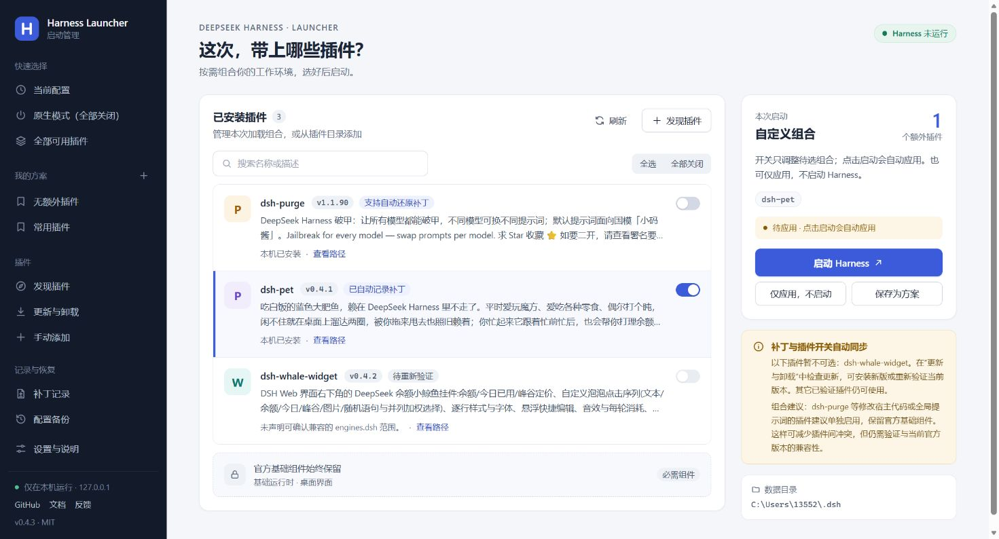
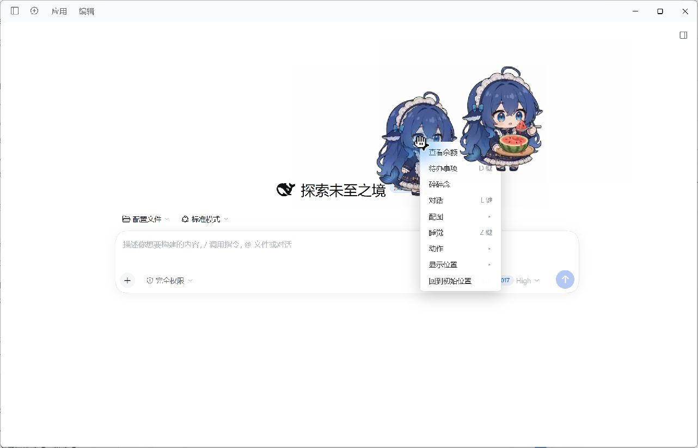
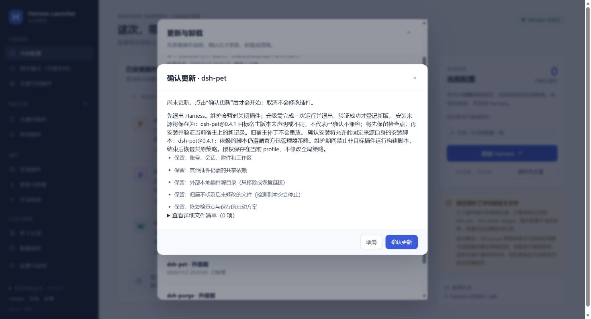
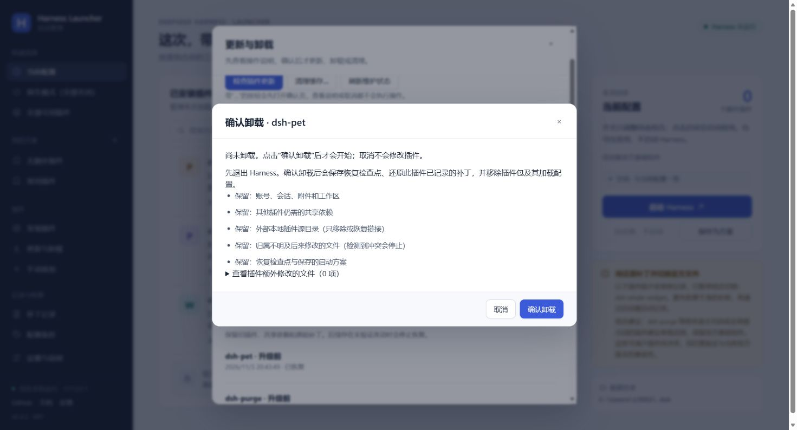
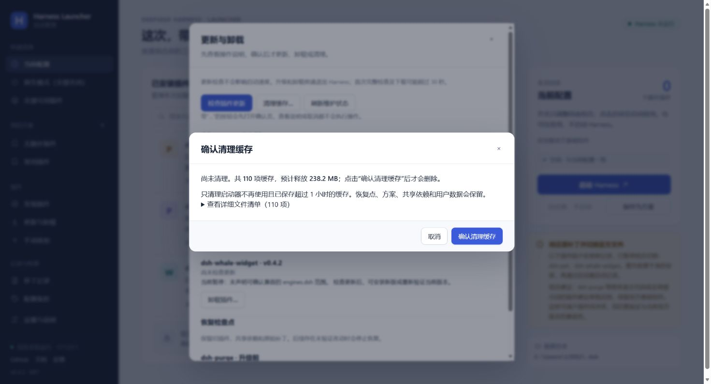

# Harness Launcher


Choose the plugins you want to use, then start DeepSeek Harness. Save your usual combinations, switch back to the official native setup, and manage plugin updates and removal from one desktop panel.

[Download for Windows](https://github.com/schrieeeffer/harness-launcher/releases/tag/v0.4.3) · [中文](README.md) · [Report a problem](https://github.com/schrieeeffer/harness-launcher/issues)

Version **0.4.3**, a community preview for Windows 10/11 x64. The portable archive includes its Python runtime. Install the official DeepSeek Harness desktop app first. This project is unaffiliated with DeepSeek.

## Get started

1. Install and open the official Harness desktop app once.
2. Download `Harness-Launcher-0.4.3-Windows-x64.zip` from [Releases](https://github.com/schrieeeffer/harness-launcher/releases/tag/v0.4.3).
3. Extract the whole archive to a folder of your choice.
4. Double-click `Harness Launcher.exe`. No Python installation or terminal commands are needed.
5. If Harness is not found, open Settings and use automatic detection or choose its executable.

Keep the `runtime` and `ui` folders next to the executable. The archive contains the launcher; Harness and third-party plugins are installed separately. The executable is not commercially code-signed. A `SHA256SUMS.txt` file is provided with each release:

```powershell
Get-FileHash .\Harness-Launcher-0.4.3-Windows-x64.zip -Algorithm SHA256
```

## Everyday use



You might use a pet and a balance widget while working, then need the official native interface to investigate a problem. Save those choices as separate combinations and select the one you need next time.

Switches edit the next launch selection. **Start Harness** applies it and opens the app; **Apply without launching** saves the configuration for later. Close Harness through its application menu before switching files.

| Action | Result |
| --- | --- |
| Current configuration | Load the currently applied selection |
| Native mode | Disable extra plugins and restore recorded native files |
| Save as a combination | Name a selection for reuse; JSON import and export are available |
| Discover plugins | Search community packages and inspect their source and version |
| Updates and uninstall | Check versions, update, remove, or restore a maintenance checkpoint |

The progress bar shows the current step, file counts, and elapsed time. Normal launches reuse verified file indexes and hashes. First installation, downloads, and full maintenance checks take longer.

## Try a plugin

Choose a plugin in the catalog or open Manual add. The launcher checks the available npm, local directory, and fixed Git commit sources before enabling them. Different plugins can support different sources. Manual installation recording is available as a separate advanced option.

Installation saves the previous state, uses the official Harness installer, and opens Harness for a first run. Use the plugin, exit Harness, then complete verification to save its record. See the [installation guide](docs/install-sources.md).

This is a real `dsh-pet` update from 0.3.8 to 0.4.1. Both the Web pet and desktop pet appeared, and the Web context menu opened:



## Updates, removal, and recovery

Open Updates and uninstall, then check for new versions. npm targets are fixed to an exact version; Git sources retain their pinned commit. Results are cached for five minutes. Normal launches do not query remote versions.

An action ending in an ellipsis opens an explanation and confirmation page. Viewing or cancelling it changes nothing. The final button names the action: confirm update, confirm uninstall, confirm restore, or confirm cache cleanup.



Updating saves a checkpoint, installs the selected version, and waits for first-run verification. The previous enabled combination is then restored. Plugins paused after an official Harness update can also be revalidated at their current version.

Uninstalling removes the selected package and its load entry, and restores recorded file changes. Accounts, conversations, workspaces, and external source directories stay in place. The maintenance page keeps a checkpoint so you can bring the plugin back.



To undo maintenance, choose the checkpoint for that plugin, review the changes, and confirm restoration. Later edits to the same managed files are reported as conflicts. Checkpoints cover recorded packages, configuration, dependencies, and patches; they are not system backups for arbitrary registry, service, or workspace changes.

Cache cleanup first reports the number of eligible objects and their size. It removes content older than one hour that no saved record references. Current packages and recovery checkpoints retain their content; conversations and global package caches are outside this cleanup.



The pictured local check took 8.1 seconds and found about 238.2 MB. It was cancelled after review so all recovery material remained available for testing. See the [maintenance validation report](docs/maintenance-ui-validation.md) for results.

## The dsh-purge adapter

The launcher includes a dedicated adapter for purge's changes to the Harness archive and extracted program tree. After recording a first run on the current Harness version, its switch can enable or disable the recorded patch and restore that version's native files.

Ordinary plugins use the general file-difference recorder. The purge adapter handles archive switching while using the same verification and recovery storage.

Two real enable/disable cycles and native restoration were completed with `dsh-purge 1.1.90` and `Harness 0.2.1-rc.5`; see the [purge validation record](docs/purge-source-audit.md). The current maintenance UI tests use pet and retain that purge installation.

Use purge on its own when first installing, updating, or troubleshooting it. Once that setup works, try other combinations. A new official Harness version requires fresh compatibility verification before old patches can be enabled.

## Official Harness updates

You can use the official updater inside Harness. On the next launch through this launcher, it detects the new version, establishes its baseline, and resumes plugins whose compatibility can be confirmed. Other plugins appear in maintenance for revalidation.

The launcher also offers an official update entry in Settings. It saves a checkpoint, restores managed patches, and invokes the official installer.

If the updated app is missing runtime files, use Official runtime repair in Settings. It verifies a same-version official installer, its signature and checksum, and the installed executable and archive, then lists missing files for restoration. Different existing files are reported as conflicts. This feature requires 7-Zip.

Official update continuation has simulation and fault coverage. A complete upgrade through the next official installer still needs a real future release. Same-version runtime recovery and native-file comparisons have local test records.

[Official update workflow](docs/official-update-flow.md) · [Runtime repair](docs/runtime-repair.md)

## Data and troubleshooting

| Location | Contents |
| --- | --- |
| Extracted launcher folder | Program, UI, bundled runtime, documentation |
| `%USERPROFILE%\.harness-launcher` | Settings, combinations, backups, plugin records, recovery checkpoints |
| Harness data directory | Its accounts, conversations, installed plugins, and plugin data |

The UI connects to a local service on `127.0.0.1`. Catalog browsing, update checks, and downloads need a network connection.

Turning a plugin off keeps its package installed for next time. Use Uninstall plugin to remove the package. To update the launcher, exit its background service from Settings, extract the new archive into a new folder, and run it. Keep the user data directory if you want to retain recovery records.

The daily launch target is about 30 seconds to a usable window after initial recording. Actual timing depends on disk performance, dependencies, and Harness itself. Installation and full maintenance checks have separate timings in the validation reports.

The current pet 0.4.1 setup misses that target: enabling it took 101.6 seconds in the backend, and restarting the same combination took 80.5 seconds. Restoring the uninstall checkpoint took about 19 minutes. These remain performance limitations of this preview; see the [measured results](docs/maintenance-ui-validation.md).

When reporting an issue, include the Harness and plugin versions, the action you took, and the error message or screenshot. Do not include credentials, private conversations, or local access tokens.

## Development

Source runs require Python 3.12+ and use the standard library. Double-click `launch.vbs` on Windows, or run:

```powershell
python launcher.py
```

Edge opens an app window when available; otherwise the default browser is used. Frontend tests require Node.js. Portable builds use the Windows .NET Framework compiler.

```powershell
python -m unittest discover -v
node --test test_ui.cjs
python packaging/build_portable.py
```

The portable builder uses an explicit file allowlist and includes file hashes and a Chinese quick-start guide. Personal installations, diagnostics, and user data are excluded.

## Documentation

- [Maintenance UI and real pet validation](docs/maintenance-ui-validation.md)
- [Plugin test records](docs/validation-0.4.3.md)
- [Installation sources](docs/install-sources.md) and [plugin maintenance](docs/plugin-maintenance.md)
- [Architecture and diagrams](docs/architecture.md), [directory checkpoints](docs/checkpoint-design.md), and [patch recording](docs/patch-recording.md)
- [Maintenance handbook](MAINTENANCE.en.md), [contributing](CONTRIBUTING.md), [security](SECURITY.md), and [changelog](CHANGELOG.md)

## License

[MIT](LICENSE). Harness and third-party plugins use their own licenses.
