<div align="center">


# Harness Launcher

**A local plugin launcher for DeepSeek Harness**<br>
Choose which plugins to load on each launch, discover official and community plugins, and automatically record and verify installation changes for file restoration.

[](https://github.com/schrieeeffer/harness-launcher/actions/workflows/ci.yml)
[](LICENSE)


[简体中文](README.md) · **English**

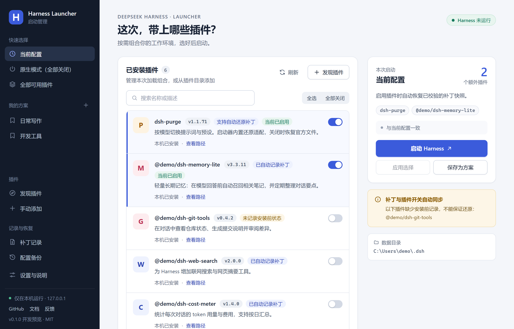

</div>

> [!NOTE]
> This is an independent community project and is not affiliated with DeepSeek. It is a **developer preview**: only the Windows desktop app has been validated. Install paths, process detection and patch handling are not finished on macOS or Linux, so please do not use it there. The interface is currently Simplified Chinese only; this guide gives the Chinese label next to each control so you can match it to the screenshots.

## Contents

- [Updated feature tour and verification screenshots](docs/feature-tour.en.md)
- [0.3.1 launch progress, button labels and performance verification](docs/launch-progress.en.md)
- [0.3.2 verification performance when switching plugins](docs/switch-performance.en.md)
- [0.3.2 measurements and the approximate 30-second target](docs/validation-0.3.2.md)
- [0.3.2 feature screenshots and walkthrough (Chinese)](docs/feature-tour-0.3.2.md)
- [Harness updates and patch conflicts (Chinese)](docs/host-updates.md)
- [Why it exists](#why-it-exists)
- [Features](#features)
- [Getting started](#getting-started)
- [User guide](#user-guide)
  - [Main window](#main-window)
  - [Choosing plugins for this launch](#choosing-plugins-for-this-launch)
  - [Presets and saved schemes](#presets-and-saved-schemes)
  - [Launch, apply and restore native](#launch-apply-and-restore-native)
  - [Discover plugins](#discover-plugins)
  - [Leaderboards](#leaderboards)
  - [Plugin details](#plugin-details)
  - [Add a plugin manually (with recording)](#add-a-plugin-manually-with-recording)
  - [Patch records](#patch-records)
  - [Configuration backups](#configuration-backups)
  - [Settings](#settings)
  - [Importing and exporting schemes](#importing-and-exporting-schemes)
  - [Narrow windows](#narrow-windows)
- [How it works](#how-it-works)
- [Data and privacy](#data-and-privacy)
- [FAQ](#faq)
- [Uninstalling](#uninstalling)
- [Development and contributing](#development-and-contributing)
- [License and disclaimer](#license-and-disclaimer)

## Why it exists

DeepSeek Harness registers plugins as bundles in the desktop profile, `profiles\desktop\package.json`. Some plugins also modify application files directly (for example `resources\app.asar`) or write rules, skills and presets into the data directory. That causes a few practical problems:

- **Switching to a different set of plugins means editing the configuration by hand**, and a mistake can stop Harness from starting.
- **Removing a plugin from the configuration does not undo the files it wrote.** "Disabling" a plugin only stops it from loading.
- **If you did not take a snapshot before installing a plugin, you can no longer tell what it changed**, and you cannot reliably return to the official state.

Harness Launcher addresses this with a local web interface. You pick plugins before each launch, and the configuration is backed up before every switch. For plugins that were snapshotted before installation, disabling restores the recorded files and enabling re-applies them. For plugins without a record, it tells you plainly that restoration cannot be guaranteed instead of pretending everything is fine.

## Features

| Feature | Description |
| --- | --- |
| **Launch combinations** | Toggle installed plugins one by one, jump to the current configuration, native mode or all plugins, and save a combination as a scheme for one-click reuse. |
| **Safe switching** | Back up configuration, preflight the whole combination and verify native base, versions, dependencies and conflicts; one transaction supports failure and crash recovery. |
| **Versions and combinations** | Retain installed code/dependencies, immutable revisions and combination records with content deduplication; read only the current data format; convert previous data once with a separate migration tool. |
| **Patch restoration** | dsh-purge uses a built-in adapter. Other plugins are recorded as file differences between before- and after-install snapshots, restored when disabled and re-applied when enabled. |
| **Plugin discovery** | Browse DeepSeek's official bundles, npm community packages and GitHub repositories with the `dsh-plugin` topic, with search, source filters, paging and a mainland China mirror option. |
| **Leaderboards** | Rank plugins by npm downloads over the last 7 days, plus a "rising" board that surfaces new plugins. |
| **Manual install** | Install from npm, a local folder or Git, or inside Harness yourself. Recording is mandatory and is verified and saved automatically after normal use and exit. |
| **Patch records** | See which plugins are recorded, which use a built-in adapter and which are unrecorded, and whether each can be restored. Recorded plugins can be upgraded and re-recorded. |
| **Configuration backups** | An automatic backup before every change. Restore any of them; the current state is backed up again first. |
| **Scheme import and export** | Back up or share schemes as a JSON file, with a per-scheme preview before importing. |
| **No dependencies, local only** | Uses only the Python standard library and your local browser. The service listens on `127.0.0.1` only and uses a random access token on every start. |

## Getting started

### Upgrading to 0.3.0

0.3.0 uses format 3 for settings, the plugin registry, adapter state, switch journals and configuration backups. The runtime accepts only this format. To upgrade a complete v2 store, finish pending installations and recovery in the previous version, fully quit Harness and the launcher service, then run in the project folder:

```powershell
python migrate.py
python migrate.py --apply
```

The first command validates a separate stage and removes that temporary directory on exit. The second rebuilds and verifies objects, blobs and combinations before swapping directories. Installed versions, enabled choices and live Harness files are preserved. The complete old store becomes a sibling `<data>.archive-<timestamp>-<id>` with a checksum manifest, solely for offline recovery. The new runtime does not read that archive. Missing or damaged history, pending work and unknown file changes stop conversion.

The default remains `%USERPROFILE%\.harness-launcher`. For a custom store use `python migrate.py --data <directory> --apply`; the tool no longer searches or merges old AppData automatically. If directory cutover is interrupted and a sibling `.upgrade.json` remains, run `python migrate.py --recover` first, adding `--data` for a custom store. Earlier formats or interrupted earlier imports must be handled with their matching previous version first.

Fresh installations need no migration. Future extensions should use optional fields and explicit capability requirements; necessary semantic changes may still require offline conversion. No project can promise that migration will never be needed again. See the [architecture and evolution contract](docs/architecture.md).

### Requirements

- **DeepSeek Harness desktop** on Windows 10 or 11, started at least once so the data directory contains `profiles\desktop\package.json`.
- **Python 3.12 or later.** You can also use the Python bundled with Harness: `<Harness install folder>\resources\runtime\primary-runtime\dependencies\python\python.exe`.
- Microsoft Edge (optional). With Edge the launcher opens as a standalone app window; otherwise it uses your default browser.

No pip or npm packages are needed.

### Install and start

1. Clone the repository, or click **Code → Download ZIP** on GitHub and extract it. **Keep it outside the Harness install folder** so a Harness update does not overwrite it.

   ```powershell
   git clone https://github.com/schrieeeffer/harness-launcher.git
   ```

2. Start it with Python the first time:

   ```powershell
   cd harness-launcher
   python launcher.py
   ```

   If Python is not installed, replace `python` with the full path of the bundled `python.exe` mentioned above.

3. After that, double-click **`launch.vbs`** to start without a console window. It prefers the `pythonw.exe` bundled with Harness (found from the saved application path or `DSH_EXECUTABLE`) and falls back to `pythonw.exe` on `PATH`. You can create a desktop shortcut to `launch.vbs`.

> [!TIP]
> Double-clicking `launch.vbs` reuses the existing service. The background service continues running and recording after the window closes; suspended browser tabs and computer sleep no longer trigger an automatic exit. To stop it, use **Settings → Exit launcher service** (设置与说明 → 退出启动器后台). Active installation, recording or switching blocks exit; exceptions are retained.

### First-time setup

The launcher looks for `DeepSeek Harness.exe` in this order:

1. The `DSH_EXECUTABLE` environment variable.
2. The location registered by the installer in the Windows uninstall registry entry (read-only; this also finds custom install folders).
3. Common install folders such as `%LOCALAPPDATA%\Programs\DeepSeek Harness` and `%ProgramFiles%\DeepSeek Harness`.

The data directory defaults to `%USERPROFILE%\.dsh` and can be set with the `DSH_HOME` environment variable.

If the executable cannot be found, a red banner ("未找到 Harness 程序") appears at the top of the main window, and launching, patch switching and recording are disabled. If Harness was detected elsewhere on the system, click **Use detected path** (使用检测到的路径); otherwise click **Settings** (去设置) and enter the path.

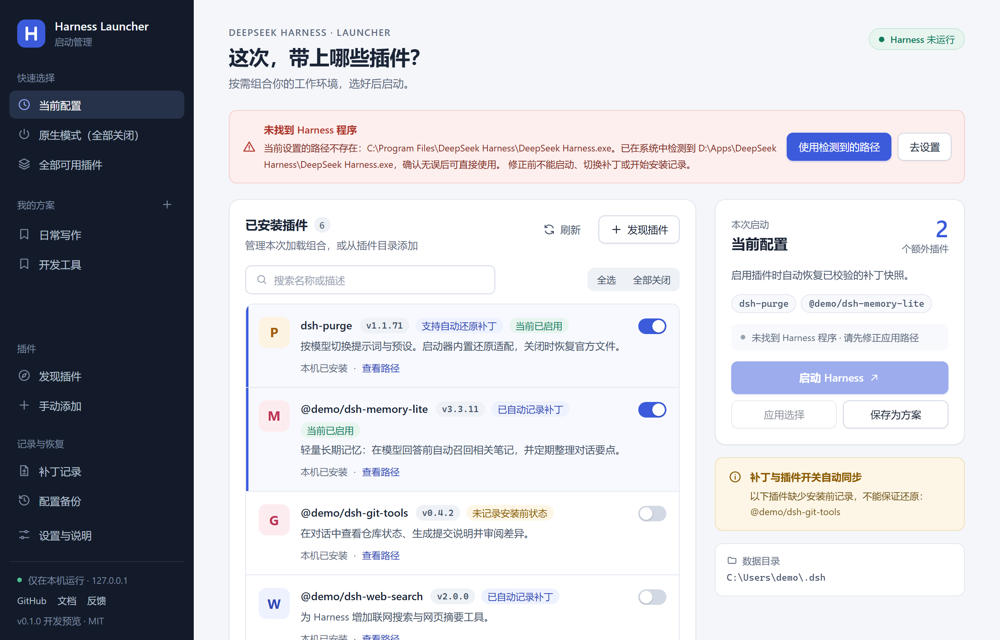

### Command-line options and environment variables

| Option / variable | Effect |
| --- | --- |
| `--data <folder>` | Store the launcher's settings, backups and snapshots in this folder instead of `%USERPROFILE%\.harness-launcher`. Useful for isolated testing. |
| `--no-open` | Start the local service without opening a window. |
| `DSH_EXECUTABLE` | Full path of `DeepSeek Harness.exe`. |
| `DSH_HOME` | Harness data directory. It is also passed to Harness when the launcher starts it. |

## User guide

### Main window

The main window has three areas:

- **Sidebar**: presets, your saved schemes, and entries for plugins, records and recovery, and settings. The version and project links are at the bottom.
- **Installed plugins** (已安装插件): every plugin bundle recognized in the local desktop profile.
- **Launch panel** (本次启动): a summary of the plugins this launch will load, pending changes, and the launch and apply buttons.

The status pill checks about every 4 seconds, and immediately when you return to the page. It shows **Harness not running** (Harness 未运行, green) or **Harness running** (Harness 运行中, amber; switching is blocked). Connection failures show a red notice and a **Reconnect** (重新连接) button. If reconnection fails, double-click the desktop shortcut or `launch.vbs` and use the newly opened menu. After a service restart, old page credentials expire, so use the new window.

Selections remain unapplied while disconnected, and changing them cannot reenable launching. Reconnection reloads actual configuration while preserving this page's draft; it never automatically retries a launch or switch. Configuration and recording read errors show their specific cause rather than claiming the service is disconnected.


<table>
  <tr>
    <td width="36%" valign="top">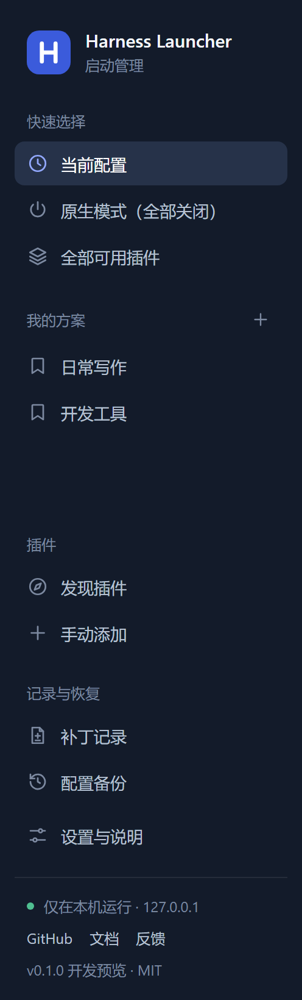</td>
    <td width="64%" valign="top">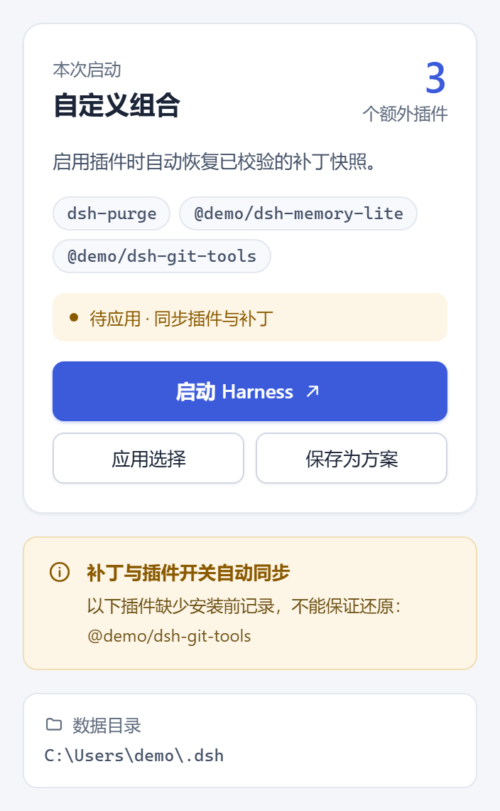</td>
  </tr>
  <tr>
    <td align="center"><sub>Sidebar</sub></td>
    <td align="center"><sub>Launch panel with unapplied changes</sub></td>
  </tr>
</table>

### Choosing plugins for this launch

The switch on each plugin card decides whether it loads this time. **Toggling only changes the pending selection.** Click **Launch Harness** (启动 Harness) to apply it automatically and start Harness. Use **Apply without launching** (仅应用，不启动) to synchronize configuration and patches in advance. Above the list you can search by name or description, select all (全选), or turn everything off (全部关闭).

Card badges:

| Badge | Meaning |
| --- | --- |
| `v1.2.3` | Version from `package.json`; shows "版本未知" (version unknown) if it cannot be read. |
| **支持自动还原补丁** (supports automatic restore) | Managed by a built-in adapter (currently dsh-purge); official files can be restored when it is disabled. |
| **已自动记录补丁** (patch recorded) | Snapshotted when installed through manual add; recorded files are restored when disabled and re-applied when enabled. |
| **未记录安装前状态** (no pre-install record) | Combination switching is blocked. Restore a clean installation first, then install through the launcher with recording; unknown past changes cannot be inferred. |
| **当前已启用** (currently enabled) | Loaded by the current `package.json`. |
| **文件缺失** (files missing) | Registered, but its folder or `package.json` is missing; it cannot be enabled. |

**查看路径** (show path) reveals the plugin's folder. Below the list, **official base components are always kept** (官方基础组件始终保留): `@deepseek-ai/dsh-base` and `@deepseek-ai/dsh-web-app` cannot be disabled.

The notice card beside the plugin list explains how this switch affects patches, for example which plugins have no pre-install record, or whether disabling will switch back to official files.

### Presets and saved schemes

The sidebar's **Quick select** (快速选择) section has three presets:

- **Current configuration** (当前配置): the plugins enabled in `package.json` right now, which discards unapplied toggles.
- **Native mode, all off** (原生模式（全部关闭）): load no extra plugins and restore every restorable patch.
- **All available plugins** (全部可用插件): select every plugin whose files are intact.

**My schemes** (我的方案) stores combinations you use often. Click **Save as scheme** (保存为方案) or the sidebar's **+**, then enter a name of 1–40 characters to save the current selection; you are asked before an existing scheme with the same name is overwritten. Clicking a scheme loads it into the pending selection; hover over it to reveal **×** for deleting it. If a scheme contains plugins that are no longer installed, they are listed when it loads. Up to 100 schemes can be saved.

Newly saved schemes also pin current plugin and Harness versions. Inspect and re-save after a version change to avoid silently substituting new plugins. Portable imports bind local installed versions; convert old schemes once with the migration tool.

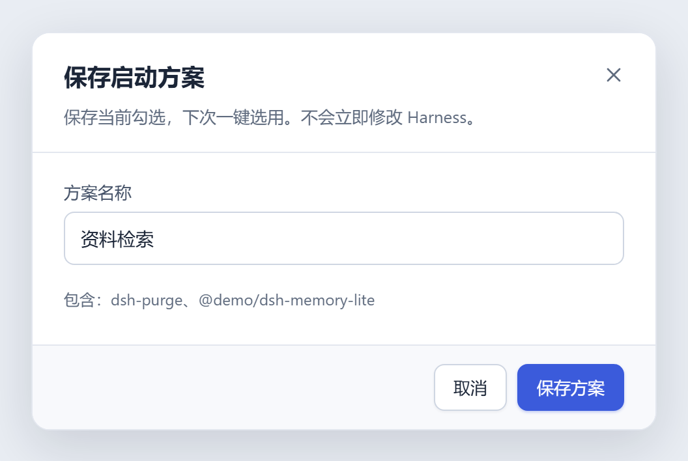

### Launch, apply and restore native

The launch panel has three buttons:

- **Launch Harness** (启动 Harness): apply the current selection, then start Harness.
- **Apply without launching** (仅应用，不启动): synchronize configuration and patches in advance. With no extra plugins selected, the label becomes **Restore without launching** (仅还原，不启动). You do not need to press this before Launch.
- **Save as scheme** (保存为方案): save the selection without modifying Harness.

When launching an unchanged, previously saved combination, the launcher verifies active files, package dependencies and the host version, then starts Harness without redundant undo, replay or backups. Actual content changes still block launch.

0.3.2 excludes unused parked trees and uses configuration-only transactions for recorded plugins with empty file deltas. Local NTFS file-identity caches and directory checkpoints guarded by continuous USN records reuse verified indexes across unchanged purge directory moves. First use, internal edits or unavailable journal evidence require complete verification. Obsolete fingerprints are removed and capacity is bounded; replay and rollback blobs remain checked. Request locks are released before response delivery. See [measurements and scope](docs/switch-performance.en.md).

**0.3.2 has completed local validation against the approximate 30-second target.** Full regression: 331 Python passes on each of Windows CI Python 3.12 and 3.13, plus 32 JavaScript passes on each. After restarting the production launcher, eight scenarios showed the complete interface by 15.115–35.318 seconds; later menu interactions all succeeded. These observations are upper bounds, not a strict 30-second guarantee. Historical failures remain in the [validation record](docs/validation-0.3.2.md). Changed host identities stop obsolete patch application early while retaining recovery records; see [updates and conflicts](docs/host-updates.md).

When a file combination needs switching, the launcher:

1. Checks that Harness, including its tray icon, has fully exited, that the executable path is valid, and that no install recording is in progress. **It never forcibly ends a running session.**
2. Checks that `package.json` has not been changed by Harness or another program since it was read. If it has, you are asked to refresh and try again; external edits are never overwritten.
3. Checks recorded host executable/archive identities first, stopping on possible updates; then backs up `package.json`.
4. Computes the new bundle list. Official components are always kept, existing plugins keep their load order, and newly enabled plugins are appended. All other fields of `package.json` are preserved.
5. Simulates the entire switch in a read-only view, verifying bidirectional copies, the native base, plugin dependencies and target files, then rechecks inputs. One transaction undoes current layers, switches the adapter and configuration, applies target layers and verifies the final result. Failed preflight leaves live files untouched.
6. If you chose to launch, rechecks host identity and starts Harness with `DSH_HOME` pointing at the current data directory. Transaction failures attempt rollback; changed host versions or invalid recovery preconditions stop overwrites and retain the journal and recovery objects.

The status line shows whether the selection is current, pending, blocked by a running Harness or missing executable, or being processed. Launch and apply operations also show a blue-purple progress bar with actual stages, file or change counts, and elapsed time. Uncounted stages use a waiting animation; the bar does not estimate remaining time. See the [0.3.1 screenshots and measurements](docs/launch-progress.en.md).

> [!IMPORTANT]
> Restore native refuses to claim a complete official state when a plugin without a pre-install record may have changed files. Disabling a plugin never uninstalls it: installed dependencies, accounts, sessions and ordinary preferences are kept.

### Discover plugins

Click **Discover plugins** (发现插件) in the sidebar or above the plugin list to open the catalog. It has two tabs: **Browse and search** (浏览与搜索) and **Leaderboard** (排行榜).

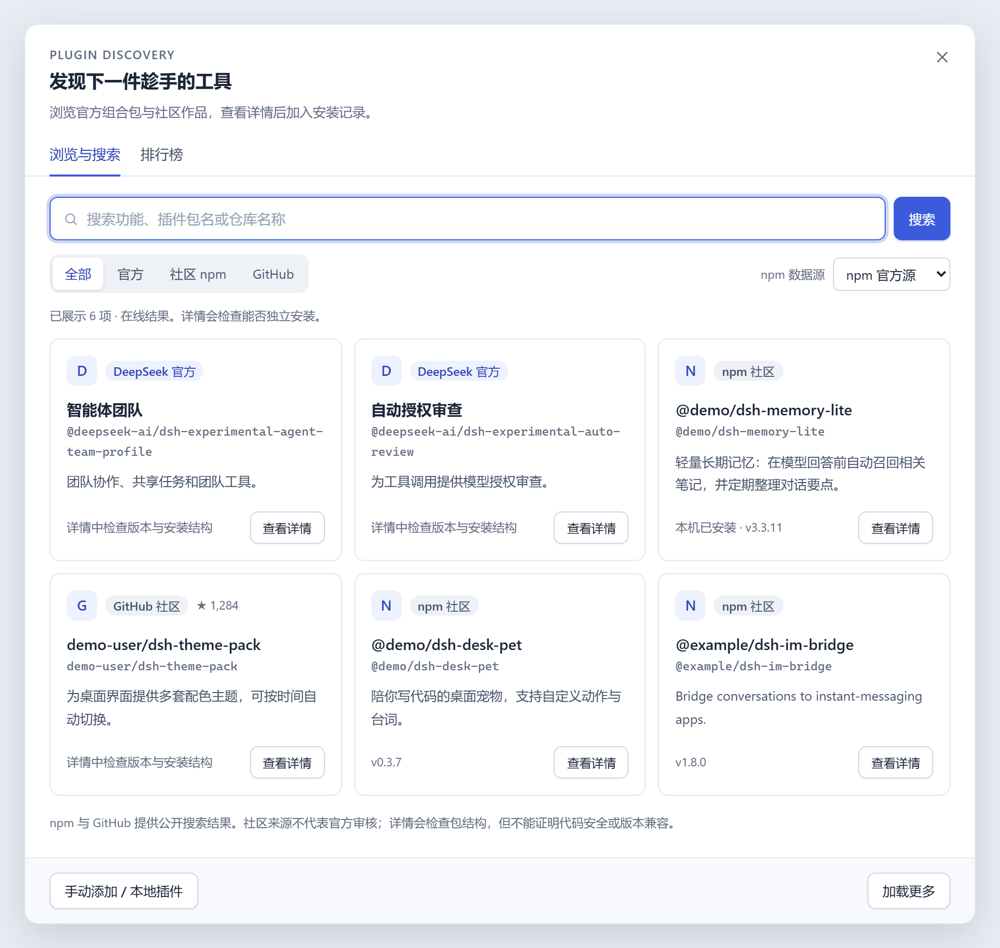

**Source filters:**

- **Official** (官方): lists four experimental DeepSeek bundles by default (agent team, automatic authorization review, scheduled tasks and voice input). Enter a package name to look up other `@deepseek-ai` components. For official features that ship with Harness, prefer enabling them on Harness's own official plugin page to avoid installing them twice.
- **Community npm** (社区 npm): npm packages with the `dsh-plugin` or `deepseek-harness` keyword. Entering a full package name containing `dsh` or `harness` also finds packages without those keywords.
- **GitHub**: repositories with the `dsh-plugin` topic that are not archived, sorted by stars. Use it to find plugins that are **not published to npm**; they are installed directly from the repository URL.

**Also note:**

- The **npm data source** (npm 数据源) can be switched to the mainland China mirror. It only affects catalog queries; installation always follows the registry configured for Harness's own package manager.
- Each page shows 18 results; **Load more** (加载更多) continues for up to 20 pages.
- If one source fails, results from the others are still shown, the failing source is named, and **Retry** (重试搜索) is offered.
- Results are cached for 5 minutes. If the cache has expired and you are offline, the last results are shown and marked as an offline cache, but details from that cache cannot be used to install.
- Cards mark plugins that are already installed, with their version.

> [!WARNING]
> The catalog is not an official marketplace and is not reviewed for security. npm search relies on keywords chosen by authors, and GitHub search on topics added by authors. Installing a community plugin runs third-party code; declaring a bundle structure does not make a plugin safe or compatible.

### Leaderboards

The **Leaderboard** tab offers two boards, each showing the top 50:

- **Downloads, last 7 days** (下载量 · 近 7 天): ranked by npm's official 7-day download count; the 30-day total is shown for reference only. A single bulk download can inflate a 30-day total. In real data, one package had over 40,000 downloads in 30 days but only a few dozen in the last 7.
- **Rising** (新晋热门): plugins with at least 200 downloads this week whose 30-day downloads mostly (more than half) happened in the last 7 days. These are usually newly published or suddenly popular. The downloads board naturally favours established plugins; this board gives new ones visibility.

Each row shows the rank, package name, description, version, last publish date and download figures; installed plugins are marked as installed. **View details** (查看详情) leads to the same details and install flow as the browse tab.

<table>
  <tr>
    <td width="50%">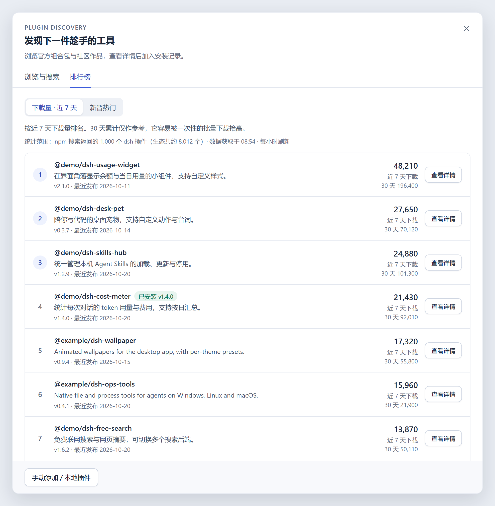</td>
    <td width="50%">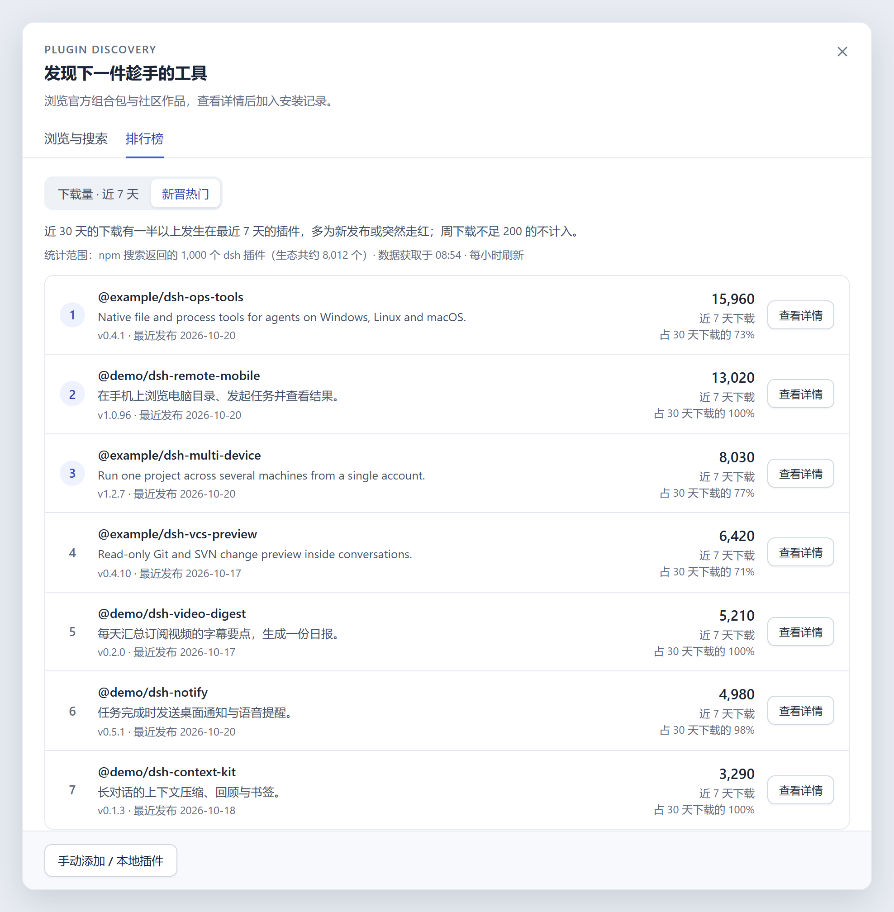</td>
  </tr>
  <tr>
    <td align="center"><sub>Downloads, last 7 days</sub></td>
    <td align="center"><sub>Rising</sub></td>
  </tr>
</table>

<details>
<summary><b>Methodology and limits</b></summary>

- npm search cannot sort by downloads, and thousands of packages carry the `dsh-plugin` / `deepseek-harness` keywords. The leaderboard scans the first 1,000 results of npm search (4 requests) and ranks within them. Top positions are reliable; lower positions may miss packages outside the scanned range. The number scanned and the ecosystem total are shown in the window.
- Download counts always come from `registry.npmjs.org`. The mainland China mirror only reports its own cumulative downloads, which are not comparable, so it is not used for ranking. When npm's official registry is unreachable, the leaderboard is unavailable and a **Reload** (重新加载) button is shown.
- Both boards share one scan, cached for 1 hour (npm updates download statistics daily). The fetch time is shown in the window.
- Downloads include automated builds and mirror synchronization and can be inflated deliberately. **A ranking reflects popularity only, not a security review or compatibility.**
- There is no GitHub star board. Most of the highest-starred repositories with the `dsh-plugin` topic are not plugins, and an npm package's repository field is self-declared, so its stars often belong to a host project or are borrowed by pointing at a well-known repository. They cannot be verified one by one without signing in to GitHub.

</details>

### Plugin details

Clicking **View details** (查看详情) in the catalog or a leaderboard reads the package metadata:

- **Source** (来源): npm community, the official `@deepseek-ai` scope, or a GitHub community repository.
- **License** (许可证), **install structure** (安装结构: whether `dsh.bundle.patch` is declared) and **version requirements** (版本要求: `@deepseek-ai/*` entries in `peerDependencies`).
- **Links**: the npm page, source code and homepage. Only `http` / `https` links are shown, and links containing credentials are removed.

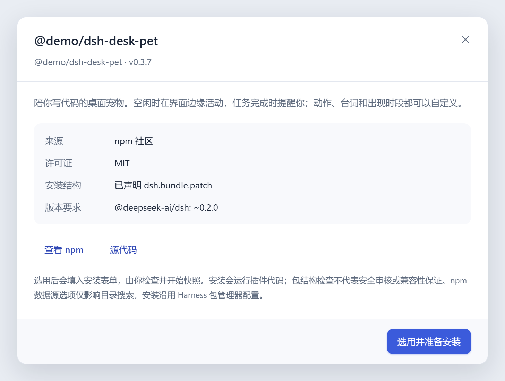

**Select and prepare install** (选用并准备安装) opens manual add with the package name and source filled in. **Nothing is installed yet.** A plugin cannot be selected when:

- it is an ordinary component library without `dsh.bundle.patch`, which cannot be installed as a standalone plugin;
- it is already installed without a pre-install record (past changes cannot be recovered);
- it is managed by a built-in adapter (it needs to be re-verified before upgrading);
- another install recording is in progress;
- the details come from the offline cache (verify online before installing).

npm details pin the version that was looked up, for example `@demo/dsh-desk-pet@0.3.7`. GitHub details read `package.json` from the repository root, and the install source becomes `git+https://github.com/<owner>/<repo>.git`. That URL is **not pinned to a commit**, so add `#<tag>` as the project describes. If the repository has no root `package.json`, read the project's instructions and add it manually. For a plugin that is already recorded, the button reads **Prepare upgrade and re-record** (准备升级并重新记录).

### Add a plugin manually (with recording)

**Add manually** (手动添加) installs new plugins and upgrades recorded ones. **Restoration recording is always enabled and cannot be skipped.** The launcher backs up files, installs the plugin and opens Harness. After normal use and exit it compares, verifies and saves automatically. There is no routine test confirmation, manual scan or save button.

**Step 1: choose a source**

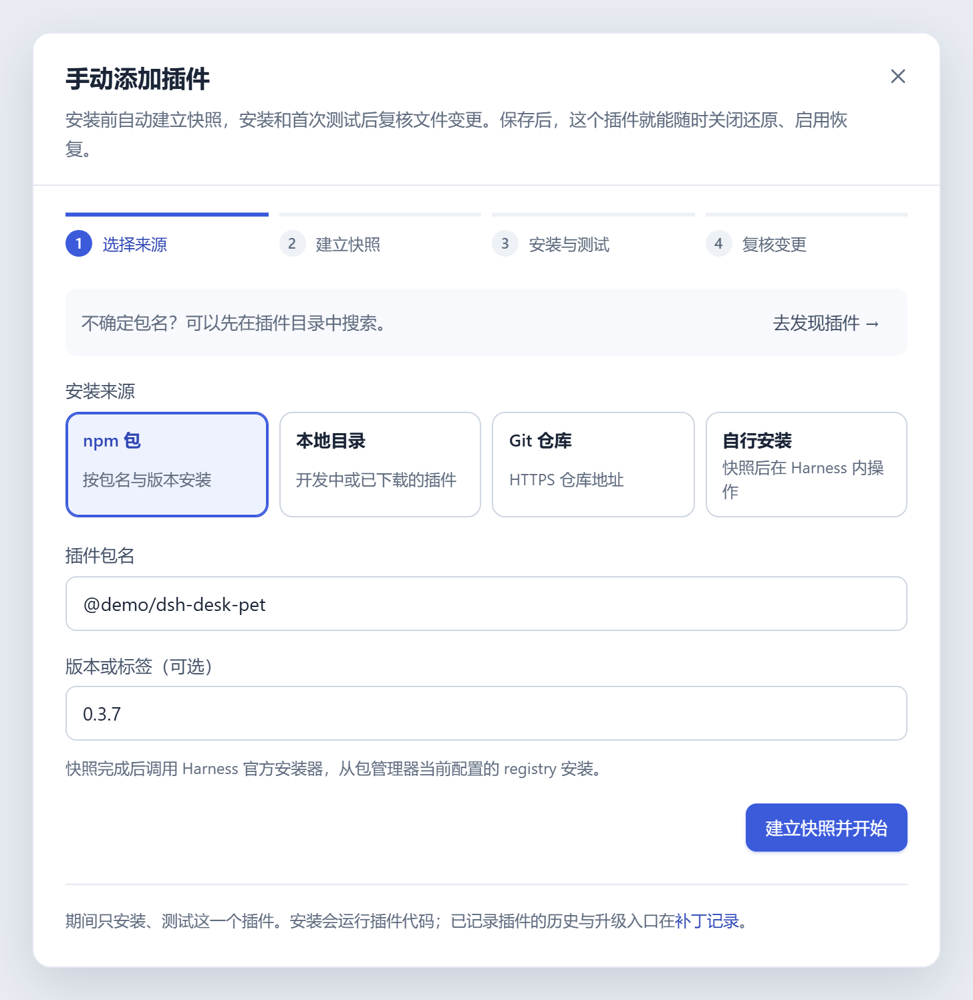

| Source | What to enter | Notes |
| --- | --- | --- |
| **npm package** (npm 包) | Package name, plus an optional version or tag | Passed to Harness's official installer as `name@version`; without a version the latest release is installed. |
| **Local folder** (本地目录) | Full path of the plugin folder | The folder must contain `package.json`. Useful for plugins in development or downloaded manually. |
| **Git repository** (Git 仓库) | For example `git+https://github.com/owner/repo.git#v1.0.0` | Pin a tag or commit after `#`. |
| **Install it yourself** (自行安装) | Package name only | After the snapshot, install or upgrade the plugin inside Harness yourself. |

The package name must match the package that ends up installed, or you are told it cannot be found after installation. Install URLs must not contain credentials; use your package manager's configured authentication instead.

**Steps 2–3: automatic backup, installation and first run**

Fully quit Harness, including its tray process, before starting. Check the source, then click **Install and open Harness** (安装并打开 Harness). The launcher backs up the files, uses the official installer, and opens Harness. With "install it yourself", the button reads **Back up and open Harness** (备份并打开 Harness); install or upgrade that plugin inside Harness once it opens. File copies are deduplicated by their content hash and the originals are retained.

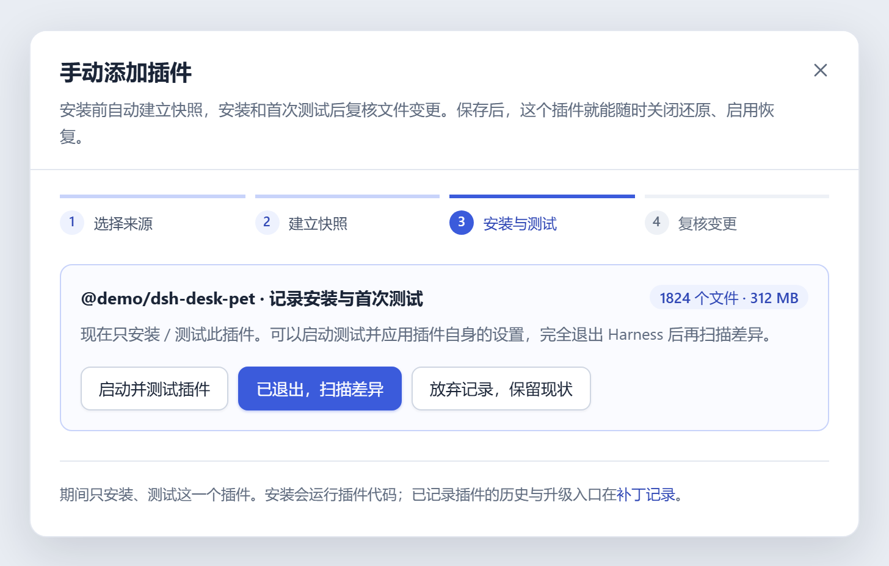

Use the plugin normally in Harness; you do not need to return and confirm a test. When finished, **fully quit Harness, including the tray process**. The background supervisor waits for the process to exit and files to settle, then records first-run changes automatically.

You may close the menu window while recording continues. Until it finishes, only work with this plugin; do not install other plugins or manually edit managed files. Recording is not a functional test and does not prove the plugin is bug-free.

While recording, a progress banner and a sidebar dot show the current task. Launch and apply stay disabled until the record is saved.

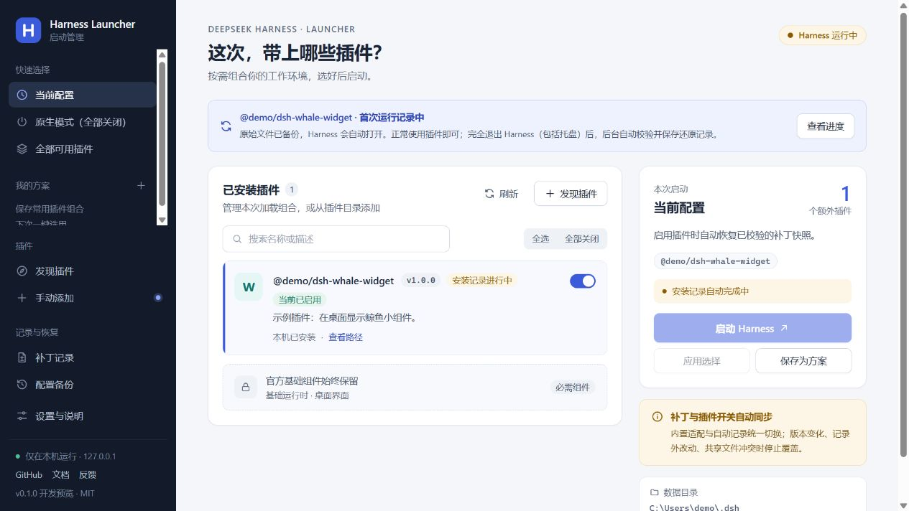

**Step 4: automatic verification and saving, with intervention only on exceptions**

Before saving, the launcher rechecks installed plugins, versions, the loading combination, the Harness executable and the entire managed scope, and verifies file copies needed for both restoration and reapplication. It saves automatically if these checks pass, without a routine confirmation dialog.

Installer failure, an unobserved launch, program or other-plugin version changes, interrupted recording, ongoing writes, link/type transitions or corrupt snapshots pause the flow and retain the original backup. Fix the reported issue, quit Harness and click **Continue automatic recording** (继续自动记录). An unfinished session from a restarted service also requires checking before it continues, rather than silently adopting changes made while the service was down. Retrying keeps the original baseline.

On an exception, inspect up to 200 collected changes or **Export full change list** (导出完整改动清单). Cancellation is allowed only if the plugin has not been installed and files remain unchanged; there is no discard-record bypass once changes exist.

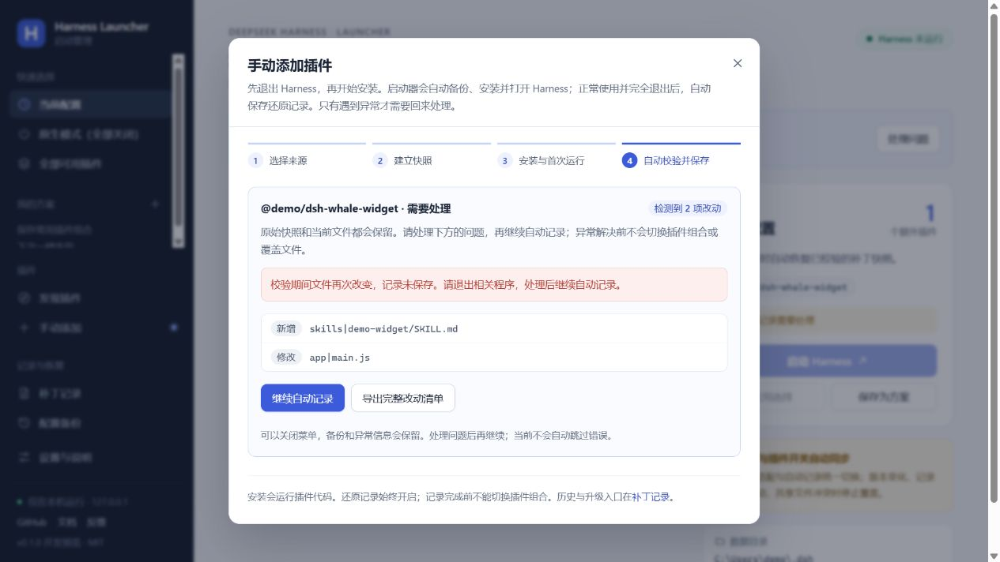

Each entry has the form `scope|relative path`, where `|.` means the scope itself. For example, `rules|desk-pet.md` is `rules\desk-pet.md` in the data directory, and `archive|.` is the `resources\app.asar` file itself.

| Scope | Location |
| --- | --- |
| `app` / `archive` / `archive_backup` / `unpacked` | `resources\app`, `resources\app.asar`, `resources\app.asar.bak`, `resources\app.asar.unpacked` in the install folder |
| `cli` | `resources\runtime\cli` |
| `agents` / `claude` / `prompt` | `AGENTS.md`, `CLAUDE.md`, `prompt-inject.md` in the data directory |
| `rules` / `skills` / `presets` | `rules`, `skills`, `.agent-presets` in the data directory |
| `user_yaml` / `root_yaml` | `cordis.patch.yml`, `cordis.yml` in `profiles\desktop` |

> [!IMPORTANT]
> A record captures the file differences **within a time window**; it does not prove the plugin's process wrote them. While recording, install and test only this one plugin and do not edit other files. A plugin that is already installed without a pre-install record cannot have its past changes recovered.

**Upgrading a recorded plugin:** click **Upgrade / re-record** (升级 / 重新记录) in patch records, or **Prepare upgrade and re-record** in plugin details. The launcher undoes the old patches and takes a new baseline. The new record replaces the current one only after automatic verification; the old record stays in history. Old files the new version no longer writes are not carried over.

New records also retain installed package contents, resolvable dependencies, existing lock files and immutable revision references. Convert old records once into the current format and retain current installed artifacts. Missing historical artifacts are never fabricated. Switches record concrete versions, order, the native base and expected output. This phase has no one-click historical-version installation or automatic patch merging.

### Patch records

**Patch records** (补丁记录) is a ledger that groups your plugins by how they can be restored:

- **Recorded** (已记录): version, number of differences, whether the patch is enabled, the base combination at recording time, and the number of history entries. Can be upgraded and re-recorded.
- **Built-in adapter** (内置适配): dsh-purge is restored by the launcher's dedicated adapter. Disabling uses the preserved official archive and stashes injected files; enabling restores the patch snapshot for the same version. It must be re-verified after an upgrade.
- **Unrecorded** (未记录): plugins without an original snapshot block combination switching. Restore a clean installation first, then install with automatic recording.

Expand **Recorded scope and limits** (记录范围与限制) for the monitored folders. An active recording has a **View progress** (查看进度) button; an exception has **Handle issue** (处理问题).

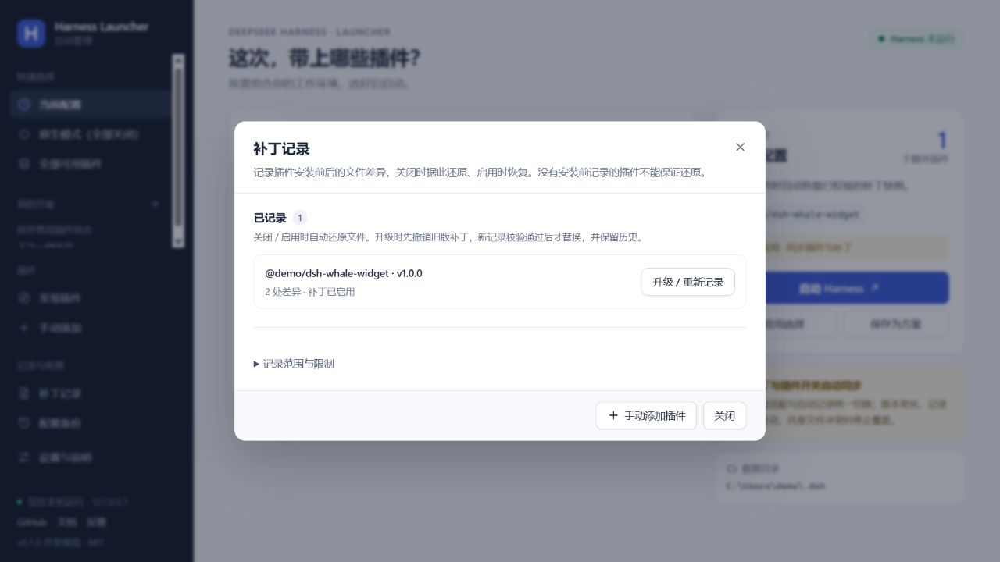

### Configuration backups

Before every change to `package.json`, the launcher saves a backup and notes why, for example "before launch switch" (启动前切换), "save plugin selection" (保存插件选择) or "before restoring a backup" (恢复备份前). **Configuration backups** (配置备份) lets you restore any of them:

- The current configuration is backed up first, so a restore can itself be undone.
- Restoring also syncs the patch state of adapted plugins, but **does not roll back plugin versions**. Version-constraint mismatches stop restoration; convert old backups with the migration tool first.
- Restoring is unavailable while Harness is running, the executable path is invalid, or a recording is in progress.
- **Open backup folder** (打开备份目录) opens the backups in File Explorer.

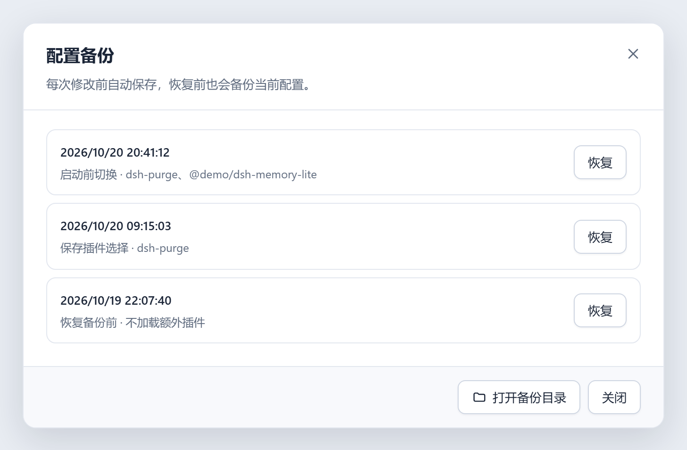

### Settings

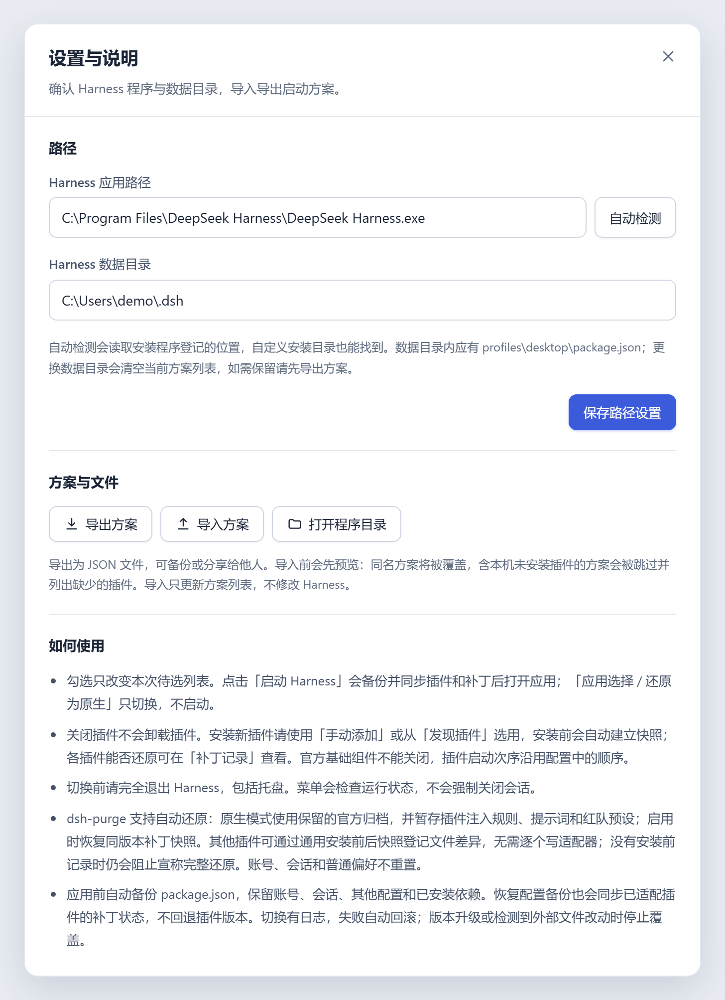

**Exit launcher service** disconnects every menu window; an already running Harness keeps running. Active recording or file switching blocks exit; paused exception records stay on disk. To leave temporarily, simply close the window and reopen it later to reuse the service.

- **Paths** (路径): the Harness executable and data directory. **Auto-detect** (自动检测) reads the location registered by the installer. Saving checks that the file is named `DeepSeek Harness.exe` and that the data directory contains `profiles\desktop\package.json`. **Changing the data directory clears your schemes**; export them first if you want to keep them.
- **Schemes and files** (方案与文件): export and import schemes, and open the launcher's program folder.
- **How to use** (如何使用): short in-app notes.

### Importing and exporting schemes

Use **Settings → Schemes and files**. The exported file is UTF-8 JSON that you can back up, keep in version control or share:

```json
{
  "format": "harness-launcher-schemes-v1",
  "schemes": {
    "Writing": ["dsh-purge", "@demo/dsh-memory-lite"],
    "Development": ["@demo/dsh-git-tools", "@demo/dsh-web-search"],
    "Native": []
  }
}
```

- Each key in `schemes` is a scheme name of 1–40 characters, and each value is the list of extra plugin package names to load. An empty list means only the official base components. Official components do not need to be listed.
- Files are limited to 64 KB and 100 schemes, and the total after importing cannot exceed 100.
- Before importing, each scheme is previewed as **new** (新增), **overwrite** (覆盖, same name as an existing scheme) or **skipped** (跳过). Schemes that reference plugins that are not installed, or whose files are missing, are skipped and the missing plugins are listed. Install them and import the same file again.
- Importing only updates the launcher's scheme list. It does not modify the Harness configuration or install plugins. Exports contain package names only, not local version constraints or recovery artifacts; imports bind the current local versions again.
- Schemes are stored in the launcher settings (by default `%USERPROFILE%\.harness-launcher\settings.json`).

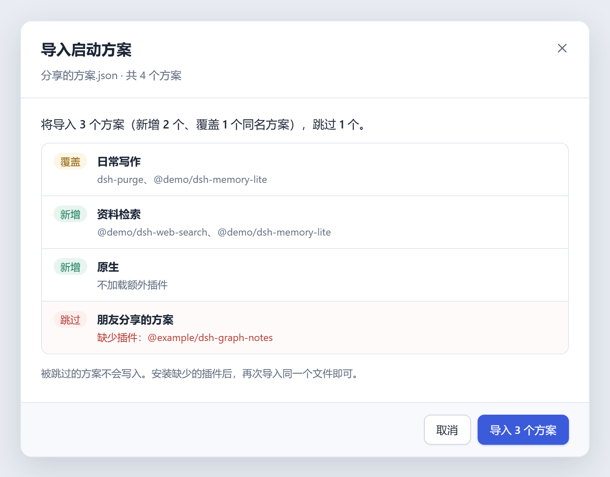

### Narrow windows

Below 1120 px wide, the launch panel collapses into a bottom action bar; below 760 px, the sidebar shows icons only.

The bottom bar places the heading, status and controls on separate rows as needed, with matching space reserved below the page content. In smaller windows, the launch button gets its own row. Long scheme names and status messages are truncated; hover over them to read the full text.

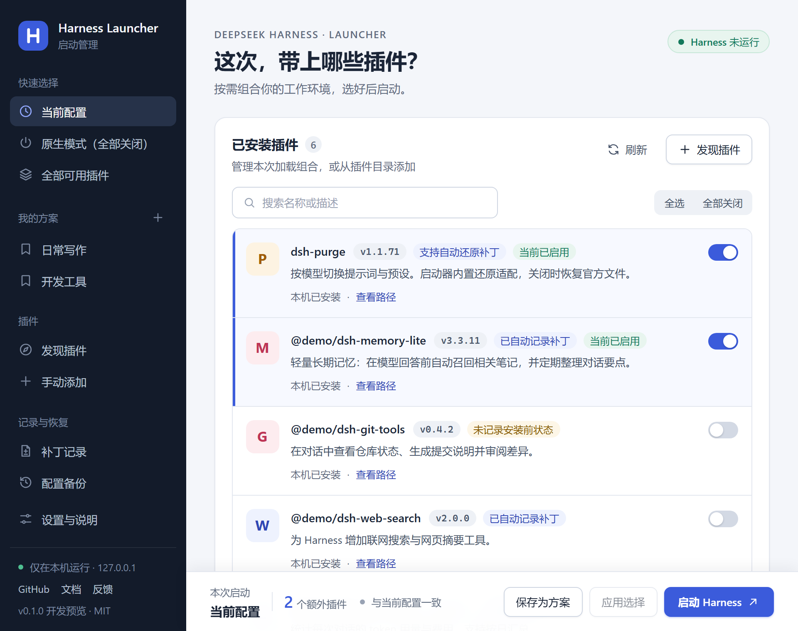

## How it works

### Applying a selection

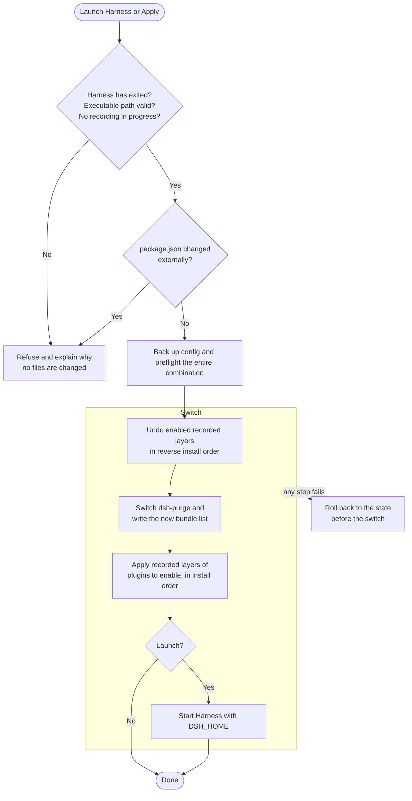

### Recording a plugin

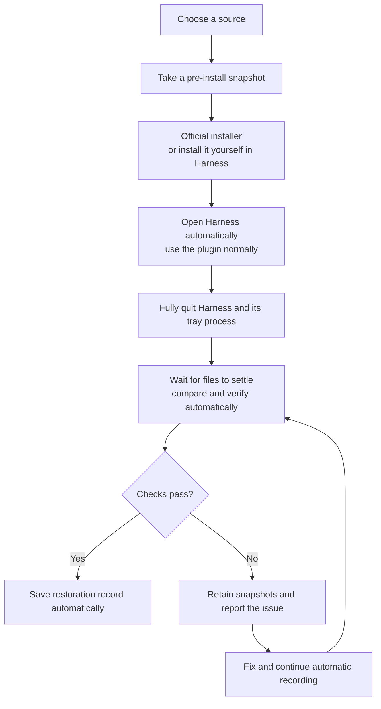

### Limits of patch restoration

- **The built-in dsh-purge adapter** applies to installations it has captured at a matching version. It preserves the official ASAR and stashes the extracted application and recognized rules and presets. After a dsh-purge upgrade it must be re-verified; old snapshots are never applied to a new version.
- **Generic recording** tracks file changes within an explicit scope only. **It is not a process-level audit and not a whole-system restore.** The registry, system services, drivers and paths outside the scope are not recorded, and new patches produced by later runs need to be handled again.
- When a version changes, files change outside a record, or records conflict on a shared file, the launcher stops overwriting and reports why instead of forcing a merge.
- Snapshots of application files, rules and presets are kept in the launcher's `patches` folder. Files that are currently inactive may be stashed in `resources\.harness-launcher-*` in the install folder, or in a directory of the same name in the data directory. **Do not delete these folders by hand.**

For more detail, see [Patch recording and restoration: technical notes](docs/patch-recording.en.md).

## Data and privacy

### File locations

| Location | Contents |
| --- | --- |
| `%USERPROFILE%\.harness-launcher\settings.json` | Executable path, data directory, schemes and plugin order. |
| `%USERPROFILE%\.harness-launcher\backups\` | Backups of `package.json`. |
| `%USERPROFILE%\.harness-launcher\patches\` | Patch snapshots, install records, installer logs and change lists. |
| `%USERPROFILE%\.harness-launcher\launcher.log` | Warnings and errors; it never contains the access token. |
| `%USERPROFILE%\.harness-launcher\instance.json` | The local address of the running service, including its access token, used to reuse the service on repeated starts. |
| `%USERPROFILE%\.harness-launcher\instance.lock` | OS lock held while the service runs to prevent multiple writers for one data directory. The file remains after exit; its presence does not mean the service is running. |
| `<install folder>\resources\.harness-launcher-*`<br>`<data directory>\.harness-launcher-*` | Stashes of official or plugin files that are currently inactive. |

With `--data <folder>`, the first six entries are stored in that folder instead. Snapshots can contain private material you keep in rules, skills or configuration files, so keep these folders private.

### Network access

| When | Host | What is sent |
| --- | --- | --- |
| Browsing, searching and npm details | `registry.npmjs.org`, or `registry.npmmirror.com` if you select it | Search terms, package names |
| GitHub source and details | `api.github.com` | Search terms, repository names |
| Leaderboards | `registry.npmjs.org` | Fixed ecosystem keywords |
| Installing a plugin | Whatever Harness's official installer uses, per its own registry configuration | Decided by the installer |

The launcher uses anonymous public APIs, never uploads profiles, sessions or credentials, and has no telemetry. Remote content is always rendered as plain text.

### Local service security

- The service listens on `127.0.0.1` only (port 17643 by default, or a random port if it is taken) and generates a random access token on every start.
- API requests are checked for Host, Origin and the access token. The page uses a strict Content Security Policy and loads nothing from a CDN.
- **Do not expose the port through a tunnel or reverse proxy.**

See [SECURITY.md](SECURITY.md) for details.

## FAQ

<details>
<summary><b>Why is the Launch Harness button greyed out?</b></summary>

Hover over the button to see why. Common causes:

- **The executable cannot be found**: follow the red banner at the top of the main window to fix the path.
- **Harness is running**, even if only its tray icon is left: quit it completely.
- **An install recording is in progress**: quit Harness and wait for automatic saving, or fix the reported exception and continue. A record cannot be discarded once changes exist.
- **A switch is in progress**: wait for it to finish.

</details>

<details>
<summary><b>Why must Harness be closed before switching?</b></summary>

While Harness runs, it reads the configuration and application files, so changes made at the same time could be overwritten or leave things inconsistent. The launcher only checks whether the process is running; it never forcibly ends your session.

</details>

<details>
<summary><b>Does disabling a plugin uninstall it?</b></summary>

No. Disabling removes it from the bundle list and undoes its recorded patch. The plugin's files and dependencies stay in `node_modules`, so you can enable it again at any time.

</details>

<details>
<summary><b>A plugin is already installed but shows "no pre-install record". What can I do?</b></summary>

Unknown past changes cannot be recovered, so file-combination switching is blocked. Restore the original state using the author's uninstall/restore procedure, a reliable original backup, or a clean installation, then reinstall through manual add or discovery with automatic recording. The modified current state cannot be registered as the original.

</details>

<details>
<summary><b>What should I do after Harness itself is upgraded?</b></summary>

A Harness upgrade replaces official files. When the launcher detects a version or file change, it stops overwriting and explains why; it never applies old snapshots to a new version. Re-apply your plugins on the new version and, if needed, create new records with **Upgrade / re-record**.

</details>

<details>
<summary><b>I selected the mainland China mirror. Why does the leaderboard still contact npm's official registry?</b></summary>

The mirror only reports its own cumulative downloads, which are not comparable with npm's official 7-day and 30-day statistics; mixing them would distort the ranking. The leaderboard therefore always uses npm's official data, and the mirror option only affects browsing and search.

</details>

<details>
<summary><b>Why is there no GitHub star leaderboard?</b></summary>

See [Leaderboards → Methodology and limits](#leaderboards). In short, most of the top-starred repositories are not plugins, and a plugin's stars often belong to its host project. The GitHub source stays available for finding plugins that are not published to npm.

</details>

<details>
<summary><b>Is installing community plugins safe?</b></summary>

Installation runs the plugin's own code. The launcher checks package structure, records changes and verifies restoration data, but it is **neither a security review nor a sandbox**. Only install plugins you trust, and read their source code and documentation first.

</details>

<details>
<summary><b>Does the background service keep running after I close the window?</b></summary>

Yes. The background service stays running, and installation and first-run recording continue after the menu closes. Missing browser heartbeats no longer cause an automatic exit, so a suspended browser or sleeping computer does not leave a dead menu. To stop the service, use **Exit launcher service** in Settings; it checks for active installation, recording and switching. Exceptions remain on disk for the next visit. Double-clicking `launch.vbs` reuses a running service.

</details>

<details>
<summary><b>Are macOS and Linux supported?</b></summary>

Not yet. Install paths, process detection and patch handling are unfinished on those platforms. For example, the launcher cannot detect whether Harness is running there, so please do not use it on them.

</details>

## Uninstalling

1. Open the launcher, choose the state you want to keep (for example native mode, or your usual plugin combination), and click **Apply**.
2. Exit the launcher service from Settings, then delete the launcher folder and any desktop shortcut. **Deleting the launcher does not roll back any Harness files.**
3. `%USERPROFILE%\.harness-launcher` holds settings, backups and patch snapshots, and `resources\.harness-launcher-*` plus `.harness-launcher-*` in the data directory hold versions that are currently inactive. Once you delete them you can no longer switch back to those versions, so only remove them when you are sure you no longer need them.

## Development and contributing

```powershell
python -m unittest discover -v   # Python 3.12+
node --check ui/api.js
node --check ui/state.js
node --check ui/runtime.js
node --check ui/app.js           # Node.js 22+, syntax check
node --test test_ui.cjs          # Isolated connection, recovery and button-state tests
```

- Tests use temporary profiles, synthetic ASAR archives and mocked remote responses. They **never** install a real plugin or change a real Harness profile.
- CI runs on Windows with Python 3.12 and 3.13.
- Network services, future Harness or plugin versions and specific machine setups can still cause problems. Issues with reproduction steps are welcome.

| Path | Purpose |
| --- | --- |
| `launcher.py`, `operations.py`, `errors.py` | HTTP/application coordination, bounded operation status, error codes and recovery advice. |
| `domain.py`, `recording_state.py`, `operation_models.py` | File identities, snapshot metadata, recording state machine and strict transaction command decoding. |
| `storage.py`, `settings_store.py`, `runtime_context.py` | Atomic content storage, settings contract and immutable installation paths. |
| `patch_modes.py`, `adapters.py` | Adapter rules, official archive verification and operation planning. |
| `plugin_tracking.py` | Mandatory recording, first-run supervision, verified saving and the current record index. |
| `version_store.py` | Deduplicated installed code, dependency graphs, immutable revisions and combination records. |
| `file_view.py`, `switch_plan.py` | Read-only file overlay, whole-switch preflight, unified transactions and crash recovery. |
| `migrate.py` | Offline v2 → v3 conversion, staged verification, directory cutover and complete old-store archival. |
| `catalog.py` | Plugin catalog: npm and GitHub search, details and leaderboards (fixed public endpoints only). |
| `ui/` | `api.js` transport, `state.js` state, `runtime.js` effects, `app.js` rendering; no build step. |
| `launch.vbs`, `bootstrap.ps1` | Start without a console window. |
| `docs/` | Technical notes and screenshots. |

See the [maintenance guide](MAINTENANCE.en.md) for taking over the project, backup/restoration and AI handoff. Please read [CONTRIBUTING.md](CONTRIBUTING.md) before contributing, and report security issues privately as described in [SECURITY.md](SECURITY.md). See [CHANGELOG.md](CHANGELOG.md) for changes between versions.

## License and disclaimer

Released under the [MIT](LICENSE) license.

This repository does not contain the Harness application, copies of official source code, dsh-purge source code, user configuration or patch contents. The names DeepSeek Harness and of third-party plugins, and their own licenses, belong to their respective projects. Screenshots in this documentation use synthetic sample data; the plugin names and numbers shown are fictional.
