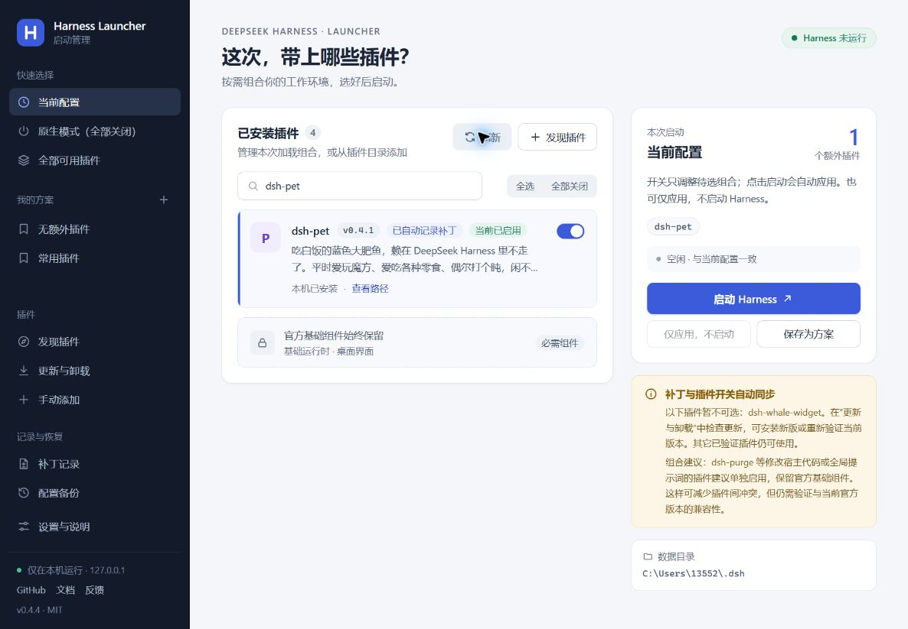
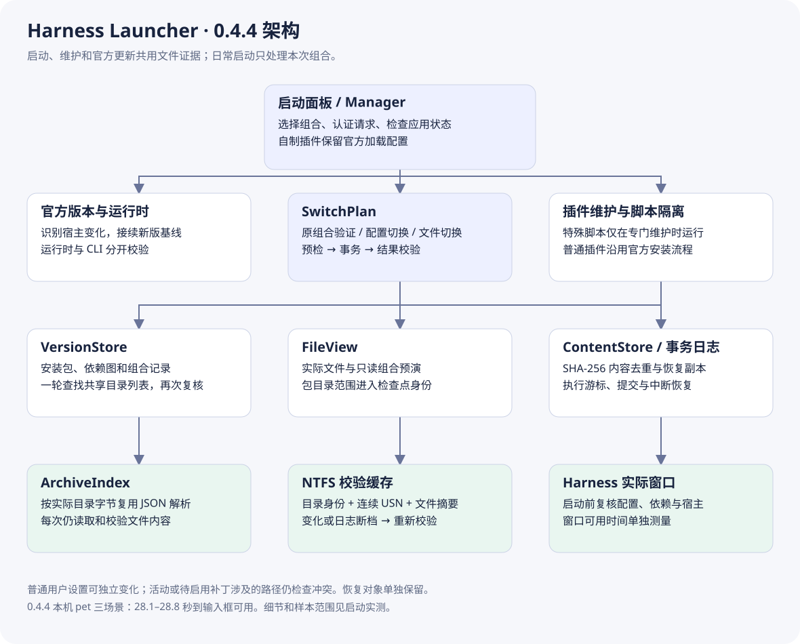
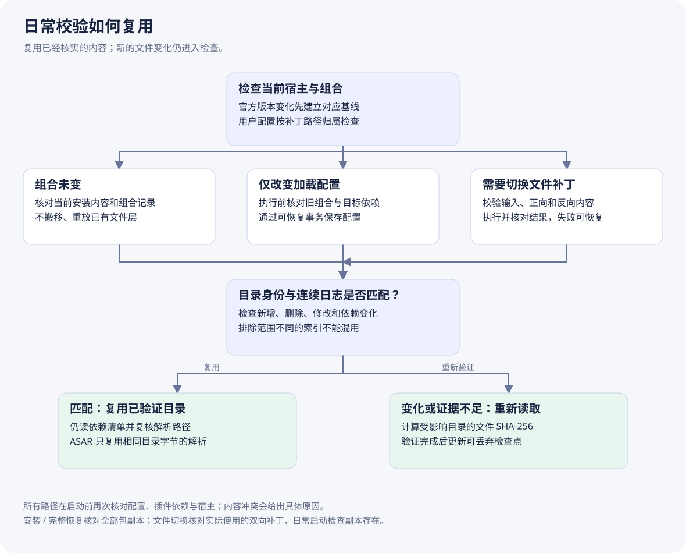
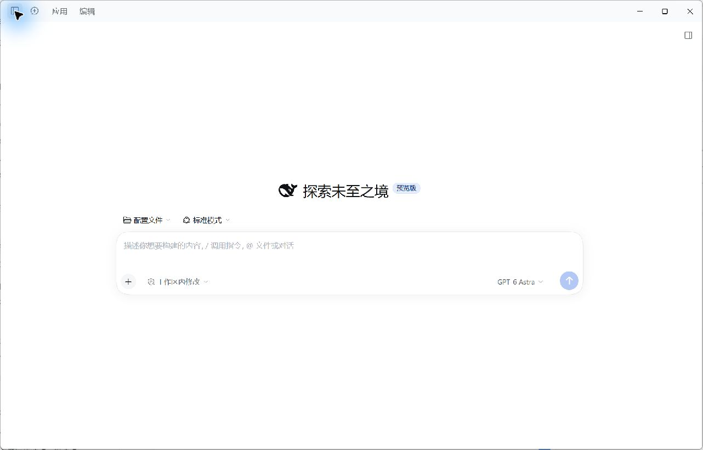
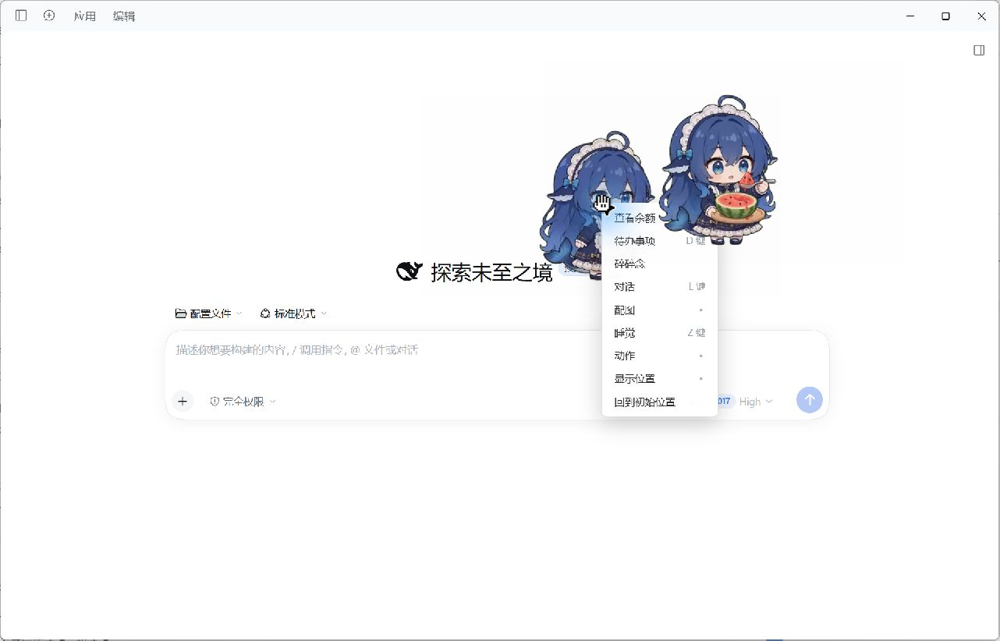
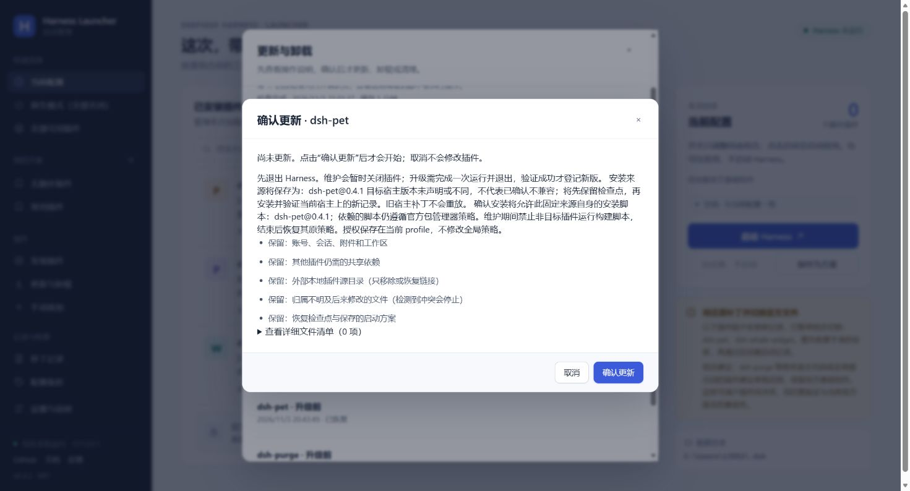
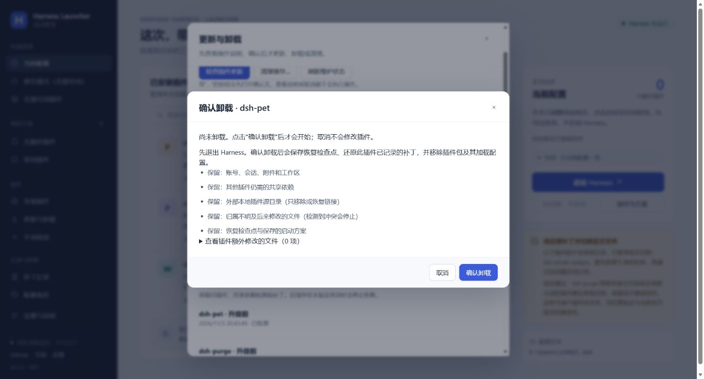
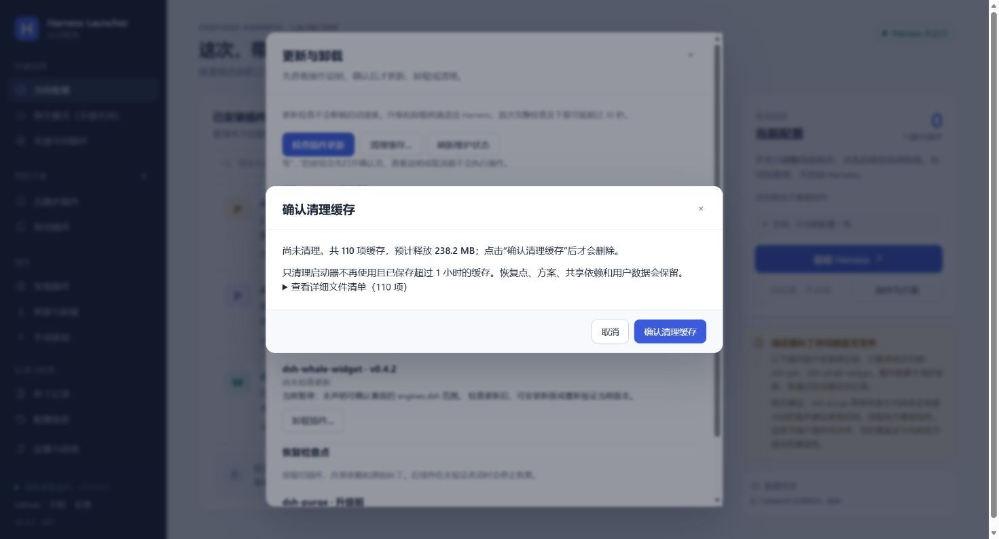

# Harness Launcher：DeepSeek Harness 中文插件管理器与启动器


Harness Launcher 是面向 DeepSeek Harness（DSH）的 Windows 中文插件管理器与启动器。选好今天要用的插件，一键启动；把常用搭配保存为方案，需要排查问题时再切回官方原生配置。插件安装、更新、卸载和回滚，都可以在桌面面板中操作。

[下载 Windows 便携版](https://github.com/schrieeeffer/harness-launcher/releases/tag/v0.4.4) · [快速开始](#下载与第一次启动) · [架构与工作原理](#架构与工作原理) · [使用文档](#使用文档) · [English](README.en.md) · [反馈问题](https://github.com/schrieeeffer/harness-launcher/issues)

当前版本：**0.4.4**（社区预览版）。支持 Windows 10/11 x64，便携包自带运行环境。先安装官方 DeepSeek Harness，再使用本启动器。



## 适合哪些时候用

你平时喜欢挂着宠物或余额挂件，排查 Harness 问题时又需要一个干净的官方界面。用启动器保存两套组合，下次直接选择，不必重新安装插件。

想试试新插件，可以从“发现插件”进入安装。启动器保存安装前的状态，打开 Harness 供你实际使用；正常退出后再保存插件记录。更新后不习惯，也能从维护页恢复到更新前。

插件用久了，可以检查新版、卸载不用的插件，或者查看缓存占用。每项操作都有说明页：先看清要做什么，再点对应的确认按钮。

| 想做的事 | 从哪里开始 |
| --- | --- |
| 带宠物、挂件开始工作 | 首页选择插件 → 启动 Harness |
| 临时回到官方原版 | 原生模式（全部关闭） → 启动 Harness |
| 保存常用搭配 | 保存为方案 → 起一个名字 |
| 尝试社区插件 | 发现插件 → 选择插件 → 安装 |
| 更新或移除插件 | 更新与卸载 |
| 撤销一次插件维护 | 更新与卸载 → 恢复检查点 |
| 切换 dsh-purge 的已记录补丁 | 首页插件开关 → 启动 Harness，由专用适配器处理程序补丁 |
| 让 Harness 编写自己的插件 | Harness 的创造模式与插件页面，启动器保留当前加载配置 |
| 官方更新后缺少运行时文件 | 设置与说明 → 官方运行时修复 |

## 下载与第一次启动

1. 安装官方 DeepSeek Harness 桌面版，并至少打开一次。
2. 到 [Releases](https://github.com/schrieeeffer/harness-launcher/releases/tag/v0.4.4) 下载 `Harness-Launcher-0.4.4-Windows-x64.zip`。
3. 把 ZIP 完整解压到自己的文件夹，例如 `D:\Apps\HarnessLauncher`。
4. 双击 `Harness Launcher.exe`。无需安装 Python，也不用输入命令。
5. 如果没有找到 Harness，打开“设置与说明”，点击“自动检测”，或填写官方程序路径。

请解压整个文件夹后运行，保留 EXE 旁的 `runtime`、`ui` 等文件。便携包只包含启动器，官方 Harness 和社区插件分别安装。

发布页同时提供 `SHA256SUMS.txt`。主程序目前没有商业代码签名，可用 PowerShell 查看下载包的摘要，与发布页的文件核对：

```powershell
Get-FileHash .\Harness-Launcher-0.4.4-Windows-x64.zip -Algorithm SHA256
```

## 架构与工作原理

启动器管理插件组合、文件变更和恢复记录，DeepSeek Harness 负责运行插件。普通插件使用通用记录层；dsh-purge 等修改程序文件的插件通过专用适配器处理；在 Harness 内自行安装的插件继续由官方管理。特殊插件的构建脚本单独隔离，普通插件安装不会顺带执行它们。



### 检查点如何减少重复校验

首次记录时保存基线，以及插件增加、删除和修改了哪些文件。日常启动先核对官方版本、当前组合和依赖，再利用 Windows NTFS 的文件身份与连续变更日志判断哪些校验结果可以复用。文件变化或日志不连续时，重新读取受影响的内容。

切换插件前，启动器校验本次要使用的文件，再通过事务日志记录执行步骤。恢复内容按 SHA-256 去重，同一份内容只保存一份；仍被插件、方案或恢复点引用的内容会继续保留。



本机 pet 的日常启动和两种启停切换，实测为 **28.1、28.5、28.8 秒**到窗口可用。完整环境与计时方法见[启动速度实测](docs/startup-validation.md)；模块关系和更详细的流程见[架构文档](docs/architecture.md)。

## 选择插件，启动工作

首页的开关编辑“本次启动”的组合。右侧会列出选中的插件；点击“启动 Harness”后，启动器才应用这套组合并打开应用。只想先保存配置，可以选择“仅应用，不启动”。

“当前配置”载入已经应用的组合，“全部可用插件”选中可用项，“原生模式（全部关闭）”关闭由启动器管理的额外插件，官方基础组件始终保留。在 Harness 内自行安装的插件由官方页面启停，详见下方的“让 Harness 给自己做插件”。切换前先从 Harness 的“应用 → 退出”完整退出，避免在应用使用文件时修改它们。

把常用组合保存为方案后，可以从左侧直接选择。方案支持 JSON 导入和导出，适合备份自己的搭配；插件版本变化后，检查一次组合并重新保存即可。

下图是关闭 pet 后重新打开的官方原生界面。本轮同时比对了官方程序、归档和 CLI 文件，结果与同版本官方安装包一致。



启动进度条显示当前步骤、文件数量和已经用去的时间。日常启动复用已有校验记录，安装、下载和首次记录会显示各自的维护进度。

## 安装一个新插件

在“发现插件”中搜索包名或描述，查看来源和版本，然后进入安装页。你也可以从“手动添加”开始。

| 安装来源 | 适用情况 |
| --- | --- |
| npm 包 | 社区发布到 npm 的插件，选择具体版本安装 |
| 本地目录 | 已下载并构建好的插件，或自己的开发目录 |
| Git 仓库 | 可以安装的仓库提交，安装前固定到该提交 |
| 自行安装并记录 | 在 Harness 内手动操作，由启动器记录前后变化 |

每个插件可用的来源不同。启动器先检查所选包、仓库或目录，验证通过的选项才可点击。

安装过程会保存安装前状态，然后调用 Harness 官方安装器并打开应用。实际使用插件后，从 Harness 菜单退出，完成首次运行验证。详细步骤见[安装来源与操作示例](docs/install-sources.md)。

下图是本机把 `dsh-pet` 从 0.3.8 更新到 0.4.1 后的真实窗口，Web 宠物和桌面宠物均已显示，右键菜单可以打开。



## 检查更新、卸载与恢复

打开左侧“更新与卸载”，点击“检查插件更新”。npm 插件会查询发布版本，Git 安装保持原来的提交来源。检查结果缓存五分钟，日常启动不自动查询新版。

### 更新插件

点击“更新到指定版本…”会打开说明页，列出当前版本、目标版本和安装来源。点“确认更新”后开始保存检查点并安装。新版本首次运行结束后，完成验证，启动器会恢复你更新前选择的组合。

官方 Harness 更新后，如果某个插件需要重新确认兼容性，维护页也会提供“重新验证当前版本…”入口，可以沿用当前插件版本重新建立记录。



### 卸载插件

“卸载插件…”打开确认页，顶部明确标注“尚未卸载”。你可以查看将要移除的插件和恢复记录；点击“确认卸载”才会执行，关闭页面或取消都不会卸载。

卸载会移除目标包和加载项，并还原已记录的插件文件改动。账号、会话、工作区和外部本地源码目录保留。卸载前的检查点会留在维护页，之后可以恢复。



### 恢复到维护前

维护页下方列出更新前和卸载前的检查点。选择对应插件的“恢复此检查点…”，查看变化，再确认恢复。更新失败时，正在进行的维护也会提供“恢复到维护前…”入口。

如果检查点之后又手动改过相关文件，恢复页会指出冲突，方便你先保留这些修改。恢复范围包括记录中的插件、加载配置、共享依赖和受管补丁；工作区文件、系统服务和注册表不属于这些检查点。

### 清理缓存

“清理缓存…”先统计可清理的数量和空间。确认页明确标注“尚未清理”，点“确认清理缓存”才删除；没有可清理内容时，确认按钮不可用。

清理对象是超过一小时、已经没有记录引用的缓存。当前插件、方案、恢复检查点引用的内容会留下，不清理会话和全局包管理器缓存。文件清单默认收起，需要时可以展开查看。



本机这一轮统计列出约 238.2 MB 的可清理内容，耗时 8.1 秒。截图中的操作停在确认页，测试期间保留了全部恢复材料。更多结果见[维护界面与普通插件实测](docs/maintenance-ui-validation.md)。

## dsh-purge 专用适配器

启动器内置 dsh-purge 适配器，处理它对 Harness 程序文件的修改。完成当前 Harness 版本上的首次运行记录后，可以通过首页开关启用、停用已记录补丁，并恢复这一版本的官方原生文件。

普通插件通常只需要加载配置和通用文件差异记录；purge 还涉及程序归档与解包目录，适配器负责这些文件的切换，沿用同一套校验和恢复记录。

特殊插件的安装脚本单独管理：普通插件安装时，purge 等适配插件的构建脚本保持禁用。只有在启动器里明确维护该特殊插件时，才临时允许所选固定来源的脚本，结束后重新隔离。策略保存在当前 Harness 配置目录，退出启动器后仍然生效。

已经在 `dsh-purge 1.1.90 + Harness 0.2.1-rc.5` 上完成两轮真实启停和原生恢复，过程见 [purge 验证记录](docs/purge-source-audit.md)。本次维护界面测试使用 pet，保留这份 purge 安装及记录。

建议首次安装、升级或排查问题时单独启用 purge，先确认它能正常运行，再尝试与其它插件组合。官方 Harness 升级后，需要在新版本上重新验证，旧程序文件不会直接覆盖到新版安装。

## 让 Harness 给自己做插件

在 Harness 的创造模式中编写、安装自己的插件，可以继续沿用官方流程。这类插件在启动器里显示为“由 Harness 管理”，安装、更新和启停都在 Harness 内完成；启动器保留它们的当前加载配置，也保留本地源码目录。

日常修改模型设置、插件配置等用户选项，不会因为一个已停用的补丁而被锁住。启动器只阻止会覆盖正在使用或准备启用的补丁文件的改动。若要切换启动器保存的补丁组合，先在 Harness 内停用自行管理的插件；停用后的包可以继续留在本机。

0.4.4 修复了两种相关问题：特殊插件残留的构建授权拦住其他插件安装，以及正常用户配置变化被当成补丁冲突。已经通过官方安装器完成本地插件安装并重启确认组件运行，详见[官方插件共存验证](docs/official-plugin-coexistence.md)。

## 官方 Harness 更新后怎么办

可以继续使用 Harness 自带的更新入口。下次通过启动器启动时，它会识别版本变化，建立新版记录，恢复已经确认兼容的插件；需要重新验证的插件会显示在维护页。

也可以从“设置与说明 → 官方版本更新”开始，由启动器保存检查点、还原受管理补丁，再调用官方安装器。

如果更新后提示缺少 `runtime` 文件，进入“官方运行时修复”。启动器使用同版本官方安装包，检查签名、安装包摘要以及已安装程序，列出缺失项，再补回对应文件。已有文件内容不同会列为冲突，方便继续排查。此功能需要安装 7-Zip。

官方更新接续已做模拟和故障测试。下一版官方安装器的完整升级还需等实际发布后验证；当前的同版本运行时修复和原生文件比对已有实测记录。

[官方更新流程](docs/official-update-flow.md) · [运行时修复](docs/runtime-repair.md) · [官方更新与插件关系](docs/host-updates.md)

## 数据、速度和常见问题

### 数据放在哪里

| 位置 | 内容 |
| --- | --- |
| 启动器解压目录 | 程序、界面、自带 Python 和说明文档 |
| `%USERPROFILE%\.harness-launcher` | 设置、方案、配置备份、插件记录和恢复检查点 |
| Harness 自己的数据目录 | 账号、会话、已安装插件及其数据，首页可查看路径 |

启动器界面只连接本机 `127.0.0.1`。浏览插件目录、检查版本和下载插件需要联网。

### 开关关了，为什么插件还在

关闭开关表示这次不加载。要把插件包移除，使用“更新与卸载 → 卸载插件…”。保留安装的插件下次可以重新选中，不必再次下载。

### 为什么有时检查比较久

日常启动和已记录组合的切换会复用文件索引与校验结果，目标是约 30 秒到窗口可用。第一次安装、维护恢复或文件变化后的完整检查，耗时会更多；界面会显示具体阶段和文件计数。实际时间受磁盘、插件依赖和应用本身启动影响。

0.4.4 在本机使用 pet 0.4.1、官方 Harness 0.2.1-rc.5 完成了以下实测，计时包含 Harness 自身加载，直到窗口输入框可用：

| 启动方式 | 窗口可用时间 |
| --- | ---: |
| pet 保持开启，正常退出后再启动 | 28.1 秒 |
| 关闭 pet，回到官方原生模式 | 28.5 秒 |
| 从原生模式重新开启 pet | 28.8 秒 |

这次优化把插件包目录检查点用于日常校验，拆开运行时和 CLI 的重复扫描，并复用同一轮归档目录解析。开关切换无需重新下载插件。文件改变或变更日志不连续时，会重新读取受影响目录；切换和回滚需要的文件仍校验内容。


这些是本机样本，其他电脑和插件的时间会不同。完整卸载恢复此前约 19 分钟，仍是单独的维护性能问题；本次没有重新执行卸载恢复。计时方法、修复内容和验证范围见[启动速度实测](docs/startup-validation.md)。

相同内容的恢复副本只保存一份，插件版本查询也复用短期缓存。启动流程不顺带做更新检查或缓存清理。[校验与缓存原理](docs/checkpoint-design.md)解释了哪些检查可以复用。

### 如何更新启动器

先在“设置与说明”中退出启动器后台，再把新版完整解压到新文件夹并运行。设置和恢复记录位于用户目录，会继续保留。数据格式与当前版本不匹配时，启动器会提示具体问题，请保留数据后提交反馈。

### 如何移除启动器

先完成需要的原生恢复或插件卸载，再退出启动器后台并删除程序目录。如果还想保留插件回退能力，留下 `%USERPROFILE%\.harness-launcher`。删除启动器程序本身不会卸载 Harness 或第三方插件。

### 如何反馈问题

在 [Issues](https://github.com/schrieeeffer/harness-launcher/issues) 中说明 Harness 和插件版本、点击了哪一步、看到什么提示，并附上相关截图。会话内容、账号凭据和本机访问令牌不必上传。

## 源码运行与开发

源码按后端、界面、测试和打包分开存放：

```text
harness_launcher/   后端：app、domain、plugins、host、storage、verification
ui/                 浏览器界面
tests/              Python 回归测试；ui/ 下是前端测试
scripts/            Windows 启动辅助脚本
packaging/          便携包构建与 EXE 入口
docs/               使用、设计、开发文档与截图
```

具体模块职责和常见改动位置见[开发与维护指南](docs/development.md)。

源码需要 Python 3.12+，运行时只使用标准库。Windows 上可双击 `launch.vbs`，也可以在仓库根目录执行：

```powershell
python -m harness_launcher
```

有 Edge 时会打开独立应用窗口，否则使用默认浏览器。前端测试需要 Node.js，构建便携包需要 Windows 自带的 .NET Framework 编译器。

```powershell
python -m unittest discover -s tests -t . -v
node --test tests/ui/test_ui.cjs
python packaging/build_portable.py
```

发布包由显式文件清单构建，附带版本信息、文件摘要和中文快速开始说明。个人安装、诊断日志和用户数据不进入发布包。

## 使用文档

| 文档 | 内容 |
| --- | --- |
| [启动速度实测](docs/startup-validation.md) | pet 日常启动、启停切换、文件一致性和计时方法 |
| [维护界面与普通插件实测](docs/maintenance-ui-validation.md) | 本次 pet 更新、卸载、恢复和界面截图 |
| [插件操作与验证记录](docs/validation-0.4.3.md) | whale、pet、purge 的已完成实测及环境 |
| [安装来源](docs/install-sources.md) | npm、本地目录、Git 与首次运行记录 |
| [插件维护指南](docs/plugin-maintenance.md) | 更新、卸载、恢复点与缓存清理 |
| [架构与原理图](docs/architecture.md) | 模块关系、官方更新和文件校验流程 |
| [补丁记录原理](docs/patch-recording.md) | 安装前后差异与回退范围 |
| [维护手册](docs/development.md) | 开发和排障入口 |
| [版本说明](CHANGELOG.md) | 当前版本改动 |

欢迎按[贡献规范](CONTRIBUTING.md)提交问题和修改，安全问题请参阅[安全说明](SECURITY.md)。

## 许可证

[MIT](LICENSE)。DeepSeek Harness 和第三方插件使用各自的许可证。本项目与 DeepSeek 官方没有隶属关系。
