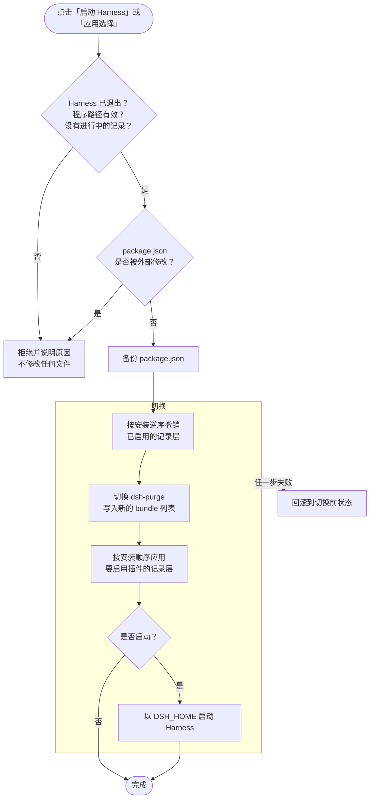
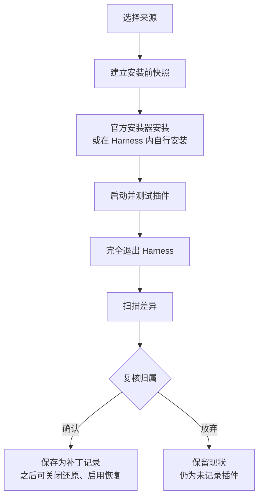

<div align="center">


# Harness Launcher

**为 DeepSeek Harness 打造的本机插件启动器**<br>
按需组合每次启动的插件，发现官方与社区作品，并以可复核的方式记录和还原插件补丁。

[](https://github.com/schrieeeffer/harness-launcher/actions/workflows/ci.yml)
[](LICENSE)


**简体中文** · [English](README.en.md)


</div>

> [!NOTE]
> 本项目由社区独立维护，与 DeepSeek 官方没有隶属关系。当前为**开发预览版**：仅 Windows 桌面版经过验证；macOS / Linux 尚未完成安装路径、进程检测与补丁适配，请不要在这些平台上使用。界面目前只有简体中文。

## 目录

- [为什么需要它](#为什么需要它)
- [功能一览](#功能一览)
- [快速开始](#快速开始)
- [使用指南](#使用指南)
  - [主界面](#主界面)
  - [选择本次启动的插件](#选择本次启动的插件)
  - [快速选择与启动方案](#快速选择与启动方案)
  - [启动、应用与还原原生](#启动应用与还原原生)
  - [发现插件](#发现插件)
  - [排行榜](#排行榜)
  - [插件详情](#插件详情)
  - [手动添加插件（自动记录）](#手动添加插件自动记录)
  - [补丁记录](#补丁记录)
  - [配置备份](#配置备份)
  - [设置与说明](#设置与说明)
  - [启动方案的导入与导出](#启动方案的导入与导出)
  - [窄窗口布局](#窄窗口布局)
- [工作原理](#工作原理)
- [数据与隐私](#数据与隐私)
- [常见问题](#常见问题)
- [卸载](#卸载)
- [开发与贡献](#开发与贡献)
- [许可证与声明](#许可证与声明)

## 为什么需要它

DeepSeek Harness 的插件以 bundle 形式登记在桌面配置 `profiles\desktop\package.json` 中，其中一部分插件还会直接修改应用文件（例如 `resources\app.asar`）或数据目录中的规则、技能和预设。这带来几个实际问题：

- **想换一组插件就得手动改配置**，改错了还可能让 Harness 无法启动。
- **把插件从配置里去掉，并不会撤销它写入的文件**，所谓"关闭"其实只是不再加载。
- **装插件之前没留底，就再也说不清它改了什么**，之后也无法可靠地回到官方原样。

Harness Launcher 用一个本机网页界面解决这些问题：启动前按需勾选插件；切换前自动备份配置；对安装前做过快照的插件，关闭时按记录还原文件，启用时重新应用。对没有记录的插件，它会明确告诉你"不能保证还原"，而不是假装一切正常。

## 功能一览

| 功能 | 说明 |
| --- | --- |
| **启动组合** | 逐项开关已安装插件，一键切到当前配置、原生模式或全部插件；保存为方案，下次一键选用。 |
| **安全切换** | 修改前备份 `package.json`；检测到 Harness 正在运行、配置被外部修改或程序路径无效时拒绝切换；失败自动回滚。 |
| **补丁还原** | dsh-purge 使用内置适配器；其他插件通过安装前后快照记录文件差异，关闭时还原、启用时恢复。 |
| **发现插件** | 浏览 DeepSeek 官方组合包、npm 社区包和带 `dsh-plugin` topic 的 GitHub 仓库，支持搜索、来源筛选、分页和中国大陆镜像。 |
| **排行榜** | 按 npm 近 7 天下载量排名，另有"新晋热门"榜帮助发现新插件。 |
| **手动添加** | 从 npm 包、本地目录、Git 仓库安装，或在 Harness 内自行安装；全程自动记录，复核后保存。 |
| **补丁记录** | 一览哪些插件已记录、哪些用内置适配、哪些未记录，以及各自能否还原；已记录的插件可以升级并重新记录。 |
| **配置备份** | 每次修改前自动备份，可随时恢复，恢复前也会再备份一次。 |
| **方案导入导出** | 以 JSON 文件备份或分享方案，导入前逐项预览。 |
| **零依赖、仅本机** | 只用 Python 标准库和本机浏览器；服务只监听 `127.0.0.1`，每次启动使用随机访问令牌。 |

## 快速开始

### 环境要求

- Windows 10 / 11 上的 **DeepSeek Harness 桌面版**，并且至少运行过一次（数据目录中已经生成 `profiles\desktop\package.json`）。
- **Python 3.12 或更高版本**。也可以直接使用 Harness 自带的 Python：`<Harness 安装目录>\resources\runtime\primary-runtime\dependencies\python\python.exe`。
- Microsoft Edge（可选）。有 Edge 时以独立应用窗口打开，否则使用默认浏览器。

不需要安装任何 pip 或 npm 依赖。

### 安装与启动

1. 克隆仓库，或在 GitHub 页面点击 **Code → Download ZIP** 下载并解压。**请放在 Harness 安装目录以外**，避免 Harness 更新时被覆盖。

   ```powershell
   git clone https://github.com/schrieeeffer/harness-launcher.git
   ```

2. 第一次用 Python 启动：

   ```powershell
   cd harness-launcher
   python launcher.py
   ```

   如果系统里没有 Python，把 `python` 换成上面提到的 Harness 自带 `python.exe` 的完整路径。

3. 之后可以直接双击 **`launch.vbs`**，它会隐藏控制台窗口启动。它优先使用 Harness 自带的 `pythonw.exe`（根据已保存的应用路径或 `DSH_EXECUTABLE` 定位），其次使用 `PATH` 中的 `pythonw.exe`。可以为 `launch.vbs` 创建桌面快捷方式。

> [!TIP]
> 重复双击 `launch.vbs` 不会启动第二个服务，而是重新打开已在运行的那一个。关闭所有启动器窗口约 5 分钟后，后台服务会自动退出；如果有快照或安装任务正在进行，会等任务结束后再退出。

### 首次配置

启动器按以下顺序定位 `DeepSeek Harness.exe`：

1. 环境变量 `DSH_EXECUTABLE`；
2. 安装程序在注册表卸载项中登记的位置（只读，自定义安装目录也能找到）；
3. 常见安装目录：`%LOCALAPPDATA%\Programs\DeepSeek Harness`、`%ProgramFiles%\DeepSeek Harness` 等。

数据目录默认为 `%USERPROFILE%\.dsh`，可用环境变量 `DSH_HOME` 指定。

如果找不到程序，主界面顶部会出现红色提示，并禁用启动、补丁切换和安装记录。已在系统中检测到 Harness 时，点击 **使用检测到的路径** 即可；否则点击 **去设置** 手动填写。


### 命令行参数与环境变量

| 参数 / 变量 | 作用 |
| --- | --- |
| `--data <目录>` | 使用指定目录保存启动器的设置、备份和快照（默认 `%LOCALAPPDATA%\HarnessLauncher`），适合隔离测试。 |
| `--no-open` | 只启动本机服务，不自动打开窗口。 |
| `DSH_EXECUTABLE` | `DeepSeek Harness.exe` 的完整路径。 |
| `DSH_HOME` | Harness 数据目录。启动 Harness 时也会把它传给 Harness。 |

## 使用指南

### 主界面

主界面分为三部分：

- **左侧边栏**：快速选择、我的方案，以及插件、记录与恢复、设置等入口。底部显示版本号和项目链接。
- **已安装插件列表**：本机 desktop profile 中所有可识别的插件 bundle。
- **本次启动面板**：汇总这次将加载的插件、待应用的改动，以及启动和应用按钮。

页面右上角的状态标签每 4 秒刷新一次：**Harness 未运行**（绿色）、**Harness 运行中**（琥珀色，此时禁止切换），以及 **菜单服务已断开**（红色，后台服务已退出，重新双击 `launch.vbs` 即可）。

<table>
  <tr>
    <td width="36%" valign="top"></td>
    <td width="64%" valign="top"></td>
  </tr>
  <tr>
    <td align="center"><sub>侧边栏</sub></td>
    <td align="center"><sub>本次启动面板（存在未应用的改动时）</sub></td>
  </tr>
</table>

### 选择本次启动的插件

每个插件卡片右侧的开关决定这次是否加载它。**勾选只改变待选列表，不会立即修改 Harness**，需要点击「启动 Harness」或「应用选择」才会生效。列表上方可以按名称或描述搜索，也可以「全选」或「全部关闭」。

卡片上的标签含义如下：

| 标签 | 含义 |
| --- | --- |
| `v1.2.3` | `package.json` 中的版本号；读不到时显示"版本未知"。 |
| **支持自动还原补丁** | 由内置适配器管理（目前是 dsh-purge），关闭时可以恢复官方文件。 |
| **已自动记录补丁** | 安装时通过「手动添加」做过快照，关闭时按记录还原、启用时恢复。 |
| **未记录安装前状态** | 安装前没有快照。关闭时只停止加载，**不能保证**还原它写入的文件。 |
| **当前已启用** | 当前 `package.json` 中正在加载。 |
| **文件缺失** | 已登记但找不到插件目录或 `package.json`，不能启用。 |

点击「查看路径」可以展开插件所在的目录。列表下方的 **官方基础组件始终保留**：`@deepseek-ai/dsh-base` 和 `@deepseek-ai/dsh-web-app` 不能关闭。

插件列表右侧的提示卡会说明本次切换对补丁的影响，例如哪些插件缺少安装前记录、关闭时是否会切换回官方文件。

### 快速选择与启动方案

侧边栏的 **快速选择** 提供三个预设：

- **当前配置**：恢复成 `package.json` 中当前启用的插件（相当于撤销未应用的勾选）。
- **原生模式（全部关闭）**：不加载任何额外插件，并还原所有可还原的补丁。
- **全部可用插件**：勾选所有文件完整的插件。

**我的方案** 用来保存常用组合。点击「保存为方案」或侧边栏的 **+**，输入名称（1–40 个字符）即可保存当前勾选；同名方案会询问是否覆盖。点击方案名会把它载入待选列表；鼠标悬停时出现的 **×** 用来删除方案。如果方案中有插件已不在本机，载入时会列出这些插件。最多保存 100 个方案。


### 启动、应用与还原原生

本次启动面板有三个按钮：

- **启动 Harness**：应用当前勾选，然后启动 Harness。
- **应用选择**：只应用，不启动。如果没有勾选任何额外插件，按钮会变为 **还原为原生**。
- **保存为方案**：把当前勾选保存为方案，不修改 Harness。

应用时，启动器会：

1. 确认 Harness（包括托盘）已经完全退出、程序路径有效，并且没有进行中的安装记录。**不会强制结束正在运行的会话。**
2. 确认 `package.json` 自读取后没有被 Harness 或其他程序修改过，否则请你刷新后重试，不会覆盖外部改动。
3. 备份 `package.json`。
4. 计算新的 bundle 列表：官方组件始终保留，已有插件沿用原来的加载顺序，新启用的插件追加到末尾；`package.json` 中的其他字段原样保留。
5. 切换补丁层：先按与安装相反的顺序撤销所有已启用的记录层，再由内置适配器切换 dsh-purge 并写入新的 `package.json`，最后按安装顺序重新应用要启用的插件。
6. 如果选择了启动，用 `DSH_HOME` 指向当前数据目录启动 Harness。任一步骤失败都会回滚到切换前的状态。

面板中的状态行会提示当前情况：**与当前配置一致**、**待应用 · 同步插件与补丁**、**切换前请完全退出 Harness**、**未找到 Harness 程序**，或 **正在校验与切换补丁…**。

> [!IMPORTANT]
> 「还原为原生」遇到没有安装前记录、又可能改过文件的插件时，会拒绝宣称已经完整恢复官方状态。关闭插件不会卸载它，已安装的依赖、账号、会话和普通偏好都会保留。

### 发现插件

点击侧边栏或插件列表中的 **发现插件** 打开插件目录。目录分为「浏览与搜索」和「排行榜」两个分页。


**来源筛选**：

- **官方**：默认列出四个 DeepSeek 实验性组合包（智能体团队、自动授权审查、自动化任务、语音输入）；输入包名可以查询 `@deepseek-ai` 下的其他官方组件。随 Harness 提供的官方功能，建议优先在 Harness 的官方插件页启用，避免重复安装。
- **社区 npm**：带 `dsh-plugin` 或 `deepseek-harness` 关键词的 npm 包。输入包含 `dsh` 或 `harness` 的完整包名时，没有打关键词的包也能搜到。
- **GitHub**：带 `dsh-plugin` topic、未归档的仓库，按 star 排序。适合寻找**没有发布到 npm** 的插件，安装时直接使用仓库地址。

**其他说明**：

- **npm 数据源** 可以切换为中国大陆镜像。这个选项只影响目录查询，安装仍沿用 Harness 包管理器自己的 registry 配置。
- 每页 18 项，点击「加载更多」继续翻页（最多 20 页）。
- 某个来源请求失败时，其他来源的结果照常显示，并提示哪个来源失败；可以点击「重试搜索」。
- 结果缓存 5 分钟。缓存过期后如果无法联网，会显示上次的结果并标记为离线缓存，但离线缓存中的详情不能直接选用安装。
- 卡片上会标出本机已安装的插件及其版本。

> [!WARNING]
> 插件目录不是官方市场，也没有人工安全审核。npm 搜索依赖作者自己填写的关键词，GitHub 搜索依赖作者自己添加的 topic。安装社区插件会运行第三方代码，"声明了组合包结构"不等于安全或兼容。

### 排行榜

「排行榜」分页提供两个榜单，各显示前 50 名：

- **下载量 · 近 7 天**：按 npm 官方统计的近 7 天下载量排名，30 天累计只作参考。30 天累计很容易被一次性的批量下载抬高，实测有的包 30 天下载 4 万多次，近 7 天却只有几十次。
- **新晋热门**：近 30 天的下载有一半以上发生在最近 7 天，并且周下载不少于 200 次的插件，多为新发布或突然走红的插件。下载量榜天然偏向老插件，这个榜能让新插件被看到。

每一行显示排名、包名、描述、版本、最近发布日期和下载数字；本机已安装的插件会标出"已安装"。点击「查看详情」进入和浏览分页相同的详情与安装流程。

<table>
  <tr>
    <td width="50%"></td>
    <td width="50%"></td>
  </tr>
  <tr>
    <td align="center"><sub>下载量 · 近 7 天</sub></td>
    <td align="center"><sub>新晋热门</sub></td>
  </tr>
</table>

<details>
<summary><b>统计口径与限制</b></summary>

- npm 搜索不支持按下载量排序，而生态中带 `dsh-plugin` / `deepseek-harness` 关键词的包有数千个。排行榜扫描 npm 搜索返回的前 1000 个包（4 次请求），在其中排名。靠前的名次基本可靠，靠后的名次可能漏掉扫描范围之外的包。界面上会显示扫描数量和生态总数。
- 下载量固定来自 `registry.npmjs.org`。中国大陆镜像只提供镜像自身的累计下载量，口径不同，不用于排名；无法访问 npm 官方源时排行榜不可用，并提供"重新加载"按钮。
- 两个榜单共用同一次扫描，数据缓存 1 小时（npm 下载统计本身按天更新）。界面会显示数据获取时间。
- 下载量包含自动化构建和镜像同步产生的下载，也可能被刷量。**排名只反映热度，不代表安全审核或兼容性。**
- 不提供 GitHub star 榜：带 `dsh-plugin` topic 的仓库中，按 star 排名靠前的大多不是插件；npm 包的 repository 字段由作者自填，star 常常属于宿主项目，或被指向知名仓库借用，不登录 GitHub 就无法逐个核实。

</details>

### 插件详情

在目录或排行榜中点击「查看详情」，启动器会读取包的元数据：

- **来源**：npm 社区、`@deepseek-ai` 官方作用域，或 GitHub 社区仓库。
- **许可证**、**安装结构**（是否声明了 `dsh.bundle.patch`）和 **版本要求**（`peerDependencies` 中的 `@deepseek-ai/*`）。
- **链接**：npm 页面、源代码和项目主页。只显示 `http` / `https` 链接，带账号密码的链接会被移除。


点击 **选用并准备安装**，启动器会打开「手动添加」并预填包名和来源，**不会立即安装**。以下情况不能直接选用：

- 普通组件库，即没有声明 `dsh.bundle.patch` 的包，不能作为独立插件安装；
- 本机已安装、但没有安装前记录的插件（无法补回已经发生的改动）；
- 由内置适配管理的插件（升级前需要重新校验）；
- 已有进行中的安装记录任务；
- 离线缓存中的详情（需要联网核实后再安装）。

npm 详情会锁定查询到的版本（例如 `@demo/dsh-desk-pet@0.3.7`）。GitHub 详情读取仓库根目录的 `package.json`，安装来源为 `git+https://github.com/<作者>/<仓库>.git`。这个地址**不锁定 commit**，建议按项目说明在末尾加上 `#<tag>`；仓库根目录没有 `package.json` 时，请查看项目说明后手动添加。已经记录过的插件，按钮会变为 **准备升级并重新记录**。

### 手动添加插件（自动记录）

「手动添加」是安装新插件的入口，也是升级已记录插件的入口。安装期间全程自动记录：安装前建立快照，安装并首次测试后扫描差异，由你复核后保存。保存之后，这个插件就能随时关闭还原、启用恢复。

**第 1 步：选择来源**


| 来源 | 填写内容 | 说明 |
| --- | --- | --- |
| **npm 包** | 包名，加上可选的版本或标签 | 拼成 `包名@版本` 交给 Harness 官方安装器；不填版本时安装最新版。 |
| **本地目录** | 插件目录的完整路径 | 目录中需要有 `package.json`，适合开发中或已下载的插件。 |
| **Git 仓库** | 例如 `git+https://github.com/作者/仓库.git#v1.0.0` | 建议在 `#` 后填写固定的 tag 或 commit。 |
| **自行安装** | 只填包名 | 快照完成后，你在 Harness 内自己安装或升级这个插件。 |

插件包名必须与安装结果中的包名一致，否则安装后会提示找不到。安装地址中不能包含账号密码，请使用已配置的包管理器认证。

**第 2–3 步：建立快照、安装与测试**

点击 **建立快照并开始** 后，启动器先为记录范围内的文件建立快照（首次需要复制较多文件，可能较慢，之后会复用没有变化的内容），然后调用官方安装器安装；选择「自行安装」时则等待你操作。


进入"记录安装与首次测试"阶段后：

- **启动并测试插件**：把这个插件加入 bundle 列表（会先备份配置）并启动 Harness。你可以在 Harness 中试用它，并应用它自己的设置。
- 测试完成后**完全退出 Harness（包括托盘）**，再点击 **已退出，扫描差异**。
- **放弃记录，保留现状**：结束记录，但已经安装的内容和文件改动会原样保留，这个插件仍然算作"未记录"。

记录进行期间，主界面顶部会显示进度横幅，侧边栏的「手动添加」旁也会出现圆点；这时启动和应用按钮会暂时禁用。关闭窗口不会取消正在执行的官方安装器。


**第 4 步：复核变更**

扫描完成后，列表展示记录窗口内的全部文件差异（最多显示 200 项，**导出完整变更清单** 可导出全部 JSON）。确认这些改动确实来自这个插件后，点击 **确认归属并保存记录**。


清单中每一项的格式为 `范围名|相对路径`，`|.` 表示范围本身。例如 `rules|desk-pet.md` 表示数据目录中的 `rules\desk-pet.md`，`archive|.` 表示 `resources\app.asar` 这个文件本身。

| 范围名 | 实际位置 |
| --- | --- |
| `app` / `archive` / `archive_backup` / `unpacked` | 安装目录下的 `resources\app`、`resources\app.asar`、`resources\app.asar.bak`、`resources\app.asar.unpacked` |
| `cli` | `resources\runtime\cli` |
| `agents` / `claude` / `prompt` | 数据目录中的 `AGENTS.md`、`CLAUDE.md`、`prompt-inject.md` |
| `rules` / `skills` / `presets` | 数据目录中的 `rules`、`skills`、`.agent-presets` |
| `user_yaml` / `root_yaml` | `profiles\desktop` 中的 `cordis.patch.yml`、`cordis.yml` |

> [!IMPORTANT]
> 记录的是**时间窗口内**的文件差异，并不能证明这些改动是插件进程写入的。记录期间请只安装、测试这一个插件，不要同时编辑其他文件。已经安装、但没有安装前记录的插件，无法补回过去的改动。

**升级已记录的插件**：在「补丁记录」中点击 **升级 / 重新记录**，或在插件详情中点击 **准备升级并重新记录**。开始时，启动器会先撤销旧版本的补丁，再建立新的基线；新的记录确认后才会替换当前记录，旧版本的记录保留为历史。如果新版不再写入某些旧文件，这些文件不会沿用。

### 补丁记录

「补丁记录」是一份台账，按还原能力把本机插件分成三组：

- **已记录**：显示版本、差异数量、补丁是否启用、记录时的基础组合和历史数量，可以升级并重新记录。
- **内置适配**：dsh-purge 使用启动器自带的专用适配器还原。关闭时使用保留的官方归档并暂存注入文件，启用时恢复同版本的补丁快照；版本升级后需要重新校验。
- **未记录**：安装时没有建立快照的插件。关闭时只停止加载，不能保证还原已写入的文件。

展开底部的 **记录范围与限制** 可以查看本机实际监控的目录。如果正在记录某个插件，顶部会显示进度和「继续」按钮。


### 配置备份

每次修改 `package.json` 之前，启动器都会自动备份，并注明原因，例如"启动前切换""保存插件选择""恢复备份前"。在「配置备份」中可以恢复任意一份：

- 恢复前会先备份当前配置，因此恢复本身也可以撤销。
- 恢复时会同步已适配插件的补丁状态，但**不会回退插件版本**。
- Harness 运行中、程序路径无效或有安装记录进行中时，不能恢复。
- **打开备份目录** 会在资源管理器中打开备份所在位置。


### 设置与说明


- **路径**：Harness 应用路径与数据目录。点击 **自动检测** 会读取安装程序在注册表中登记的位置。保存时会检查程序文件名是否为 `DeepSeek Harness.exe`，以及数据目录中是否有 `profiles\desktop\package.json`。**更换数据目录会清空方案列表**，如需保留，请先导出方案。
- **方案与文件**：导出 / 导入方案，以及打开启动器程序目录。
- **如何使用**：界面内的简要说明。

### 启动方案的导入与导出

在「设置与说明 → 方案与文件」中操作。导出文件是 UTF-8 编码的 JSON，可以备份、放进版本库，或分享给他人：

```json
{
  "format": "harness-launcher-schemes-v1",
  "schemes": {
    "日常写作": ["dsh-purge", "@demo/dsh-memory-lite"],
    "开发工具": ["@demo/dsh-git-tools", "@demo/dsh-web-search"],
    "原生": []
  }
}
```

- `schemes` 的键是方案名称（1–40 个字符），值是要加载的额外插件包名；空数组表示只加载官方基础组件。官方组件不需要写入。
- 文件不超过 64 KB，单个文件最多 100 个方案，导入后总数也不能超过 100 个。
- 导入前会逐项预览：**新增**、**覆盖**（与现有方案同名）或**跳过**。含本机未安装或文件缺失插件的方案会被跳过，并列出缺少的插件；装好这些插件后，再导入一次同一个文件即可。
- 导入只更新启动器的方案列表，不修改 Harness 配置，也不会安装插件。
- 方案保存在启动器设置中（默认 `%LOCALAPPDATA%\HarnessLauncher\settings.json`）。


### 窄窗口布局

窗口宽度小于 1120 px 时，本次启动面板会收成底部操作栏；小于 760 px 时，侧边栏只显示图标。


## 工作原理

### 应用一次选择



### 记录一个插件



### 补丁还原的边界

- **内置 dsh-purge 适配器**适用于已捕获且版本匹配的安装：它保存官方 ASAR，暂存解包后的应用和已识别的规则、预设。dsh-purge 升级后需要重新校验，不会把旧快照套到新版本上。
- **通用记录**只追踪明确范围内的文件变化，**不是进程级的归属审计，也不是整机还原**。注册表、系统服务、驱动和范围以外的路径都不在记录内；之后运行中产生的新补丁需要重新处理。
- 版本变化、记录以外的文件改动、共享文件冲突时，启动器会停止覆盖并报告原因，不会强行合并。
- 应用文件、规则和预设的快照保存在启动器数据目录的 `patches` 中；当前没有启用的文件可能暂存在安装目录的 `resources\.harness-launcher-*` 或数据目录中同名的暂存目录里。**请不要手动删除这些目录。**

更详细的说明见 [补丁记录与还原：技术说明](docs/patch-recording.md)。

## 数据与隐私

### 文件位置

| 位置 | 内容 |
| --- | --- |
| `%LOCALAPPDATA%\HarnessLauncher\settings.json` | 应用路径、数据目录、启动方案和插件顺序。 |
| `%LOCALAPPDATA%\HarnessLauncher\backups\` | `package.json` 的历史备份。 |
| `%LOCALAPPDATA%\HarnessLauncher\patches\` | 补丁快照、安装记录、安装器日志和差异清单。 |
| `%LOCALAPPDATA%\HarnessLauncher\launcher.log` | 警告与错误日志，不包含访问令牌。 |
| `%LOCALAPPDATA%\HarnessLauncher\instance.json` | 当前服务的本机地址（含访问令牌），用于重复启动时复用服务。 |
| `<安装目录>\resources\.harness-launcher-*`<br>`<数据目录>\.harness-launcher-*` | 当前没有启用的官方文件或插件文件的暂存目录。 |

使用 `--data <目录>` 时，前五项会改存到指定目录。快照可能包含你放在规则、技能或配置文件中的私人内容，请妥善保管这些目录。

### 网络访问

| 何时 | 访问 | 发送的内容 |
| --- | --- | --- |
| 浏览、搜索、查看 npm 详情 | `registry.npmjs.org`，或你选择的 `registry.npmmirror.com` | 搜索词、包名 |
| GitHub 来源与详情 | `api.github.com` | 搜索词、仓库名 |
| 排行榜 | `registry.npmjs.org` | 固定的生态关键词 |
| 安装插件 | 由 Harness 官方安装器按其自身 registry 配置访问 | 由安装器决定 |

启动器使用匿名的公开接口，不上传配置文件、会话或凭据，也没有遥测。远程返回的内容一律按纯文本显示。

### 本机服务安全

- 服务只监听 `127.0.0.1`（默认端口 17643，被占用时改用随机端口），每次启动生成随机访问令牌。
- 接口请求会校验 Host、Origin 和访问令牌；页面使用严格的内容安全策略，不加载任何 CDN 资源。
- **不要通过隧道或反向代理把这个端口暴露出去。**

完整说明见 [SECURITY.md](SECURITY.md)。

## 常见问题

<details>
<summary><b>「启动 Harness」按钮是灰色的？</b></summary>

把鼠标悬停在按钮上可以看到原因。常见情况：

- **找不到 Harness 程序**：主界面顶部会有红色提示，按提示修正路径即可。
- **Harness 正在运行**：包括只剩托盘图标的情况，请先完全退出。
- **有安装记录正在进行**：先完成或放弃记录。
- **正在切换**：等待当前操作完成。

</details>

<details>
<summary><b>为什么必须先退出 Harness 才能切换？</b></summary>

Harness 运行时会读取配置和应用文件，这时修改可能被覆盖，或者导致状态不一致。启动器只检查进程状态，不会强制结束你的会话。

</details>

<details>
<summary><b>关闭插件会卸载它吗？</b></summary>

不会。关闭只是把它从 bundle 列表中移除，并撤销已记录的补丁；插件文件和依赖仍然保留在 `node_modules` 中，下次可以直接重新启用。

</details>

<details>
<summary><b>插件已经装好了，但显示"未记录安装前状态"，怎么办？</b></summary>

启动器无法补回已经发生的改动，所以不能保证还原这个插件。它仍然可以正常启用和关闭，只是关闭时不会还原它写入的文件。今后安装新插件时，请通过「手动添加」或「发现插件」进行，这样会自动记录。

</details>

<details>
<summary><b>Harness 本体升级后需要做什么？</b></summary>

Harness 升级会替换官方文件。启动器检测到版本或文件变化后，会停止自动覆盖并说明原因，不会把旧快照套到新版本上。请在新版本上重新应用插件，必要时通过「升级 / 重新记录」建立新的记录。

</details>

<details>
<summary><b>选择了中国大陆镜像，为什么排行榜还要连接 npm 官方源？</b></summary>

镜像只提供镜像自身的累计下载量，和 npm 官方的近 7 天 / 30 天统计口径不同，混用会让排名失真。所以排行榜固定使用 npm 官方数据；镜像选项只影响浏览和搜索。

</details>

<details>
<summary><b>为什么没有 GitHub star 排行榜？</b></summary>

见 [排行榜 → 统计口径与限制](#排行榜)。简单来说，按 star 排名靠前的大多不是插件，而插件的 star 也常常属于它所在的宿主项目。GitHub 分页仍然保留，用来寻找没有发布到 npm 的插件。

</details>

<details>
<summary><b>安装社区插件安全吗？</b></summary>

安装会运行插件自己的代码。启动器会检查包结构，记录文件变化，并在复核时把清单交给你确认，但它**不是安全审核，也不是沙箱**。请只安装你信任的插件，并先查看它的源代码和说明。

</details>

<details>
<summary><b>关闭窗口后，后台服务还在运行吗？</b></summary>

关闭所有窗口约 5 分钟后，服务会自动退出；如果有快照或安装任务正在进行，会等任务结束再退出。再次双击 `launch.vbs` 时，如果服务还在运行，会直接复用。

</details>

<details>
<summary><b>支持 macOS 或 Linux 吗？</b></summary>

暂不支持。这两个平台上还没有完成安装路径、进程检测和补丁适配，例如无法检测 Harness 是否正在运行，因此请不要在这些平台上使用。

</details>

## 卸载

1. 打开启动器，选择你希望最终保留的状态（例如原生模式，或常用的插件组合），然后点击「应用选择」。
2. 删除启动器所在的文件夹和桌面快捷方式。**删除启动器本身不会回滚任何 Harness 文件。**
3. `%LOCALAPPDATA%\HarnessLauncher` 中保存着设置、备份和补丁快照；`resources\.harness-launcher-*` 和数据目录中的 `.harness-launcher-*` 保存着当前没有启用的版本。删除这些目录后，就再也不能切换回那些版本了，请确认不再需要后再删除。

## 开发与贡献

```powershell
python -m unittest discover -v   # Python 3.12+
node --check ui/app.js           # Node.js 22+，仅用于语法检查
```

- 测试使用临时 profile、合成的 ASAR 和模拟的远程响应，**不会**安装真实插件，也不会修改真实的 Harness 配置。
- CI 在 Windows 上运行 Python 3.12 / 3.13。
- 网络服务状态、未来的 Harness 或插件版本，以及特定机器环境仍可能出问题，欢迎提交带复现步骤的 issue。

| 路径 | 说明 |
| --- | --- |
| `launcher.py` | 本机 HTTP 服务、配置读写、切换与回滚、程序路径检测。 |
| `patch_modes.py` | dsh-purge 内置适配器与官方归档校验。 |
| `plugin_tracking.py` | 通用安装记录：快照、差异、复核、重放与恢复。 |
| `catalog.py` | 插件目录：npm / GitHub 搜索、详情与排行榜（只访问固定的公开接口）。 |
| `ui/` | 界面：`index.html`、`style.css`、`app.js`，无需构建。 |
| `launch.vbs`、`bootstrap.ps1` | 隐藏控制台启动。 |
| `docs/` | 技术说明与截图。 |

贡献前请阅读 [CONTRIBUTING.md](CONTRIBUTING.md)。安全问题请按 [SECURITY.md](SECURITY.md) 私下报告。版本变化见 [CHANGELOG.md](CHANGELOG.md)。

## 许可证与声明

本项目以 [MIT](LICENSE) 许可证发布。

本仓库不包含 Harness 程序、官方源码拷贝、dsh-purge 源码、用户配置或补丁内容。DeepSeek Harness 和第三方插件的名称及其自身的许可证归各自项目所有。文档截图使用的都是合成的示例数据，其中的插件名称和数字均为虚构。
