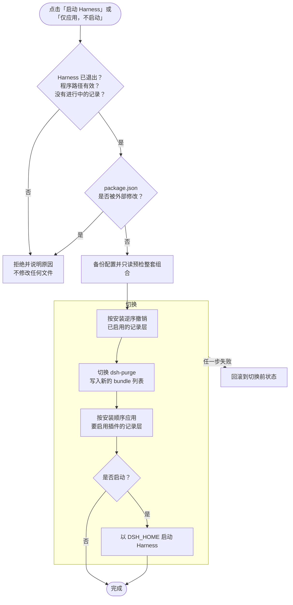
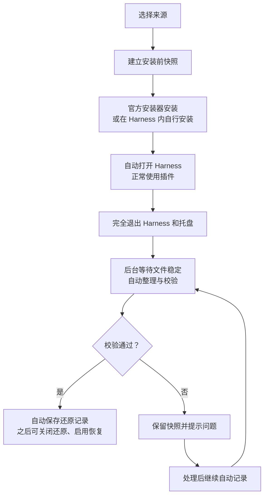

<div align="center">


# Harness Launcher

**为 DeepSeek Harness 打造的本机插件启动器**<br>
按需组合每次启动的插件，发现官方与社区作品，自动记录和校验安装改动，用于还原插件文件。

[](https://github.com/schrieeeffer/harness-launcher/actions/workflows/ci.yml)
[](LICENSE)


**简体中文** · [English](README.en.md)


</div>

> [!NOTE]
> 本项目由社区独立维护，与 DeepSeek 官方没有隶属关系。当前为**开发预览版**：仅 Windows 桌面版经过验证；macOS / Linux 尚未完成安装路径、进程检测与补丁适配，请不要在这些平台上使用。界面目前只有简体中文。

## 下载即用（Windows x64）

从 [0.4.0 Release](https://github.com/schrieeeffer/harness-launcher/releases/tag/v0.4.0) 下载 **Harness-Launcher-0.4.0-Windows-x64.zip**，完整解压后双击 **Harness Launcher.exe**。自带 Python，无需安装开发环境或输入命令。请先安装并打开一次 DeepSeek Harness 官方桌面版；本包不包含官方应用。

已有用户先退出旧启动器后台，再解压新版到新文件夹。格式 3 数据继续使用；旧格式 2 仍需按下文迁移。保留 `.harness-launcher` 数据目录，里面有回滚材料。

0.4.0 新增**统一更新检查、可恢复升级、可预览卸载、无引用缓存清理**，支持普通插件和 purge 的独立处理。见[维护指南](docs/plugin-maintenance.md)、[新功能截图](docs/feature-tour-0.4.0.md)、[测试与窗口实测](docs/validation-0.4.0.md)、[架构与校验原理图](docs/architecture.md)。升级下载与首次完整检查可能更慢；日常目标为本机约 30 秒，不是跨机器的硬上限。

## 目录

- [新版完整功能演示与验证截图](docs/feature-tour.md)
- [0.3.1 启动进度、按钮说明与性能验证](docs/launch-progress.md)
- [0.3.2 切换插件时的校验优化](docs/switch-performance.md)
- [0.3.2 实测与“约 30 秒”目标的适用范围](docs/validation-0.3.2.md)
- [0.3.2 全功能截图与说明](docs/feature-tour-0.3.2.md)
- [官方更新后如何处理补丁与冲突](docs/host-updates.md)
- [为什么需要它](#为什么需要它)
- [功能一览](#功能一览)
- [快速开始](#快速开始)
- [使用指南](#使用指南)
  - [主界面](#主界面)
  - [选择本次启动的插件](#选择本次启动的插件)
  - [快速选择与启动方案](#快速选择与启动方案)
  - [启动、应用与还原原生](#启动应用与还原原生)
  - [发现插件](#发现插件)
  - [排行榜](#排行榜)
  - [插件详情](#插件详情)
  - [手动添加插件（自动记录）](#手动添加插件自动记录)
  - [补丁记录](#补丁记录)
  - [配置备份](#配置备份)
  - [设置与说明](#设置与说明)
  - [启动方案的导入与导出](#启动方案的导入与导出)
  - [窄窗口布局](#窄窗口布局)
- [工作原理](#工作原理)
- [数据与隐私](#数据与隐私)
- [常见问题](#常见问题)
- [卸载](#卸载)
- [开发与贡献](#开发与贡献)
- [许可证与声明](#许可证与声明)

## 为什么需要它

DeepSeek Harness 的插件以 bundle 形式登记在桌面配置 `profiles\desktop\package.json` 中，其中一部分插件还会直接修改应用文件（例如 `resources\app.asar`）或数据目录中的规则、技能和预设。这带来几个实际问题：

- **想换一组插件就得手动改配置**，改错了还可能让 Harness 无法启动。
- **把插件从配置里去掉，并不会撤销它写入的文件**，所谓"关闭"其实只是不再加载。
- **装插件之前没留底，就再也说不清它改了什么**，之后也无法可靠地回到官方原样。

Harness Launcher 用一个本机网页界面解决这些问题：启动前按需勾选插件；切换前自动备份配置；对安装前做过快照的插件，关闭时按记录还原文件，启用时重新应用。对没有记录的插件，它会明确告诉你"不能保证还原"，而不是假装一切正常。

## 功能一览

| 功能 | 说明 |
| --- | --- |
| **启动组合** | 逐项开关已安装插件，一键切到当前配置、原生模式或全部插件；保存为方案，下次一键选用。 |
| **安全切换** | 修改前备份配置并预检整套文件变化；核验原生基线、版本、依赖和冲突；统一事务支持失败及中断恢复。 |
| **版本与组合** | 留存已安装插件与依赖、不可变版本及组合清单，按内容去重；日常只读取新版格式，旧数据通过独立工具一次性迁移。 |
| **补丁还原** | dsh-purge 使用内置适配器；其他插件通过安装前后快照记录文件差异，关闭时还原、启用时恢复。 |
| **发现插件** | 浏览 DeepSeek 官方组合包、npm 社区包和带 `dsh-plugin` topic 的 GitHub 仓库，支持搜索、来源筛选、分页和中国大陆镜像。 |
| **排行榜** | 按 npm 近 7 天下载量排名，另有"新晋热门"榜帮助发现新插件。 |
| **手动添加** | 从 npm 包、本地目录、Git 仓库安装，或在 Harness 内自行安装；强制记录，正常使用并退出后自动校验保存。 |
| **补丁记录** | 一览哪些插件已记录、哪些用内置适配、哪些未记录，以及各自能否还原；已记录的插件可以升级并重新记录。 |
| **配置备份** | 每次修改前自动备份，可随时恢复，恢复前也会再备份一次。 |
| **方案导入导出** | 以 JSON 文件备份或分享方案，导入前逐项预览。 |
| **零依赖、仅本机** | 只用 Python 标准库和本机浏览器；服务只监听 `127.0.0.1`，每次启动使用随机访问令牌。 |

## 快速开始

更新前请阅读[官方与插件更新处理](docs/host-updates.md)：官方更新前先恢复原生；普通插件从“升级 / 重新记录”开始；purge 需要专用适配。启动器不能拦截 Harness 内的更新器或自动重启，会在后续操作中检测宿主、插件及依赖变化并保留恢复记录。新安装会话要求支持更新保护的启动器；旧版未完成会话应先在原版本中完成或恢复。

### 升级到 0.3.0

0.3.0 将设置、插件登记表、适配状态、切换日志和配置备份统一为格式 3，运行时只读取新格式。升级已有完整 v2 记录时，先在旧版完成未结束的安装及恢复，然后完全退出 Harness 和启动器后台服务，在项目目录运行：

```powershell
python migrate.py
python migrate.py --apply
```

第一条在独立暂存目录预检，退出时清理该临时目录。第二条重新转换并核验对象、文件副本和组合后切换目录。插件实际版本、启用选择和 Harness 应用文件保持原状；完整旧数据目录改名为同级的 `<数据目录>.archive-<时间>-<编号>`，附带校验清单，仅用于离线恢复。新版运行时不会读取归档；缺失或损坏的历史、未完成记录及未知文件变化会阻止迁移。

默认数据目录仍为 `%USERPROFILE%\.harness-launcher`。自定义目录使用 `python migrate.py --data <数据目录> --apply`；不再自动搜寻或合并旧 AppData。若目录切换中断并留下同级的 `.upgrade.json`，先运行 `python migrate.py --recover`（自定义目录加 `--data`）。更早的格式及旧导入中断应先在对应旧版完成处理。

新安装无需迁移。未来增加功能会尽量采用兼容的可选字段与明确的能力声明；必要语义变化仍可能需要离线迁移，不能保证永不迁移。实现边界及数据演进规则见 [架构说明](docs/architecture.md)。

### 环境要求

- Windows 10 / 11 上的 **DeepSeek Harness 桌面版**，并且至少运行过一次（数据目录中已经生成 `profiles\desktop\package.json`）。
- **Python 3.12 或更高版本**。也可以直接使用 Harness 自带的 Python：`<Harness 安装目录>\resources\runtime\primary-runtime\dependencies\python\python.exe`。
- Microsoft Edge（可选）。有 Edge 时以独立应用窗口打开，否则使用默认浏览器。

不需要安装任何 pip 或 npm 依赖。

### 安装与启动

1. 克隆仓库，或在 GitHub 页面点击 **Code → Download ZIP** 下载并解压。**请放在 Harness 安装目录以外**，避免 Harness 更新时被覆盖。

   ```powershell
   git clone https://github.com/schrieeeffer/harness-launcher.git
   ```

2. 第一次用 Python 启动：

   ```powershell
   cd harness-launcher
   python launcher.py
   ```

   如果系统里没有 Python，把 `python` 换成上面提到的 Harness 自带 `python.exe` 的完整路径。

3. 之后可以直接双击 **`launch.vbs`**，它会隐藏控制台窗口启动。它优先使用 Harness 自带的 `pythonw.exe`（根据已保存的应用路径或 `DSH_EXECUTABLE` 定位），其次使用 `PATH` 中的 `pythonw.exe`。可以为 `launch.vbs` 创建桌面快捷方式。

> [!TIP]
> 重复双击 `launch.vbs` 会复用已有服务。关闭菜单后，后台仍会运行并完成安装和首次运行记录；网页挂起或电脑休眠不会触发自动退出。需要彻底退出时，使用「设置与说明 → 退出启动器后台」。正在安装、记录或切换时会阻止退出，异常记录会保留。

### 首次配置

启动器按以下顺序定位 `DeepSeek Harness.exe`：

1. 环境变量 `DSH_EXECUTABLE`；
2. 安装程序在注册表卸载项中登记的位置（只读，自定义安装目录也能找到）；
3. 常见安装目录：`%LOCALAPPDATA%\Programs\DeepSeek Harness`、`%ProgramFiles%\DeepSeek Harness` 等。

数据目录默认为 `%USERPROFILE%\.dsh`，可用环境变量 `DSH_HOME` 指定。

如果找不到程序，主界面顶部会出现红色提示，并禁用启动、补丁切换和安装记录。已在系统中检测到 Harness 时，点击 **使用检测到的路径** 即可；否则点击 **去设置** 手动填写。


### 命令行参数与环境变量

| 参数 / 变量 | 作用 |
| --- | --- |
| `--data <目录>` | 使用指定目录保存启动器的设置、备份和快照（默认 `%USERPROFILE%\.harness-launcher`），适合隔离测试。 |
| `--no-open` | 只启动本机服务，不自动打开窗口。 |
| `DSH_EXECUTABLE` | `DeepSeek Harness.exe` 的完整路径。 |
| `DSH_HOME` | Harness 数据目录。启动 Harness 时也会把它传给 Harness。 |

## 使用指南

### 主界面

主界面分为三部分：

- **左侧边栏**：快速选择、我的方案，以及插件、记录与恢复、设置等入口。底部显示版本号和项目链接。
- **已安装插件列表**：本机 desktop profile 中所有可识别的插件 bundle。
- **本次启动面板**：汇总这次将加载的插件、待应用的改动，以及启动和应用按钮。

页面右上角约每 4 秒检查状态，回到页面时会立即检查：**Harness 未运行**（绿色）、**Harness 运行中**（琥珀色，此时禁止切换）。如果无法连接后台，会出现红色提示和 **重新连接** 按钮；仍无法连接时，请重新双击桌面快捷方式或 `launch.vbs`，使用新打开的菜单。后台重启后，旧页面的凭据会失效，需要使用新窗口。

断线期间勾选不会自动应用，也不会重新启用启动按钮。恢复连接后会重新读取实际配置并保留本页勾选，不会自动重试启动或切换请求。配置或记录读取错误会单独显示具体原因，不再一律提示后台断开。


<table>
  <tr>
    <td width="36%" valign="top"></td>
    <td width="64%" valign="top"></td>
  </tr>
  <tr>
    <td align="center"><sub>侧边栏</sub></td>
    <td align="center"><sub>本次启动面板（存在未应用的改动时）</sub></td>
  </tr>
</table>

### 选择本次启动的插件

每个插件卡片右侧的开关决定这次是否加载它。**开关只调整待选组合，不会立即修改 Harness**；直接点击「启动 Harness」就会自动应用。若只想提前同步配置与补丁，点击「仅应用，不启动」。列表上方可以按名称或描述搜索，也可以「全选」或「全部关闭」。

卡片上的标签含义如下：

| 标签 | 含义 |
| --- | --- |
| `v1.2.3` | `package.json` 中的版本号；读不到时显示"版本未知"。 |
| **支持自动还原补丁** | 由内置适配器管理（目前是 dsh-purge），关闭时可以恢复官方文件。 |
| **已自动记录补丁** | 安装时通过「手动添加」做过快照，关闭时按记录还原、启用时恢复。 |
| **未记录安装前状态** | 安装前没有快照，组合切换会被阻止。需先恢复干净的安装，再通过启动器安装并记录，不能补猜历史改动。 |
| **当前已启用** | 当前 `package.json` 中正在加载。 |
| **文件缺失** | 已登记但找不到插件目录或 `package.json`，不能启用。 |

点击「查看路径」可以展开插件所在的目录。列表下方的 **官方基础组件始终保留**：`@deepseek-ai/dsh-base` 和 `@deepseek-ai/dsh-web-app` 不能关闭。

插件列表右侧的提示卡会说明本次切换对补丁的影响，例如哪些插件缺少安装前记录、关闭时是否会切换回官方文件。

### 快速选择与启动方案

侧边栏的 **快速选择** 提供三个预设：

- **当前配置**：恢复成 `package.json` 中当前启用的插件（相当于撤销未应用的勾选）。
- **原生模式（全部关闭）**：不加载任何额外插件，并还原所有可还原的补丁。
- **全部可用插件**：勾选所有文件完整的插件。

**我的方案** 用来保存常用组合。点击「保存为方案」或侧边栏的 **+**，输入名称（1–40 个字符）即可保存当前勾选；同名方案会询问是否覆盖。点击方案名会把它载入待选列表；鼠标悬停时出现的 **×** 用来删除方案。如果方案中有插件已不在本机，载入时会列出这些插件。最多保存 100 个方案。

新保存的方案还会记住当前插件与 Harness 版本；版本变化后请检查并重新保存，避免旧方案悄悄加载新版插件。导入便携方案时会绑定本机当前版本；旧方案通过迁移工具统一转换。


### 启动、应用与还原原生

本次启动面板有三个按钮：

- **启动 Harness**：应用当前勾选，然后启动 Harness。
- **仅应用，不启动**：提前同步配置与补丁。如果没有勾选任何额外插件，按钮会变为 **仅还原，不启动**。正常启动无需先点此按钮。
- **保存为方案**：把当前勾选保存为方案，不修改 Harness。

启动时，如果选择与已保存的组合完全一致，启动器会重新校验当前文件、插件依赖和宿主版本，然后直接启动，省去重复撤销、重放与备份。内容真实变化仍会被拦截。

0.3.2 排除未使用的暂存补丁树，并为没有文件差异的插件使用仅修改加载配置的事务。本机 NTFS 上使用文件身份缓存和连续 USN 日志保护的目录检查点，未变化的 purge 目录搬移可复用已验证索引；首次、内部文件变化或日志不可用时完整校验。缓存清理同一文件的旧记录并限制总条数，实际重放和回滚需要的副本仍逐一核验。请求锁在发送响应前释放。详见[测量与适用范围](docs/switch-performance.md)。

**0.3.2 已完成本机约 30 秒目标的验证。** 完整回归为 Windows CI 的 Python 3.12、3.13 各 331 项全部通过，JavaScript 各 32 项通过。重启启动器后的 8 个场景中，完整界面在 15.115–35.318 秒时确认可见，随后菜单交互均通过；观察值是上界，不保证严格 30 秒。历史失败样本继续保留在[验证记录](docs/validation-0.3.2.md)。官方更新时会提前识别宿主变化、停止套用旧补丁并保留恢复记录，详见[更新与冲突处理](docs/host-updates.md)。

需要切换文件组合时，启动器会：

1. 确认 Harness（包括托盘）已经完全退出、程序路径有效，并且没有进行中的安装记录。**不会强制结束正在运行的会话。**
2. 确认 `package.json` 自读取后没有被 Harness 或其他程序修改过，否则请你刷新后重试，不会覆盖外部改动。
3. 先检查已记录的宿主程序与归档身份；若变化则停止并提示可能发生更新。检查通过后备份 `package.json`。
4. 计算新的 bundle 列表：官方组件始终保留，已有插件沿用原来的加载顺序，新启用的插件追加到末尾；`package.json` 中的其他字段原样保留。
5. 先在只读视图中推演整套切换，确认双向副本、原生基线、插件依赖与目标文件没有冲突，再重新核验输入。通过后用统一事务撤销当前层、切换内置层及配置、应用目标层，并核验最终结果；预检失败不改实际文件。
6. 如果选择了启动，再次检查宿主身份，用 `DSH_HOME` 指向当前数据目录启动 Harness。事务失败时尝试回滚；若宿主已跨版本变化或恢复条件不再成立，停止覆盖并保留日志与恢复对象。

面板中的状态行会提示当前情况：**与当前配置一致**、**待应用 · 点击启动会自动应用**、**切换前请完全退出 Harness**、**未找到 Harness 程序**，或正在执行的操作。启动和应用期间还会显示蓝紫渐变进度条、实际阶段、文件或改动计数及已用时间。阶段没有可计数的工作时显示等待动画；进度条不估算剩余时间。见[截图与测量说明](docs/launch-progress.md)。

> [!IMPORTANT]
> 「还原为原生」遇到没有安装前记录、又可能改过文件的插件时，会拒绝宣称已经完整恢复官方状态。关闭插件不会卸载它，已安装的依赖、账号、会话和普通偏好都会保留。

### 发现插件

点击侧边栏或插件列表中的 **发现插件** 打开插件目录。目录分为「浏览与搜索」和「排行榜」两个分页。


**来源筛选**：

- **官方**：默认列出四个 DeepSeek 实验性组合包（智能体团队、自动授权审查、自动化任务、语音输入）；输入包名可以查询 `@deepseek-ai` 下的其他官方组件。随 Harness 提供的官方功能，建议优先在 Harness 的官方插件页启用，避免重复安装。
- **社区 npm**：带 `dsh-plugin` 或 `deepseek-harness` 关键词的 npm 包。输入包含 `dsh` 或 `harness` 的完整包名时，没有打关键词的包也能搜到。
- **GitHub**：带 `dsh-plugin` topic、未归档的仓库，按 star 排序。适合寻找**没有发布到 npm** 的插件，安装时直接使用仓库地址。

**其他说明**：

- **npm 数据源** 可以切换为中国大陆镜像。这个选项只影响目录查询，安装仍沿用 Harness 包管理器自己的 registry 配置。
- 每页 18 项，点击「加载更多」继续翻页（最多 20 页）。
- 某个来源请求失败时，其他来源的结果照常显示，并提示哪个来源失败；可以点击「重试搜索」。
- 结果缓存 5 分钟。缓存过期后如果无法联网，会显示上次的结果并标记为离线缓存，但离线缓存中的详情不能直接选用安装。
- 卡片上会标出本机已安装的插件及其版本。

> [!WARNING]
> 插件目录不是官方市场，也没有人工安全审核。npm 搜索依赖作者自己填写的关键词，GitHub 搜索依赖作者自己添加的 topic。安装社区插件会运行第三方代码，"声明了组合包结构"不等于安全或兼容。

### 排行榜

「排行榜」分页提供两个榜单，各显示前 50 名：

- **下载量 · 近 7 天**：按 npm 官方统计的近 7 天下载量排名，30 天累计只作参考。30 天累计很容易被一次性的批量下载抬高，实测有的包 30 天下载 4 万多次，近 7 天却只有几十次。
- **新晋热门**：近 30 天的下载有一半以上发生在最近 7 天，并且周下载不少于 200 次的插件，多为新发布或突然走红的插件。下载量榜天然偏向老插件，这个榜能让新插件被看到。

每一行显示排名、包名、描述、版本、最近发布日期和下载数字；本机已安装的插件会标出"已安装"。点击「查看详情」进入和浏览分页相同的详情与安装流程。

<table>
  <tr>
    <td width="50%"></td>
    <td width="50%"></td>
  </tr>
  <tr>
    <td align="center"><sub>下载量 · 近 7 天</sub></td>
    <td align="center"><sub>新晋热门</sub></td>
  </tr>
</table>

<details>
<summary><b>统计口径与限制</b></summary>

- npm 搜索不支持按下载量排序，而生态中带 `dsh-plugin` / `deepseek-harness` 关键词的包有数千个。排行榜扫描 npm 搜索返回的前 1000 个包（4 次请求），在其中排名。靠前的名次基本可靠，靠后的名次可能漏掉扫描范围之外的包。界面上会显示扫描数量和生态总数。
- 下载量固定来自 `registry.npmjs.org`。中国大陆镜像只提供镜像自身的累计下载量，口径不同，不用于排名；无法访问 npm 官方源时排行榜不可用，并提供"重新加载"按钮。
- 两个榜单共用同一次扫描，数据缓存 1 小时（npm 下载统计本身按天更新）。界面会显示数据获取时间。
- 下载量包含自动化构建和镜像同步产生的下载，也可能被刷量。**排名只反映热度，不代表安全审核或兼容性。**
- 不提供 GitHub star 榜：带 `dsh-plugin` topic 的仓库中，按 star 排名靠前的大多不是插件；npm 包的 repository 字段由作者自填，star 常常属于宿主项目，或被指向知名仓库借用，不登录 GitHub 就无法逐个核实。

</details>

### 插件详情

在目录或排行榜中点击「查看详情」，启动器会读取包的元数据：

- **来源**：npm 社区、`@deepseek-ai` 官方作用域，或 GitHub 社区仓库。
- **许可证**、**安装结构**（是否声明了 `dsh.bundle.patch`）和 **版本要求**（`peerDependencies` 中的 `@deepseek-ai/*`）。
- **链接**：npm 页面、源代码和项目主页。只显示 `http` / `https` 链接，带账号密码的链接会被移除。


点击 **选用并准备安装**，启动器会打开「手动添加」并预填包名和来源，**不会立即安装**。以下情况不能直接选用：

- 普通组件库，即没有声明 `dsh.bundle.patch` 的包，不能作为独立插件安装；
- 本机已安装、但没有安装前记录的插件（无法补回已经发生的改动）；
- 由内置适配管理的插件（升级前需要重新校验）；
- 已有进行中的安装记录任务；
- 离线缓存中的详情（需要联网核实后再安装）。

npm 详情会锁定查询到的版本（例如 `@demo/dsh-desk-pet@0.3.7`）。GitHub 详情读取仓库根目录的 `package.json`，安装来源为 `git+https://github.com/<作者>/<仓库>.git`。这个地址**不锁定 commit**，建议按项目说明在末尾加上 `#<tag>`；仓库根目录没有 `package.json` 时，请查看项目说明后手动添加。已经记录过的插件，按钮会变为 **准备升级并重新记录**。

### 手动添加插件（自动记录）

「手动添加」是安装新插件和升级已记录插件的入口。**还原记录始终开启，不能跳过。** 启动器自动备份、安装、打开 Harness；正常使用并退出后，后台自动整理、校验并保存。日常不需要手动试用确认、扫描文件或点击保存。

**第 1 步：选择来源**


| 来源 | 填写内容 | 说明 |
| --- | --- | --- |
| **npm 包** | 包名，加上可选的版本或标签 | 拼成 `包名@版本` 交给 Harness 官方安装器；不填版本时安装最新版。 |
| **本地目录** | 插件目录的完整路径 | 目录中需要有 `package.json`，适合开发中或已下载的插件。 |
| **Git 仓库** | 例如 `git+https://github.com/作者/仓库.git#v1.0.0` | 建议在 `#` 后填写固定的 tag 或 commit。 |
| **自行安装** | 只填包名 | 快照完成后，你在 Harness 内自己安装或升级这个插件。 |

插件包名必须与安装结果中的包名一致，否则安装后会提示找不到。安装地址中不能包含账号密码，请使用已配置的包管理器认证。

**第 2–3 步：自动备份、安装与首次运行**

开始前，请先完全退出 Harness（包括托盘）。检查来源后点击 **安装并打开 Harness**，启动器自动备份并通过官方安装器安装，再打开 Harness。选择「自行安装」时按钮为 **备份并打开 Harness**，打开后由你在 Harness 内安装或升级这个插件。备份内容按哈希去重，原始文件会保留。


在 Harness 中正常使用这个插件即可，不需要回到启动器确认“试用完成”。使用结束后，**完全退出 Harness，包括托盘程序**。后台确认进程已退出、文件停止写入后，自动整理并保存首次运行产生的改动。

可以关闭菜单窗口，后台仍会继续记录和保存；记录完成前只操作这个插件，不另装其他插件或手动编辑记录范围内的文件。自动记录不是插件功能测试，也不能证明插件没有 bug。

记录期间，主界面顶部显示进度横幅，侧边栏「手动添加」旁有圆点；启动和应用按钮暂时禁用，保存成功后自动恢复。


**第 4 步：自动校验保存，异常才处理**

保存前会重新检查插件列表、版本、加载组合、Harness 程序，以及整个记录范围是否再次发生变化，并校验双向还原所需的文件副本。全部通过后自动保存，不显示常规确认框。

安装失败、启动未被检测到、程序或其他插件版本变化、记录中断、文件仍在写入、链接或文件类型变化、快照损坏时，会暂停并保留原始快照。处理提示的问题、退出 Harness 后点击 **继续自动记录**；重新启动服务留下的未完成记录也会先提示检查，避免直接采用服务停止期间的改动。原始基线不会被新的现状替换。

异常页面可查看已整理的改动（最多 200 项），并 **导出完整改动清单**。只有确认插件没有安装、文件没有改动时才允许取消；发生改动后不能通过“不保存”绕过还原记录。


清单中每一项的格式为 `范围名|相对路径`，`|.` 表示范围本身。例如 `rules|desk-pet.md` 表示数据目录中的 `rules\desk-pet.md`，`archive|.` 表示 `resources\app.asar` 这个文件本身。

| 范围名 | 实际位置 |
| --- | --- |
| `app` / `archive` / `archive_backup` / `unpacked` | 安装目录下的 `resources\app`、`resources\app.asar`、`resources\app.asar.bak`、`resources\app.asar.unpacked` |
| `cli` | `resources\runtime\cli` |
| `agents` / `claude` / `prompt` | 数据目录中的 `AGENTS.md`、`CLAUDE.md`、`prompt-inject.md` |
| `rules` / `skills` / `presets` | 数据目录中的 `rules`、`skills`、`.agent-presets` |
| `user_yaml` / `root_yaml` | `profiles\desktop` 中的 `cordis.patch.yml`、`cordis.yml` |

> [!IMPORTANT]
> 记录的是**时间窗口内**的文件差异，并不能证明这些改动是插件进程写入的。记录期间请只安装、测试这一个插件，不要同时编辑其他文件。已经安装、但没有安装前记录的插件，无法补回过去的改动。

**升级已记录的插件**：在「补丁记录」中点击 **升级 / 重新记录**，或在插件详情中点击 **准备升级并重新记录**。先撤销旧版本补丁，再建立新基线；新版完成自动校验后才替换当前记录，旧版保留为历史。如果新版不再写入某些旧文件，这些文件不会沿用。

新版同时保存插件安装内容、可解析依赖、现有 lock 文件和不可变版本引用。旧记录先通过一次性迁移转为新版，同时留存本机当前安装内容，缺失的历史安装包不会伪造。每次切换保存具体版本、顺序、原生基线及预期文件的组合记录。本阶段尚无一键安装历史版本入口，也不自动合并冲突补丁。

### 补丁记录

「补丁记录」是一份台账，按还原能力把本机插件分成三组：

- **已记录**：显示版本、差异数量、补丁是否启用、记录时的基础组合和历史数量，可以升级并重新记录。
- **内置适配**：dsh-purge 使用启动器自带的专用适配器还原。关闭时使用保留的官方归档并暂存注入文件，启用时恢复同版本的补丁快照；版本升级后需要重新校验。
- **未记录**：安装时没有原始快照的插件。会阻止组合切换，需先恢复干净安装，再通过启动器自动记录。

展开底部的 **记录范围与限制** 可以查看本机实际监控的目录。正常记录时顶部显示「查看进度」，出现异常时显示「处理问题」。


### 配置备份

每次修改 `package.json` 之前，启动器都会自动备份，并注明原因，例如"启动前切换""保存插件选择""恢复备份前"。在「配置备份」中可以恢复任意一份：

- 恢复前会先备份当前配置，因此恢复本身也可以撤销。
- 恢复时会同步已适配插件的补丁状态，但**不会回退插件版本**。版本约束不匹配时会拒绝恢复；旧备份需先通过迁移工具转换。
- Harness 运行中、程序路径无效或有安装记录进行中时，不能恢复。
- **打开备份目录** 会在资源管理器中打开备份所在位置。


### 设置与说明


「退出启动器后台」会断开所有菜单窗口，已启动的 Harness 会继续运行。安装记录或文件切换仍在进行时会拒绝退出；已暂停的异常记录保留在磁盘。只想暂时关掉窗口时，关闭窗口即可，下次打开会复用后台。

- **路径**：Harness 应用路径与数据目录。点击 **自动检测** 会读取安装程序在注册表中登记的位置。保存时会检查程序文件名是否为 `DeepSeek Harness.exe`，以及数据目录中是否有 `profiles\desktop\package.json`。**更换数据目录会清空方案列表**，如需保留，请先导出方案。
- **方案与文件**：导出 / 导入方案，以及打开启动器程序目录。
- **如何使用**：界面内的简要说明。

### 启动方案的导入与导出

在「设置与说明 → 方案与文件」中操作。导出文件是 UTF-8 编码的 JSON，可以备份、放进版本库，或分享给他人：

```json
{
  "format": "harness-launcher-schemes-v1",
  "schemes": {
    "日常写作": ["dsh-purge", "@demo/dsh-memory-lite"],
    "开发工具": ["@demo/dsh-git-tools", "@demo/dsh-web-search"],
    "原生": []
  }
}
```

- `schemes` 的键是方案名称（1–40 个字符），值是要加载的额外插件包名；空数组表示只加载官方基础组件。官方组件不需要写入。
- 文件不超过 64 KB，单个文件最多 100 个方案，导入后总数也不能超过 100 个。
- 导入前会逐项预览：**新增**、**覆盖**（与现有方案同名）或**跳过**。含本机未安装或文件缺失插件的方案会被跳过，并列出缺少的插件；装好这些插件后，再导入一次同一个文件即可。
- 导入只更新启动器的方案列表，不修改 Harness 配置，也不会安装插件。导出文件仅含包名，不包含本机版本约束或恢复文件；导入时会重新绑定本机当前版本。
- 方案保存在启动器设置中（默认 `%USERPROFILE%\.harness-launcher\settings.json`）。


### 窄窗口布局

窗口宽度小于 1120 px 时，本次启动面板会收成底部操作栏；小于 760 px 时，侧边栏只显示图标。

底部操作栏会分行排列标题、状态和按钮，页面会预留对应空间；更小的窗口中，启动按钮会单独占一行。长方案名和状态文字会省略显示，鼠标悬停可查看全文。


## 工作原理

### 应用一次选择



### 记录一个插件



### 补丁还原的边界

- **内置 dsh-purge 适配器**适用于已捕获且版本匹配的安装：它保存官方 ASAR，暂存解包后的应用和已识别的规则、预设。dsh-purge 升级后需要重新校验，不会把旧快照套到新版本上。
- **通用记录**只追踪明确范围内的文件变化，**不是进程级的归属审计，也不是整机还原**。注册表、系统服务、驱动和范围以外的路径都不在记录内；之后运行中产生的新补丁需要重新处理。
- 版本变化、记录以外的文件改动、共享文件冲突时，启动器会停止覆盖并报告原因，不会强行合并。
- 应用文件、规则和预设的快照保存在启动器数据目录的 `patches` 中；当前没有启用的文件可能暂存在安装目录的 `resources\.harness-launcher-*` 或数据目录中同名的暂存目录里。**请不要手动删除这些目录。**

更详细的说明见 [补丁记录与还原：技术说明](docs/patch-recording.md)。

## 数据与隐私

### 文件位置

| 位置 | 内容 |
| --- | --- |
| `%USERPROFILE%\.harness-launcher\settings.json` | 应用路径、数据目录、启动方案和插件顺序。 |
| `%USERPROFILE%\.harness-launcher\backups\` | `package.json` 的历史备份。 |
| `%USERPROFILE%\.harness-launcher\patches\` | 补丁快照、安装记录、安装器日志和差异清单。 |
| `%USERPROFILE%\.harness-launcher\launcher.log` | 警告与错误日志，不包含访问令牌。 |
| `%USERPROFILE%\.harness-launcher\instance.json` | 当前服务的本机地址（含访问令牌），用于重复启动时复用服务。 |
| `%USERPROFILE%\.harness-launcher\instance.lock` | 后台运行期间持有的系统锁，防止同一数据目录出现多个写入实例；退出后文件保留，不代表服务仍在运行。 |
| `<安装目录>\resources\.harness-launcher-*`<br>`<数据目录>\.harness-launcher-*` | 当前没有启用的官方文件或插件文件的暂存目录。 |

使用 `--data <目录>` 时，前六项会改存到指定目录。快照可能包含你放在规则、技能或配置文件中的私人内容，请妥善保管这些目录。

### 网络访问

| 何时 | 访问 | 发送的内容 |
| --- | --- | --- |
| 浏览、搜索、查看 npm 详情 | `registry.npmjs.org`，或你选择的 `registry.npmmirror.com` | 搜索词、包名 |
| GitHub 来源与详情 | `api.github.com` | 搜索词、仓库名 |
| 排行榜 | `registry.npmjs.org` | 固定的生态关键词 |
| 安装插件 | 由 Harness 官方安装器按其自身 registry 配置访问 | 由安装器决定 |

启动器使用匿名的公开接口，不上传配置文件、会话或凭据，也没有遥测。远程返回的内容一律按纯文本显示。

### 本机服务安全

- 服务只监听 `127.0.0.1`（默认端口 17643，被占用时改用随机端口），每次启动生成随机访问令牌。
- 接口请求会校验 Host、Origin 和访问令牌；页面使用严格的内容安全策略，不加载任何 CDN 资源。
- **不要通过隧道或反向代理把这个端口暴露出去。**

完整说明见 [SECURITY.md](SECURITY.md)。

## 常见问题

<details>
<summary><b>「启动 Harness」按钮是灰色的？</b></summary>

把鼠标悬停在按钮上可以看到原因。常见情况：

- **找不到 Harness 程序**：主界面顶部会有红色提示，按提示修正路径即可。
- **Harness 正在运行**：包括只剩托盘图标的情况，请先完全退出。
- **有安装记录正在进行**：正常退出 Harness 后等待自动保存；出现异常时先处理并继续自动记录，不能丢弃已发生改动的记录。
- **正在切换**：等待当前操作完成。

</details>

<details>
<summary><b>为什么必须先退出 Harness 才能切换？</b></summary>

Harness 运行时会读取配置和应用文件，这时修改可能被覆盖，或者导致状态不一致。启动器只检查进程状态，不会强制结束你的会话。

</details>

<details>
<summary><b>关闭插件会卸载它吗？</b></summary>

不会。关闭只是把它从 bundle 列表中移除，并撤销已记录的补丁；插件文件和依赖仍然保留在 `node_modules` 中，下次可以直接重新启用。

</details>

<details>
<summary><b>插件已经装好了，但显示"未记录安装前状态"，怎么办？</b></summary>

启动器无法补回未知的历史改动，因此会阻止文件组合切换。请先通过插件作者提供的卸载或还原方法、可靠的原始备份，或干净安装恢复原状，再通过「手动添加」或「发现插件」重新安装并自动记录。不能把已修改的现状作为“原始文件”补记。

</details>

<details>
<summary><b>Harness 本体升级后需要做什么？</b></summary>

Harness 升级会替换官方文件。启动器检测到版本或文件变化后，会停止自动覆盖并说明原因，不会把旧快照套到新版本上。请在新版本上重新应用插件，必要时通过「升级 / 重新记录」建立新的记录。

</details>

<details>
<summary><b>选择了中国大陆镜像，为什么排行榜还要连接 npm 官方源？</b></summary>

镜像只提供镜像自身的累计下载量，和 npm 官方的近 7 天 / 30 天统计口径不同，混用会让排名失真。所以排行榜固定使用 npm 官方数据；镜像选项只影响浏览和搜索。

</details>

<details>
<summary><b>为什么没有 GitHub star 排行榜？</b></summary>

见 [排行榜 → 统计口径与限制](#排行榜)。简单来说，按 star 排名靠前的大多不是插件，而插件的 star 也常常属于它所在的宿主项目。GitHub 分页仍然保留，用来寻找没有发布到 npm 的插件。

</details>

<details>
<summary><b>安装社区插件安全吗？</b></summary>

安装会运行插件自己的代码。启动器检查包结构、记录文件变化并校验还原数据，但它**不是安全审核，也不是沙箱**。请只安装你信任的插件，并先查看它的源代码和说明。

</details>

<details>
<summary><b>关闭窗口后，后台服务还在运行吗？</b></summary>

会。关闭菜单后，后台继续运行，安装和首次运行记录继续进行。服务不会根据网页心跳缺失自动退出，因此浏览器挂起或电脑休眠后仍可继续使用。需要结束后台时，在「设置与说明」点击「退出启动器后台」；它会检查是否有安装、记录或切换进行。异常记录保存在磁盘，下次打开处理。再次双击 `launch.vbs` 会复用仍在运行的服务。

</details>

<details>
<summary><b>支持 macOS 或 Linux 吗？</b></summary>

暂不支持。这两个平台上还没有完成安装路径、进程检测和补丁适配，例如无法检测 Harness 是否正在运行，因此请不要在这些平台上使用。

</details>

## 卸载

1. 打开启动器，选择你希望最终保留的状态（例如原生模式，或常用的插件组合），然后点击「仅应用，不启动」（原生组合显示「仅还原，不启动」）。
2. 在「设置与说明」退出启动器后台，再删除启动器所在的文件夹和桌面快捷方式。**删除启动器本身不会回滚任何 Harness 文件。**
3. `%USERPROFILE%\.harness-launcher` 中保存着设置、备份和补丁快照；`resources\.harness-launcher-*` 和数据目录中的 `.harness-launcher-*` 保存着当前没有启用的版本。删除这些目录后，就再也不能切换回那些版本了，请确认不再需要后再删除。

## 开发与贡献

```powershell
python -m unittest discover -v   # Python 3.12+
node --check ui/api.js
node --check ui/state.js
node --check ui/runtime.js
node --check ui/app.js           # Node.js 22+，语法检查
node --test test_ui.cjs          # 隔离的连接、断线恢复与按钮状态测试
```

- 测试使用临时 profile、合成的 ASAR 和模拟的远程响应，**不会**安装真实插件，也不会修改真实的 Harness 配置。
- CI 在 Windows 上运行 Python 3.12 / 3.13。
- 网络服务状态、未来的 Harness 或插件版本，以及特定机器环境仍可能出问题，欢迎提交带复现步骤的 issue。

| 路径 | 说明 |
| --- | --- |
| `launcher.py`、`operations.py`、`errors.py` | HTTP 与应用编排、有界操作状态、错误代码及恢复建议。 |
| `domain.py`、`recording_state.py`、`operation_models.py` | 文件身份、快照元信息、安装状态机与事务命令的严格解码。 |
| `storage.py`、`settings_store.py`、`runtime_context.py` | 原子内容存储、设置契约与不可变路径上下文。 |
| `patch_modes.py`、`adapters.py` | 内置适配规则、官方归档校验与操作规划。 |
| `plugin_tracking.py` | 强制安装记录：自动备份、首次运行监督、校验保存与新版记录索引。 |
| `version_store.py` | 按内容去重的插件安装内容、依赖图、不可变版本及组合记录。 |
| `file_view.py`、`switch_plan.py` | 只读文件视图、整套预检、统一切换事务及中断恢复。 |
| `migrate.py` | 独立 v2 → v3 转换；暂存核验、目录切换、完整旧目录离线归档。 |
| `catalog.py` | 插件目录：npm / GitHub 搜索、详情与排行榜（只访问固定的公开接口）。 |
| `ui/` | `api.js` 传输、`state.js` 状态、`runtime.js` 异步调度、`app.js` 渲染；无需构建。 |
| `launch.vbs`、`bootstrap.ps1` | 隐藏控制台启动。 |
| `docs/` | 技术说明与截图。 |

接手项目、备份恢复及 AI 交接请阅读 [维护说明](MAINTENANCE.md)。贡献前请阅读 [CONTRIBUTING.md](CONTRIBUTING.md)。安全问题请按 [SECURITY.md](SECURITY.md) 私下报告。版本变化见 [CHANGELOG.md](CHANGELOG.md)。

## 许可证与声明

本项目以 [MIT](LICENSE) 许可证发布。

本仓库不包含 Harness 程序、官方源码拷贝、dsh-purge 源码、用户配置或补丁内容。DeepSeek Harness 和第三方插件的名称及其自身的许可证归各自项目所有。文档截图使用的都是合成的示例数据，其中的插件名称和数字均为虚构。
