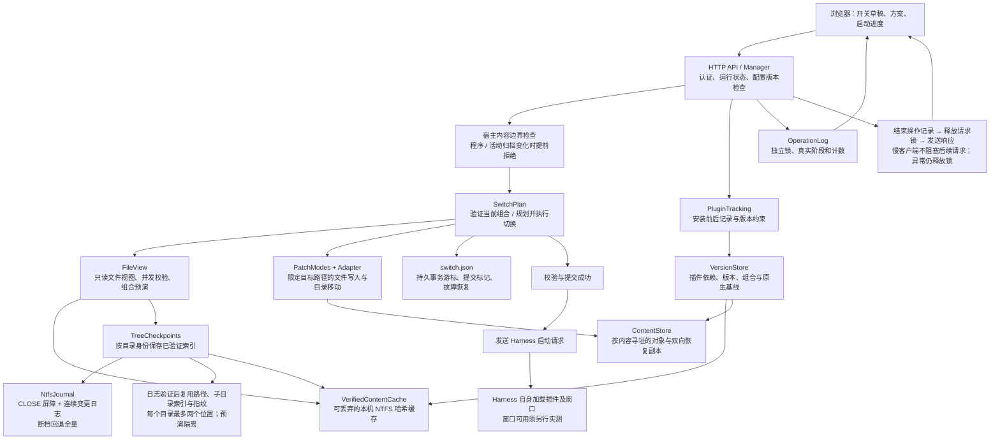
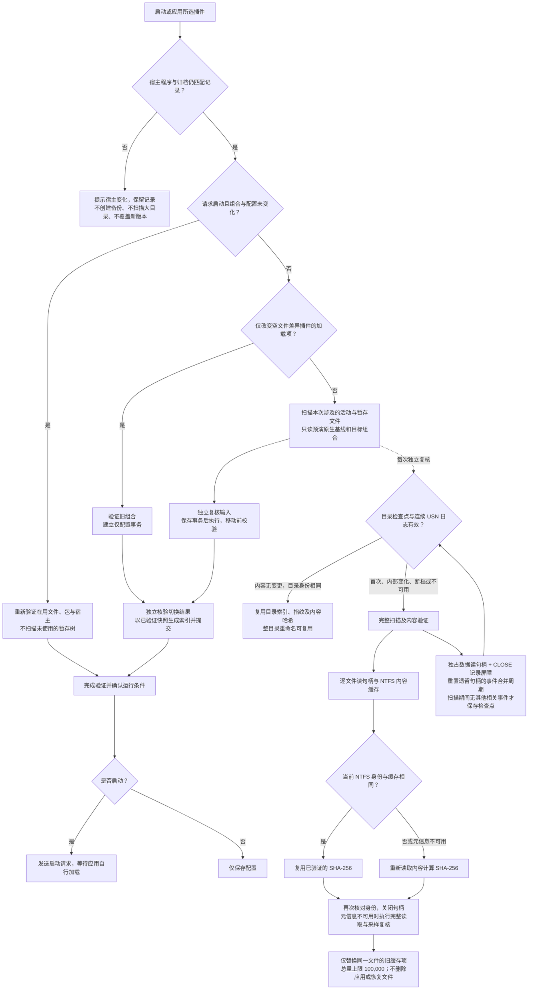

# Architecture and data contract / 架构与数据契约

This describes the 0.3.2 implementation. Runtime control data uses format 3.
本文说明 0.3.2 实现；运行时控制数据统一使用格式 3。本机约 30 秒目标的实测与边界见[验证记录](validation-0.3.2.md)。

## Architecture diagram / 架构图

Mermaid source / 图源

## Verification principle / 校验原理图

Mermaid source / 图源

The diagrams describe implemented paths, including the checkpoint optimization under acceptance testing. See [checkpoint design](checkpoint-design.md). They are not a 30-second guarantee. A full
adapter switch still has independent input, move and output checks. The current
purge measurements exceed the acceptance limit.

图示包含正在验收的检查点优化，详见[设计说明](checkpoint-design.md)，不表示已达到 30 秒。内置补丁切换仍保留输入、移动前及输出校验，
本机 purge 测量仍超过验收上限。

## Boundaries / 模块边界

| Layer / 层 | Modules / 模块 | Responsibility / 职责 |
| --- | --- | --- |
| Application / 应用编排 | `launcher.py`, `plugin_tracking.py` | HTTP、配置与安装流程；协调依赖，决定何时启动或保存 |
| Domain / 领域规则 | `domain.py`, `recording_state.py`, `operation_models.py` | 文件身份、快照元信息、安装状态转换、事务命令解码；不执行 IO |
| Planning and execution / 规划与执行 | `file_view.py`, `switch_plan.py`, `patch_modes.py` | 只读推演、输入复核、持久事务、执行与恢复 |
| Adapter / 适配规则 | `adapters.py` | 插件专属路径、标记、归档位置和文件归属规则 |
| Storage / 存储 | `storage.py`, `version_store.py`, `settings_store.py` | 原子写入、内容校验、包与依赖图、严格设置加载 |
| Verification cache / 校验缓存 | `verification_cache.py`, `tree_checkpoint.py`, `ntfs_journal.py` | 连续日志保护的目录检查点与 NTFS 内容缓存；失效时完整校验，独立于恢复对象 |
| Runtime context / 路径上下文 | `runtime_context.py` | 不可变安装路径；基础模块不通过 Manager 反向寻找依赖 |
| Observability / 操作状态 | `operations.py`, `errors.py` | 有界操作记录、稳定错误代码、恢复建议 |
| Browser / 前端 | `ui/api.js`, `ui/state.js`, `ui/runtime.js`, `ui/app.js` | 请求传输、不可变状态与 reducer、异步调度、DOM 呈现与事件 |
| Offline conversion / 离线迁移 | `migrate.py` | 在独立暂存目录转换和核验旧数据；运行时不导入该模块 |

`ContentStore` does not know about plugins or `Manager`. `VersionStore` receives
paths, the content store and a read-only host archive dependency. Adapter rules
are centralized; adding one requires explicit planning, ownership and recovery
tests, not scattered package-name branches.

`ContentStore` 不知道插件或 Manager；版本库接收路径、内容库及只读宿主归档依赖。
增加适配器时，应补齐其规划、路径归属和恢复测试，避免在通用模块散布插件名判断。

## Invariants / 不变量

- Content identity is file kind plus SHA-256, or a link target. Size, mtime and
  the source sampling stamp are separate snapshot metadata. A changed timestamp
  never proves changed contents. Blob timestamps never stand in for the live file.
- 文件内容身份与快照元信息分离；文件哈希决定内容相同，原文件时间戳只用于采样和恢复。
  恢复副本的时间戳不得代替原文件时间戳。
- Recording phases are `preparing → installing → recording → scanning → verifying`;
  manual installation skips `installing`. `runState` is exactly one of `idle`,
  `launching`, `running`, `closed`. Every transition validates evidence first.
- 安装状态转换集中于 `RecordingSession.transition`。完整基线是安装的前提；观察到运行并确认退出，
  才能扫描和校验。异常保留状态与基线。扫描/校验重试复用已结束的首次运行，不重复启动程序。
- A transaction decodes every command, verifies its owned paths and both recovery
  directions, checks the complete input again, and only then mutates files.
  Unknown operation kinds fail before execution. Recovery uses the persisted
  plan and file evidence, including crashes between a write and cursor update.
- 事务必须先完整预检，再重新核验输入后执行；未知命令、损坏副本、越界路径和外部修改均拒绝覆盖。
  恢复依据持久计划及实际文件，不只依据日志游标。

## Persistence contract / 持久化契约

| Data / 数据 | Version / 版本 | Rule / 规则 |
| --- | --- | --- |
| Settings, registry, adapter state, active switch journal, configuration backup / 设置、登记表、适配状态、切换日志、配置备份 | `format: 3` | Runtime reads only this format / 运行时只读此格式 |
| Immutable packages, revisions, combinations and native baselines / 不可变包、版本、组合和原生基线 | Their existing `format: 1` contracts / 各自原有格式 1 | Content-addressed objects are independent of control-data versions / 对象格式独立于控制数据版本 |
| Snapshot and delta objects / 快照及差异对象 | Stable existing JSON shape / 稳定 JSON 结构 | Explicit domain decoding; identity derives from canonical JSON / 领域解码，规范 JSON 决定内容标识 |
| Portable schemes / 便携方案 | `harness-launcher-schemes-v1` | Package names only; bind local versions on import / 只传包名，导入时绑定本机版本 |
| Optional NTFS verification cache / 可选 NTFS 校验缓存 | `format: 2` | Discard legacy/invalid cache and rebuild; never a recovery source / 旧格式或损坏时丢弃重建，不作为恢复来源 |

Settings and registry loaders preserve additive fields. Their `requiredFeatures`
declares capabilities a reader must understand; unsupported requirements stop
loading instead of silently losing semantics. New optional fields must preserve
old meaning, have safe defaults and remain intact when existing data is saved.
Session and transaction command fields remain strict because ignoring one can
make replay unsafe.

设置及登记表保留新增可选字段；其必要的新语义通过 `requiredFeatures` 声明，当前程序不支持时拒绝读取。
可选字段须保持原语义、具有安全默认值，并在重新保存时保留。会话及事务命令字段保持严格解码，
避免忽略字段后错误重放。更改必要语义必须提高对应契约版本并提供离线转换；不能承诺未来永不迁移。

## Offline cutover / 离线切换

1. Finish pending installations and transactions in the old version, then stop
   both applications. Only complete v2 stores are accepted; missing history is
   not fabricated, and older incomplete stores are not silently imported.
2. `python migrate.py` builds and verifies a separate sibling stage. The preview
   removes its temporary stage and does not change live Harness files or the source store.
3. `python migrate.py --apply` verifies reachable objects, blobs, versions and
   supported combinations before swapping directories. The complete old store
   becomes `<data>.archive-<timestamp>-<id>` with a checksum manifest.
4. A sibling `<data>.upgrade.json` guards the rename boundary. Use
   `python migrate.py --recover` only if that cutover was interrupted. Keep all
   involved directories until recovery has finished.

对应中文流程：先用旧版结束未完成操作并退出；在独立目录预检；通过 `--apply` 切换新目录；
仅目录切换中断时使用 `--recover`。自定义数据路径用 `--data <目录>`。新版不自动搜寻或合并旧 AppData。
归档只作为离线恢复证据，不参与运行。归档不是 Harness 本体和用户数据的完整备份，需另行配套备份。

## Operation and error API / 操作与错误 API

`GET /api/operations` returns `current` and `last`, each with an operation id,
kind, status and elapsed time. This in-memory endpoint has its own lock and
remains readable during a long application mutation. It is not a durable task
queue and cannot resume work after a restart; the file transaction journal does that.

`/api/operations` 返回当前及最近一次操作，包含编号、类型、状态和耗时。该接口独立加锁，
用于长操作期间显示进度；持久恢复仍由事务日志负责。错误统一返回
`error`, `code`, `details`, `recovery`, `retryable`, `operationId`。
机器分支判断应使用 `code`，不解析中文错误文本。`retryable` 只是提示，前端不得自动重放写请求。

POST 响应先在内存中完成序列化，结束操作记录并释放请求锁后再发送。客户端收到结果后可以立即发起下一项操作；
慢连接或断开连接不会继续占用写请求锁。操作记录清理抛出异常时也保证释放请求锁。

宿主程序和归档的内容边界检查位于配置备份与大目录扫描之前；变化时返回 `host_identity_changed`。
普通插件的活动归档对照当前已验证组合，不能误与未打补丁的原生基线比较。相同内容的文件替换允许通过此早期检查，
后续独立验证仍执行。未完成事务发现宿主程序跨版本变化时保留日志并停止回滚。具体能力与未实现的三方迁移方案见[官方更新说明](host-updates.md)。

The optional `progress` field contains `stage`, `label`, `step`, `steps`,
`completed`, `total` and `unit`. Stages are `check`, `packages`, `files`, `sync`
and `launch`; counts are actual work in the current phase. They are not a time
estimate, and phases without a known total remain indeterminate. Reporting is
bound to the request context and operation id, so unrelated threads or late
callbacks cannot update a different operation.

0.3.1 的相同组合启动路径只在组合、配置、层顺序与版本锁完全匹配时使用。它重新计算在用文件的
内容哈希并校验已启用的包与宿主，结束前再次检查控制输入；不修改配置、重放补丁或创建切换日志。
未启用的内置暂存树不会在此路径执行，真正切换时仍须完整预检。不能把时间戳缓存替代内容验证，
也不能把此路径用于安装、还原或改变组合。

0.3.2 adds an optional `preserveNative` transaction flag for ordinary plugin
switches that leave the built-in adapter inactive. It requires identical input,
previous and target adapter states, a native mode, no selected adapter, and no
adapter mutation except the profile manifest. Such plans exclude unused parked
trees; active inputs are freshly verified and independently checked before commit.
Enabling the adapter retains the full parked-tree and installed-code checks.

0.3.2 在内置补丁保持原生时缩小预检范围。原生基线复用以当前内容、宿主和归档身份完全匹配为前提；
实际使用的双向恢复副本始终校验。哈希每轮最多 32 个工作线程，进度由调用线程汇报，事务写入和恢复仍串行。
`preserveNative` 不能掩盖内置目录移动或其他内置文件写入。`configurationOnly` 只允许一个 manifest 写入，
变化插件必须具有空文件差异，前后组合的文件状态、基线和内置补丁版本必须相同；提交前验证旧组合。

`verification_cache.py` 是可丢弃的本机 NTFS 加速数据，独立于不可变内容库。键包含卷编号、文件标识、创建时间、
修改时间、NTFS ChangeTime、大小、当前 USN 日志身份与文件变更序号。查询期间以 `GENERIC_READ` 数据读取权限持有句柄，
共享方式仅允许读取，复用前后均检查标识。仅申请属性权限的句柄不能阻止数据写入，旧格式 1、2 缓存已停用；
不可靠或不支持的元信息改为完整读取。缓存带格式和校验和，损坏时忽略；同一文件标识只保留一个版本，
总量最多 100,000 项。它不会作为目录扫描根，也不会自动清理恢复对象。重启后仍查询当前标识才能使用缓存，
不能仅凭大小和 mtime 复用哈希。这是正常文件变化检测与性能优化，不承诺检测绕过文件系统的离线磁盘损坏。

只读视图移动子树时只更新被移动的父子索引；未涉及的目录不再重复建立索引。
这一优化不改变实际磁盘事务、独立验证或恢复步骤。

目录检查点在连续日志验证通过后复用路径对象、子目录索引和指纹，每个目录最多缓存活动、暂存两个位置。
返回给预演视图的条目和子目录集合独立复制，虚拟改动不能回写目录指纹；路径缓存不保存或替代本轮日志验证结果。切换后的元数据索引由
独立结果校验的快照生成，避免重复遍历，也避免信任验证结束后才出现的外部文件。
`domain.py` 另以有界内存缓存复用不可变路径字符串的语法检查，不缓存文件系统状态或路径安全检查结果。

## Validation and capacity / 验证与容量

Use temporary synthetic installations for unit, HTTP, failure and recovery
tests. Add model tests for illegal states and browser tests for stale responses,
timeouts and connection recovery. Fixture success is not whole-platform or
third-party-plugin certification.

`test_architecture.py` checks dependency boundaries, including that runtime
modules do not import the offline migrator and domain/storage modules do not
depend on application coordinators.

测试必须使用临时合成安装目录；重点覆盖非法状态、内容损坏、事务中断和异步旧响应。
`test_architecture.py` 自动检查运行时与离线迁移的隔离，以及领域、存储层的依赖边界。
内容库按哈希去重并提供容量统计；迁移只清理已核验暂存目录中的不可达旧对象。
运行时不自动删除历史；后续垃圾回收必须先证明完整引用可达性并单独测试，不能按文件年龄直接删除。
