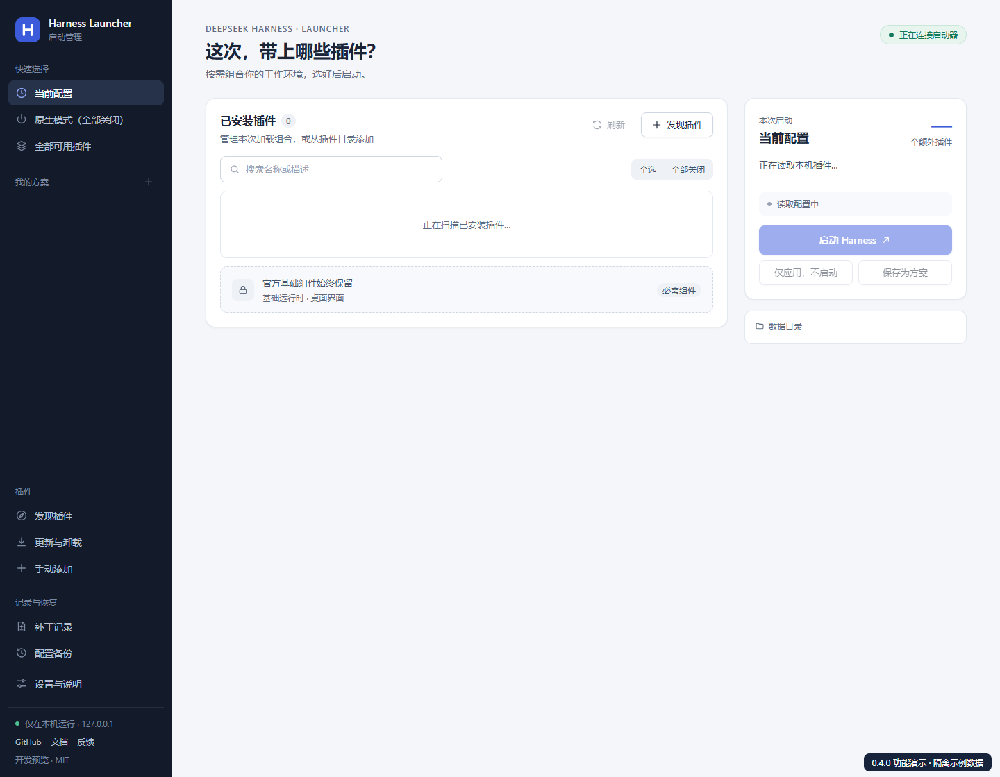
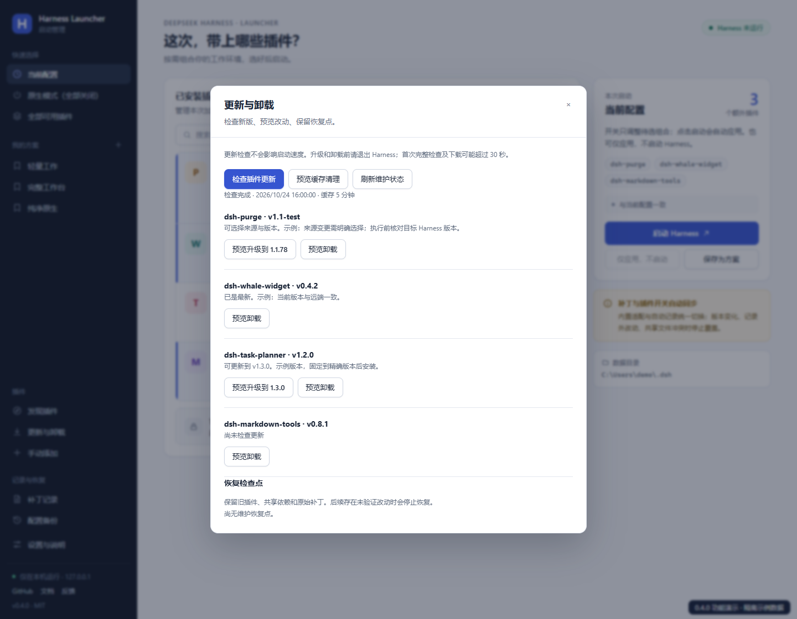
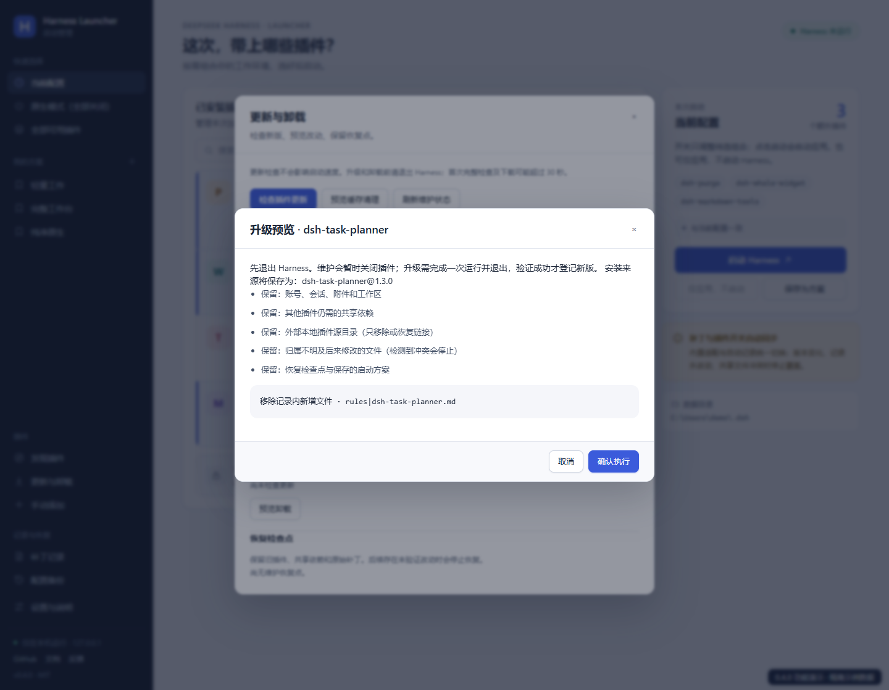
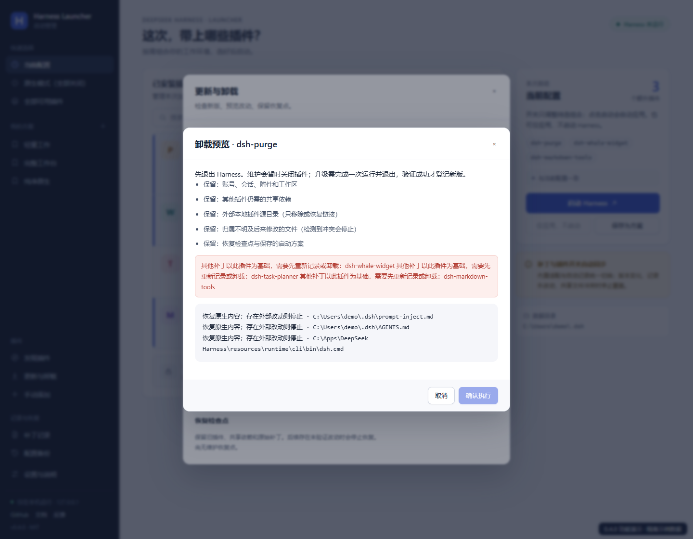
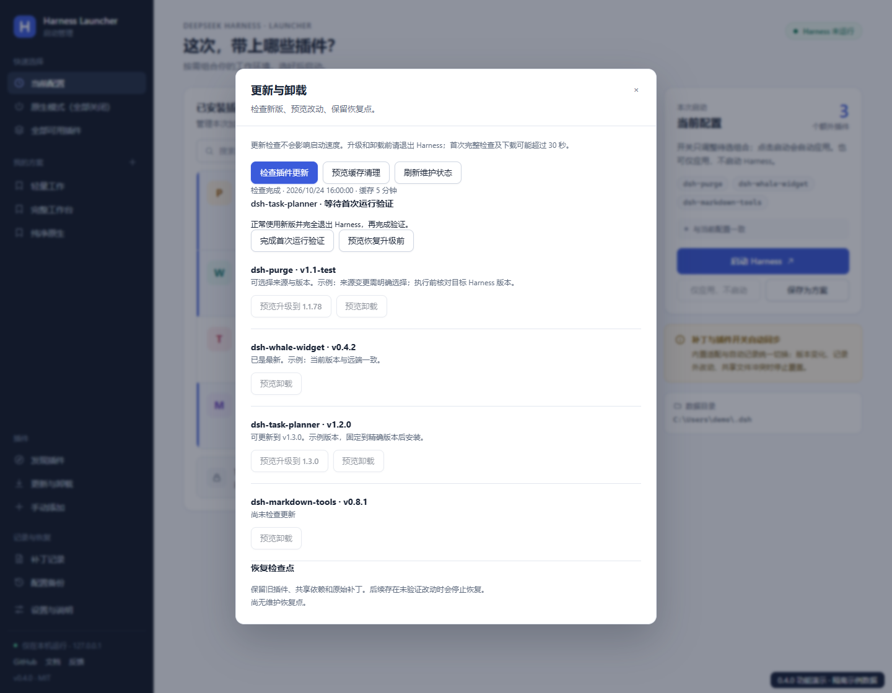
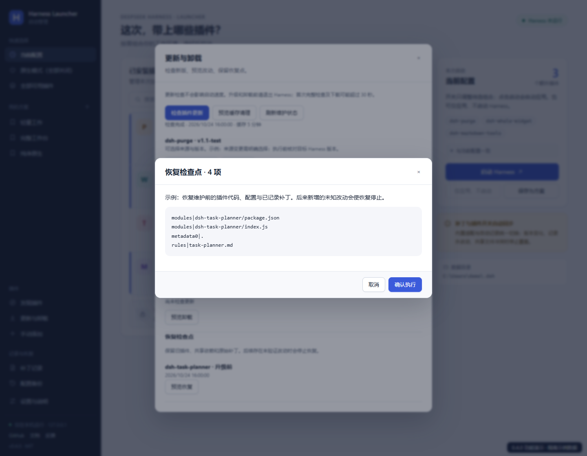
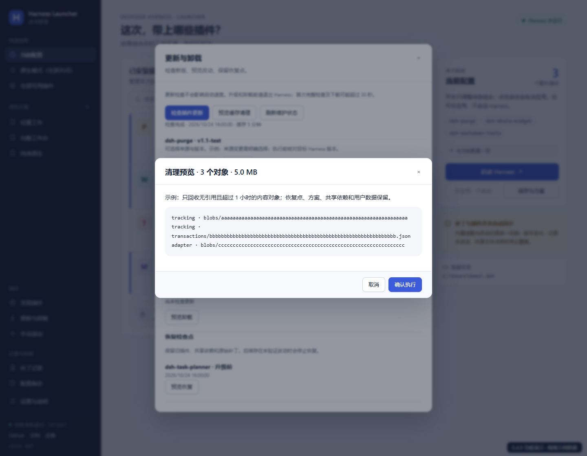
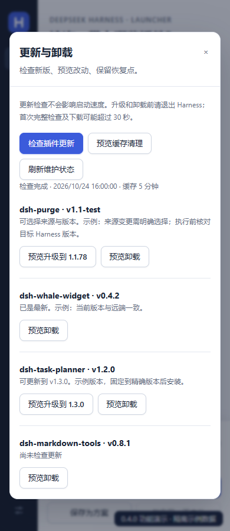

# 0.4.0 更新与维护功能图解

[返回首页](../README.md) · [维护细则与边界](plugin-maintenance.md) · [测试与实测](validation-0.4.0.md) · [架构图与原理图](architecture.md)

以下 8 张截图来自运行真实前端的隔离演示。插件、路径、远端版本、恢复条目与清理数值为示例；不包含真实会话，也不代表已在用户安装上完成第三方升级。后端的升级、卸载和恢复使用独立夹具测试，真实启动计时另列于验证记录。

## 1. 启动与插件开关

开关编辑本次草稿，“启动 Harness”会应用并启动；“仅应用，不启动”用于提前保存组合。左侧新增“更新与卸载”，日常启动不主动查询远端更新。其余方案、发现、补丁记录与备份功能见[原有完整图解](feature-tour-0.3.2.md)。

## 2. 统一检查更新

点击“检查插件更新”。普通 npm 插件显示当前和可用版本；本地或 Git 来源显示需明确选择的来源。未知、私有或固定来源保留原约束。

## 3. 预览升级

预览显示精确目标、受管改动和保留项。退出 Harness 后执行，先保存可恢复检查点，再还原旧补丁并安装。下载与首次检查不属于约 30 秒的日常启动目标。

## 4. purge 卸载预览

purge 通过专用适配还原规则、提示词和应用补丁。普通插件依据安装前后差异。图中的红色提示展示其他补丁依赖 purge 时禁止执行。无法确认归属、存在依赖或后来编辑时停止；外部源目录、用户会话和共享依赖保留。

## 5. 新版首次运行验证

新版正常运行并完全退出后，点击“完成首次运行验证”。记录成功才恢复原启用组合。purge 需要在首次运行时先应用新版补丁；不适配当前宿主的版本会在安装前被拒绝。

## 6. 恢复检查点

从升级或卸载前检查点预览恢复内容。现场必须仍符合已验证状态；后来出现的新改动会阻止覆盖。恢复只对已知条目操作，不递归删除未知目录。

## 7. 无引用缓存清理

先预览对象数与空间。清理仅触及超过一小时的无引用内容对象；被方案、历史、备份和恢复点引用的对象继续保留。执行前重新计算引用，避免使用过期预览。

## 8. 窄窗口

维护弹窗可滚动浏览。浏览器检查覆盖 1440、1080 和 390 像素宽度，页面与弹窗正文无横向溢出。

## 便携版

在 [Release](https://github.com/schrieeeffer/harness-launcher/releases/tag/v0.4.0) 下载 Windows x64 ZIP，完整解压，双击 **Harness Launcher.exe**。包内附“先读我.txt”和运行时，无需另装 Python。仍需事先安装官方 Harness。
