# 0.3.0 feature tour and verification

[简体中文](feature-tour.md) · [Back to the user guide](../README.en.md)

See [launch progress and verification](launch-progress.en.md) for the 0.3.1 progress bar, clearer button labels and performance fix. This page retains the 0.3.0 feature screenshots.

This tour accompanies the 2026-10-24 verification. **Every screenshot uses an isolated demonstration environment.** Plugin names, paths, catalog entries and statistics illustrate the interface; they do not describe the user's installation or live rankings. Installation, launch, restoration and error examples do not establish compatibility with real third-party plugins. The interface remains in Chinese; control labels below match the screenshots.

Automated checks: **250 Python backend tests: 248 passed, 2 skipped; all 30 frontend tests passed.** This tour contains 29 screenshots; the browser developer log contained no error or warn entries. The results below distinguish the real service restart, actual interactions in the isolated environment, simulated state displays and usage references. Branches not reproduced in this browser run are not reported as browser-verified.

The real service restart is reported separately, without using demonstration screenshots as evidence:

| Check | Result |
| --- | --- |
| The backend process was replaced | Passed |
| Served `app.js`, `state.js`, `api.js` and `runtime.js` are byte-for-byte identical to workspace sources | Passed |
| Actual configuration and enabled-plugin selection are unchanged | Passed |
| No recording session or transaction awaiting recovery remains | Passed |

## 01 Main window and current configuration

Open the menu and inspect the version, connection status, plugins and launch summary. Select **当前配置** to restore the actual enabled selection. Official base components always remain enabled.

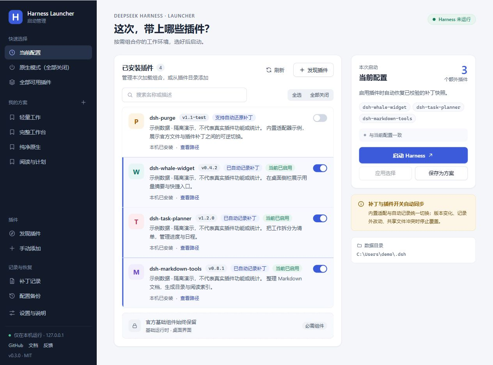

Isolated interaction result: **当前配置** successfully discarded unapplied checkbox changes and restored the actual selection. The main window displays its version, running state and selected plugins.

## 02 Search, paths and draft selection

Search a plugin name or description, expand **查看路径**, toggle a plugin, then click **刷新**. **全选**, **全部关闭** and the sidebar's **全部可用插件** provide bulk selection.

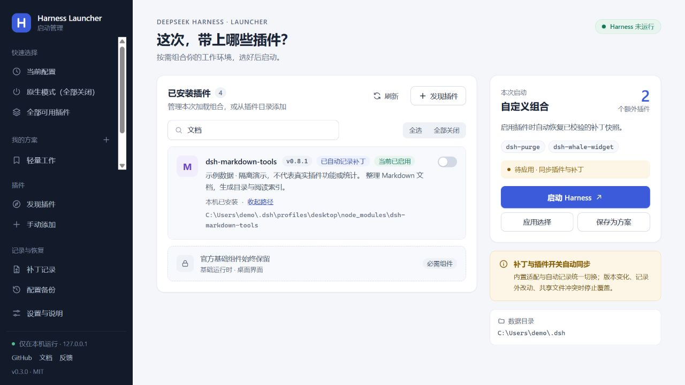

Isolated interaction result: Name and description searches and path expansion passed. Refresh preserved an unchecked draft and the title showed **自定义组合**. Missing-file selection constraints are covered by frontend automated tests, not another browser scenario in this run.

## 03 Native mode

Select **原生模式（全部关闭）**, check that the extra-plugin count is zero, then use **还原为原生** in the isolated environment.

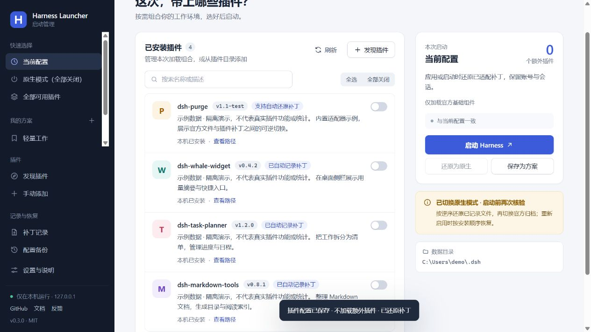

Isolated interaction result: Applying native selection left zero extra plugins, preserved official components and returned `verifiedNative`. No native-mode switch was performed against the user's real installation.

## 04 Apply and launch

**应用选择** synchronizes configuration and patches without launching. **启动 Harness** synchronizes and then launches. Observe operation status and the resulting running indicator.

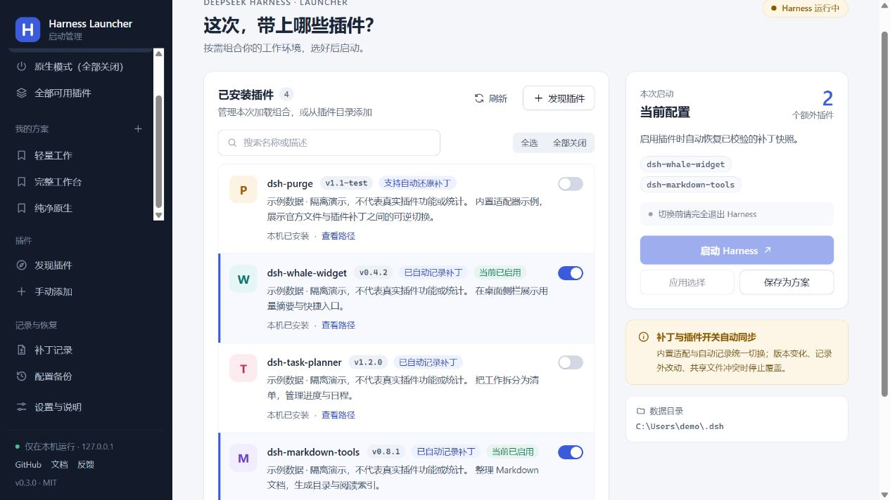

Isolated interaction result: After selecting **轻量工作** and clicking launch, both launch and apply were disabled under the simulated running state. This checks the interface response without launching the user's real Harness. Duplicate-submission protection is separately covered by frontend automated tests.

## 05 Save and select a scheme

Click **保存为方案** or the plus beside **我的方案**, enter a name and save. Select the new scheme from the sidebar.

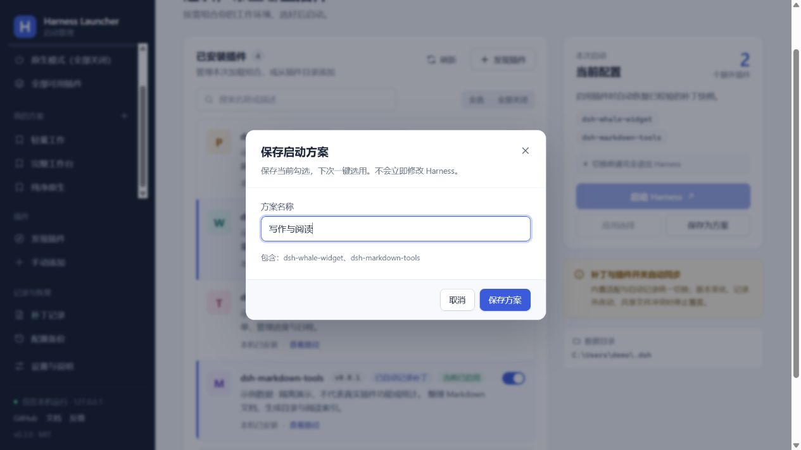

Isolated interaction result: A new scheme was created and selected from the sidebar, restoring its saved combination. Overwrite and delete checks follow below.

## 06 Overwrite, delete and outdated schemes

Save with an existing name to inspect overwrite confirmation; use a scheme's delete button to inspect deletion confirmation.

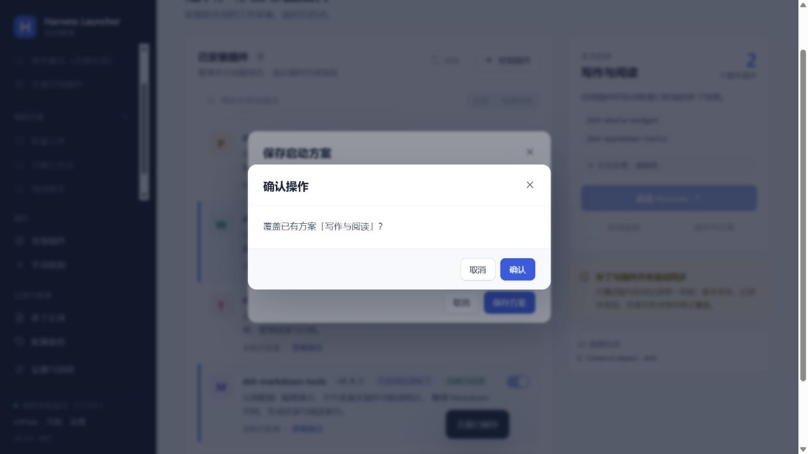

Isolated interaction result: Both overwrite and delete passed separate cancel and confirm checks. Downgrading schemes with removed plugins or external edits is covered by frontend automated tests; those cases were not repeated individually in this browser run.

## 07 Discover and search

Open **发现插件**, search, switch among all, official, community npm and GitHub sources, and choose the npm registry or mainland-China mirror. Use **加载更多** when another page is available.

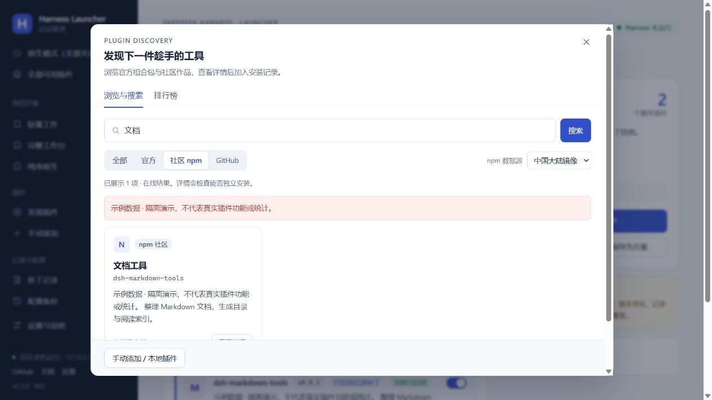

Isolated interaction result: Official, community, GitHub and mirror search switching passed. The example results were on their final page, so **加载更多** was absent. An empty search displayed a no-results message; a catalog error exposed retry, which returned four entries after normal service resumed. Retrying the original failed page is separately covered by frontend automated tests. This screenshot does not validate live catalog or mirror availability.

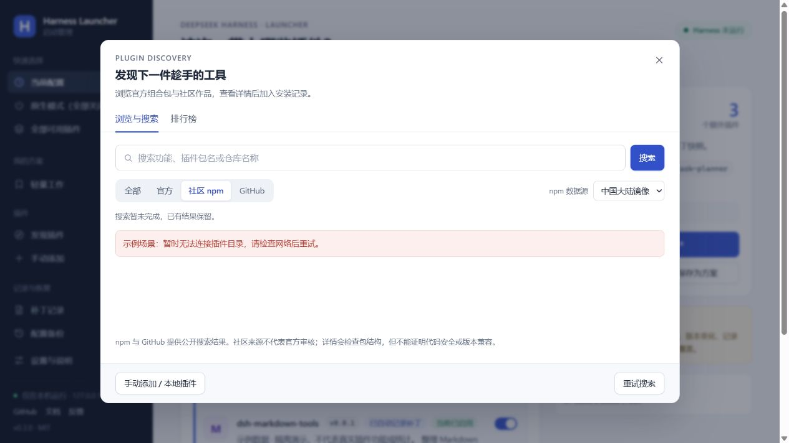

## 08 Download leaderboard

Open **排行榜** and select **下载量 · 近 7 天**. Inspect the scan scope, timestamp and detail buttons.

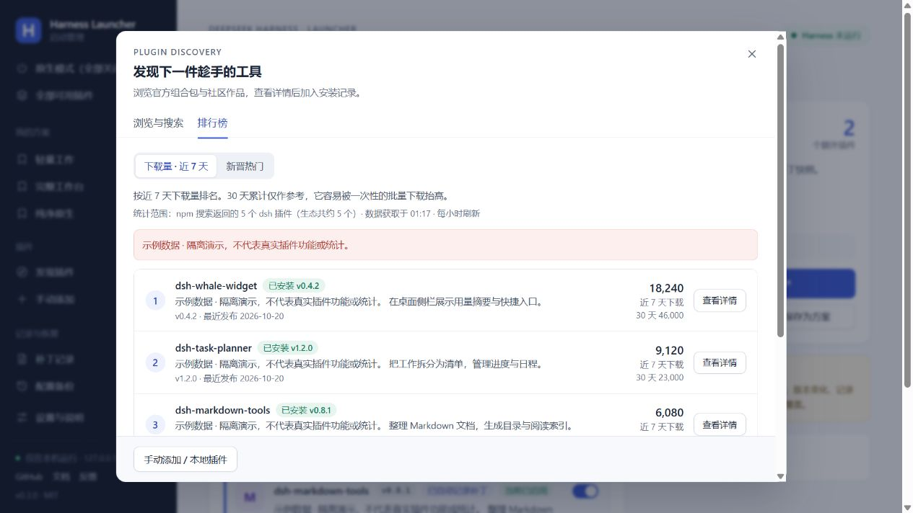

Isolated interaction result: The download leaderboard displayed example data, scope and timestamp and allowed opening details. Retry after a loading failure remains a usage reference; that branch was not separately reproduced here.

## 09 Rising leaderboard

Select **新晋热门** and inspect each plugin's share of thirty-day downloads occurring in the latest seven days.

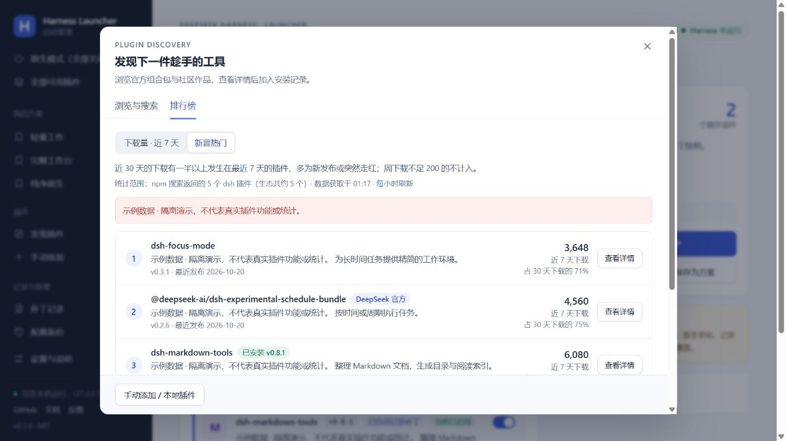

Isolated interaction result: Switching displayed the rising leaderboard with its matching explanation. Numbers are examples, not real rankings or compatibility findings.

## 10 Plugin details and installation prefill

Click **查看详情** from a catalog or leaderboard entry. Inspect source, license, bundle structure and compatibility requirements, then choose **选用并准备安装**.

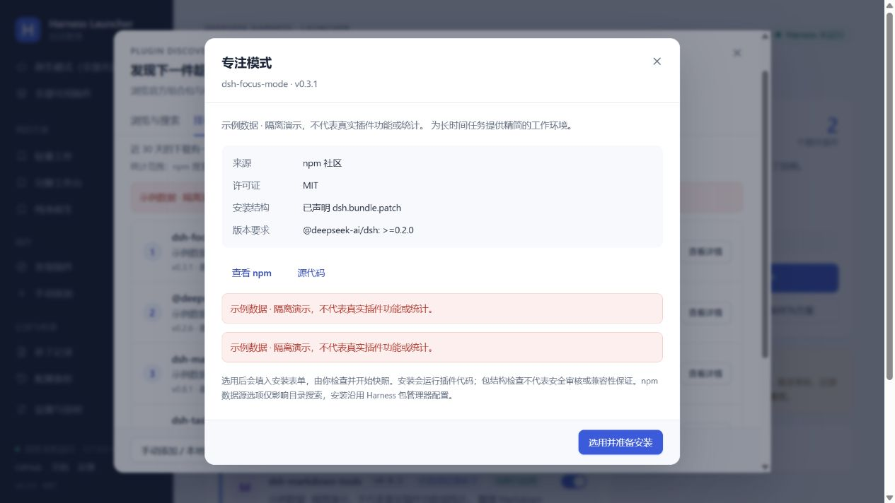

Isolated interaction result: Details opened, and **选用并准备安装** correctly prefilled the npm package and version without installing. External-link opening and non-installable library, stale-cache and other blocked branches were not individually browser-tested in this run.

## 11 Add from npm

Open **手动添加**, select **npm 包**, and enter a package name plus an optional version or tag. Review the fields before starting recording.

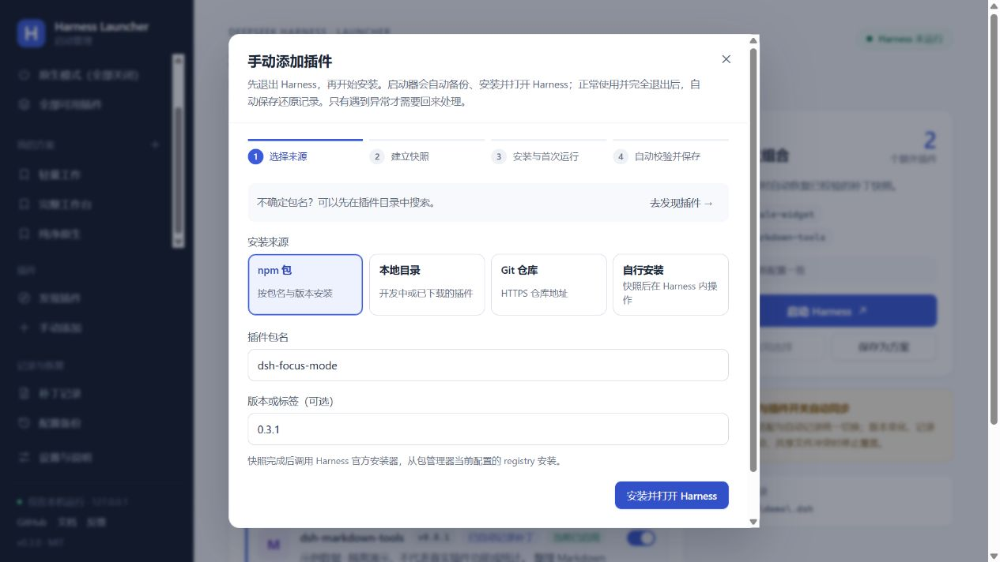

Isolated interaction result: The npm form and package/version prefill displayed correctly. This checks the form, not a real npm installer run. Default version resolution when left empty is usage guidance.

## 12 Add from a local directory

Select **本地目录** and enter the package name and a directory containing `package.json`.

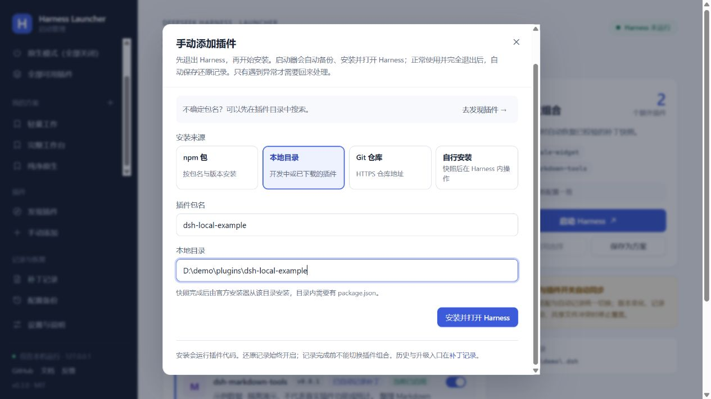

Isolated interaction result: Switching to the local source displayed its directory field and guidance. No real local-plugin installation was performed.

## 13 Add from Git

Select **Git 仓库** and enter a package name and supported HTTPS repository address. Specify a tag or commit in the source when a fixed version is needed.

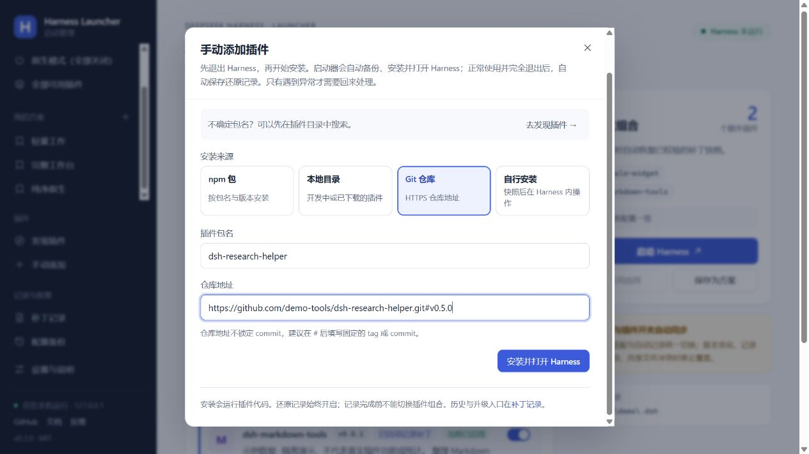

Isolated interaction result: The Git form displayed the repository field and guidance. No repository clone or real Git-plugin installation was performed.

## 14 Self-installation and upgrades

Use **升级 / 重新记录** in patch records, or select **自行安装** manually. Check the package name, use **备份并打开 Harness**, then install or upgrade inside Harness.

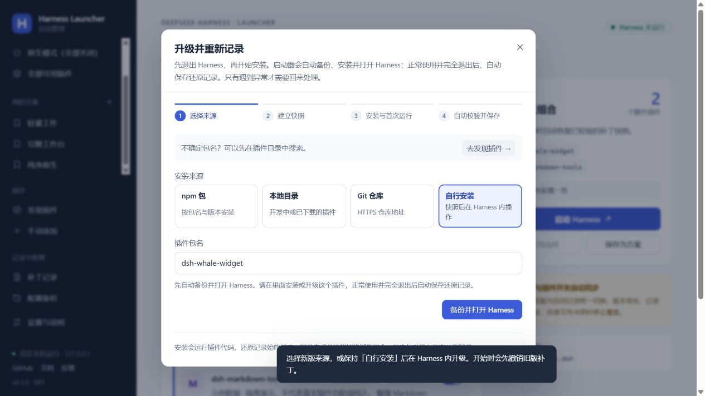

Isolated interaction result: The self-installation form and upgrade prefill passed. No plugin was actually upgraded. Replacing records after validation and retaining history are documented behavior, not proven by this form screenshot.

## 15 Automatic recording progress

Installation progresses through snapshot, installation, first-run recording, scan and verification. This image uses a simulated snapshot-preparation stage to show progress layout. During normal installation, fully exit Harness, including its tray process, after use.

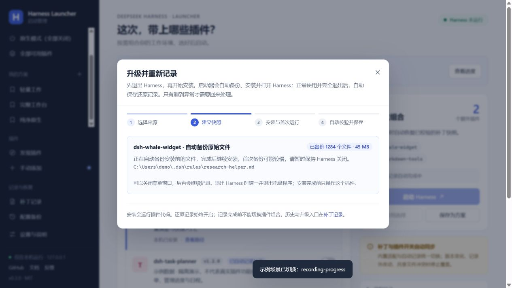

Simulated display result: Snapshot preparation, progress information and operation restrictions are visible. This browser run did not complete all five stages through a real third-party installer.

## 16 Automatic completion

Wait for process exit, stable files and verification. Inspect the completion notice and open patch records.

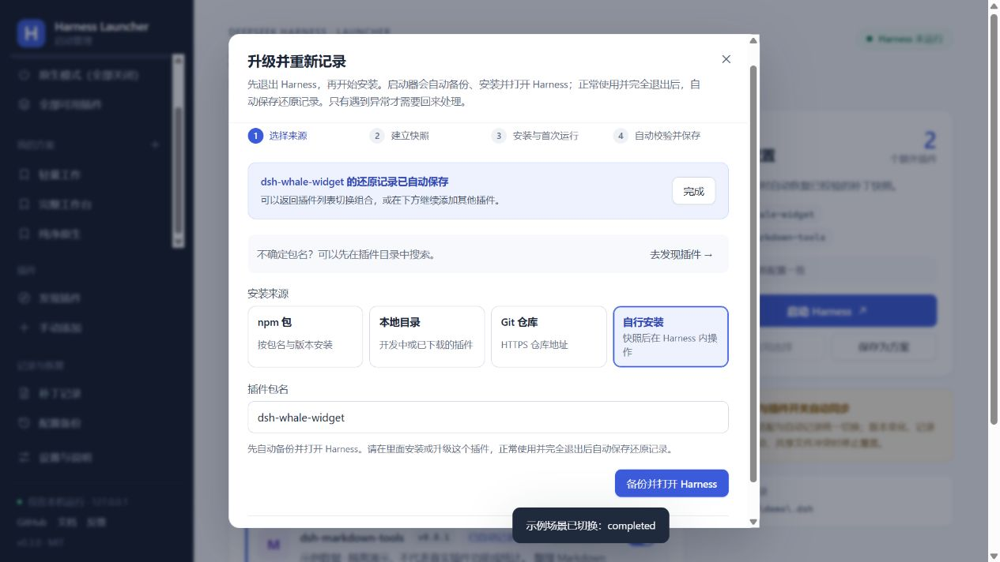

Simulated display result: The completion scene displayed its automatic-save notice. Clicking **继续自动记录** in the error demonstration also moved to this scene. This checks interface transitions, not execution of real plugin installation and file verification.

## 17 Recovery and change export

Inspect an isolated error case and its file changes. Use **导出完整改动清单**, address the problem, exit Harness and choose **继续自动记录**.

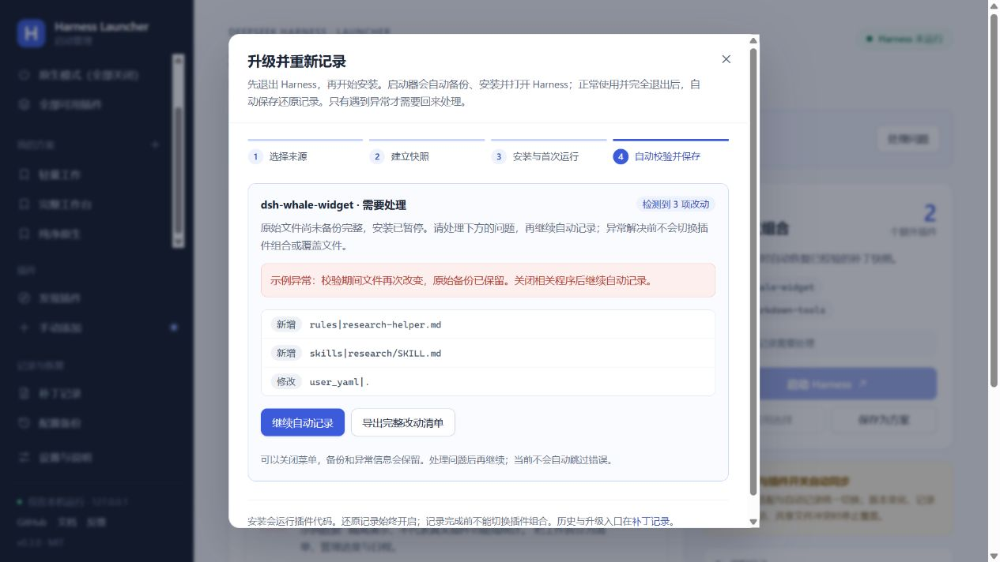

Isolated interaction result: The JSON actually exported from the simulated error scene contained three entries matching the displayed changes. Retry entered the simulated completion scene. Unchanged-install cancellation protection was not browser-tested here, and this does not prove real snapshot recovery.

## 18 Patch records and scope

Open **补丁记录** and inspect recorded, built-in-adapter and unrecorded groups. Expand **记录范围与限制**.

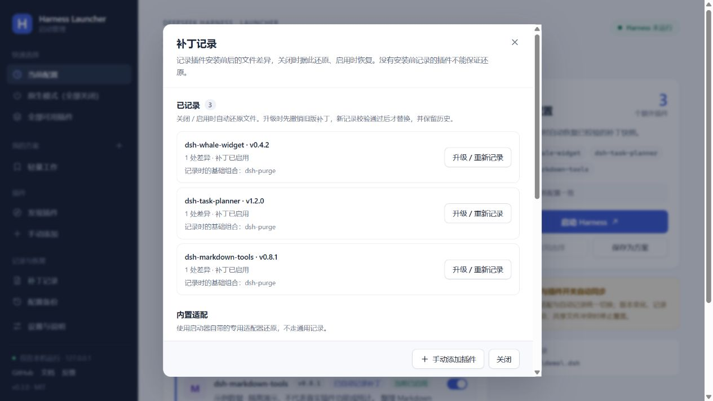

Isolated interaction result: Three generic records and the built-in adapter entry were read from the isolated fixture; base combinations and recording scope were readable. The first image shows categories; the next shows the expanded full scope. Unrecorded-plugin switching restrictions are covered by frontend automated tests.

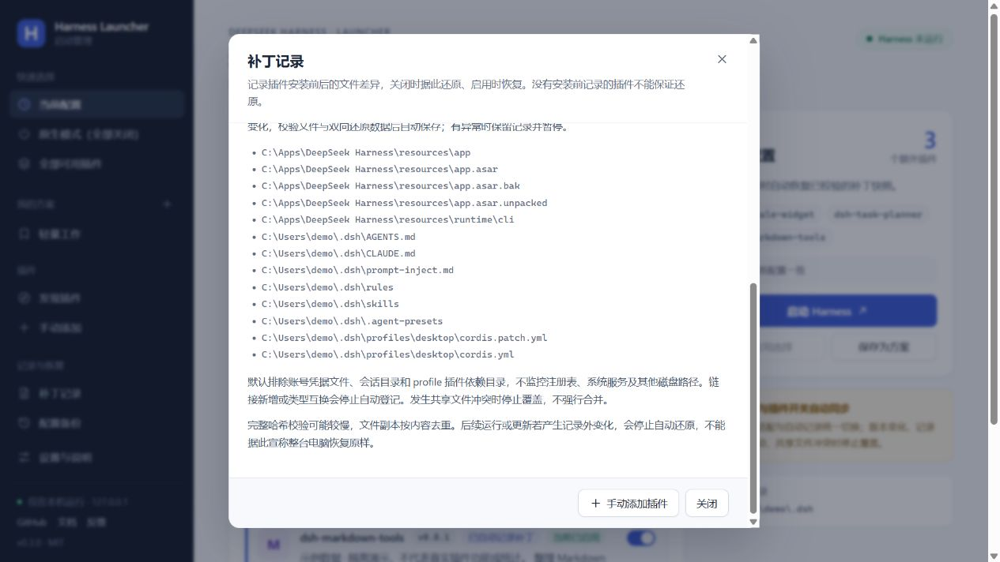

## 19 Configuration backups and restoration

Open **配置备份**, inspect dates, reasons and plugin lists, then choose a backup and review confirmation. **打开备份目录** opens its directory.

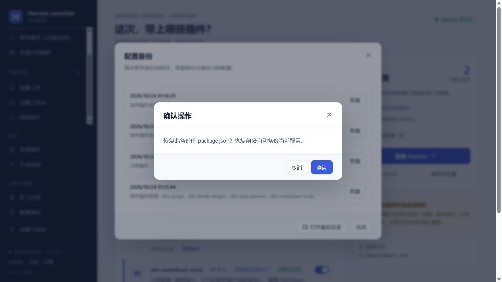

Isolated interaction result: Cancel left configuration unchanged. Confirm restored zero extra plugins and added a **恢复备份前** backup. Old-format backups and version-lock conflicts were not separately reproduced in this browser run; their restrictions are documented and within backend test scope.

## 20 Paths, directories and service exit

Open **设置与说明**, detect or enter application and data paths, and save. This dialog also provides **打开程序目录** and **退出启动器后台**.

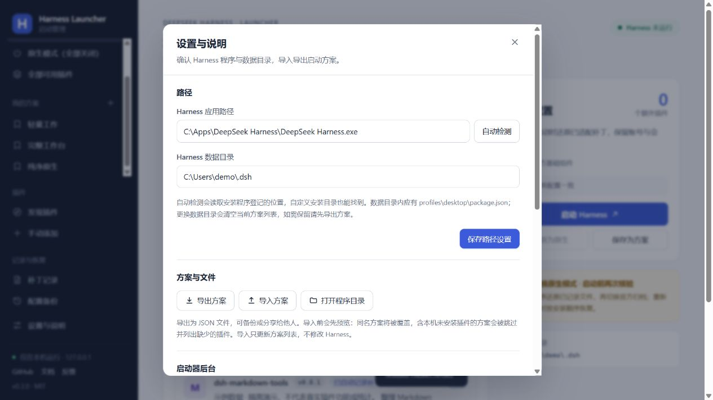

Isolated interaction result: Detection and saving were exercised with simulated paths. Program- and backup-directory requests returned responses, but the isolated script intercepted system opening, so Explorer opening is not claimed as verified.

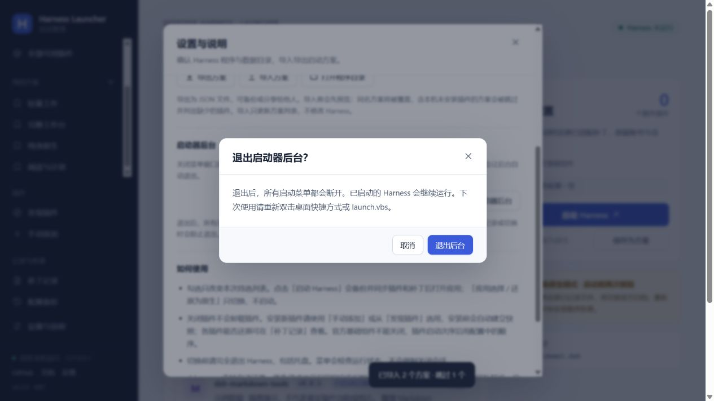

Exit demonstration result: Cancelling first kept the backend available. Subsequently confirming actually stopped the isolated demonstration service; the page displayed **启动器后台已退出** and disabled writes. **The user's real launcher backend remained running.** Blocking exit during active installation or switching, and preserving an already-running Harness, were not individually reproduced in this exit demonstration.

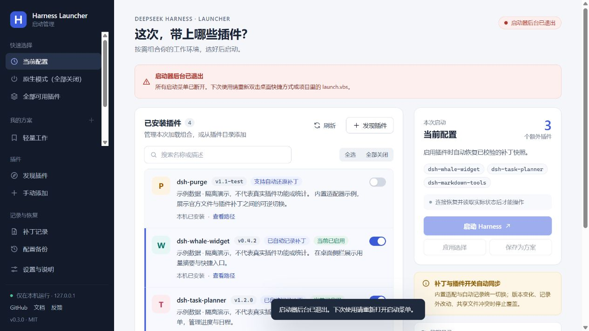

## 21 Scheme import and export

Export JSON from settings, or select a file to import. Inspect new, overwrite and skipped entries before confirming.

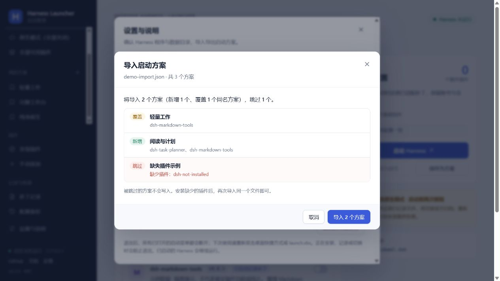

Isolated interaction result: The actual exported JSON was readable. Import successfully added one scheme, overwrote one and skipped one with a missing plugin. Actual configuration still had zero extra plugins afterward.

```json
{
  "format": "harness-launcher-schemes-v1",
  "schemes": {"Example": ["@demo/dsh-example"], "Native": []}
}
```

## 22 Missing executable

Use an invalid application path in the isolated environment. Inspect the warning and repair it with **使用检测到的路径** or **去设置**.

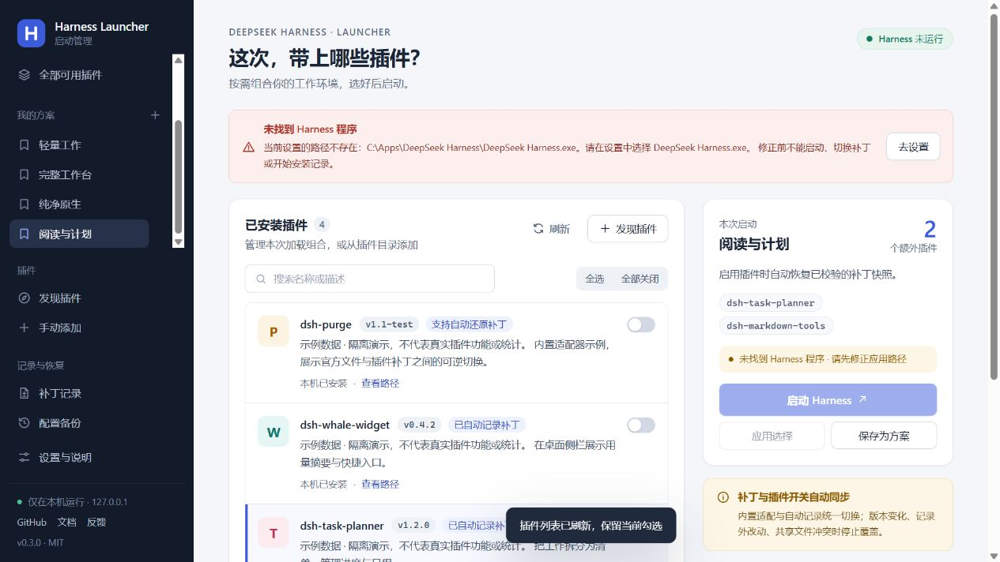

Isolated interaction result: The missing-executable scene disabled launch and apply. Opening settings, detecting and saving a simulated path restored the interface. The corresponding begin-recording constraint is covered by frontend automated tests.

## 23 Disconnection and reconnect

Keep an unapplied draft and temporarily make the isolated backend unavailable. Inspect the warning, restore the service and click **重新连接**.

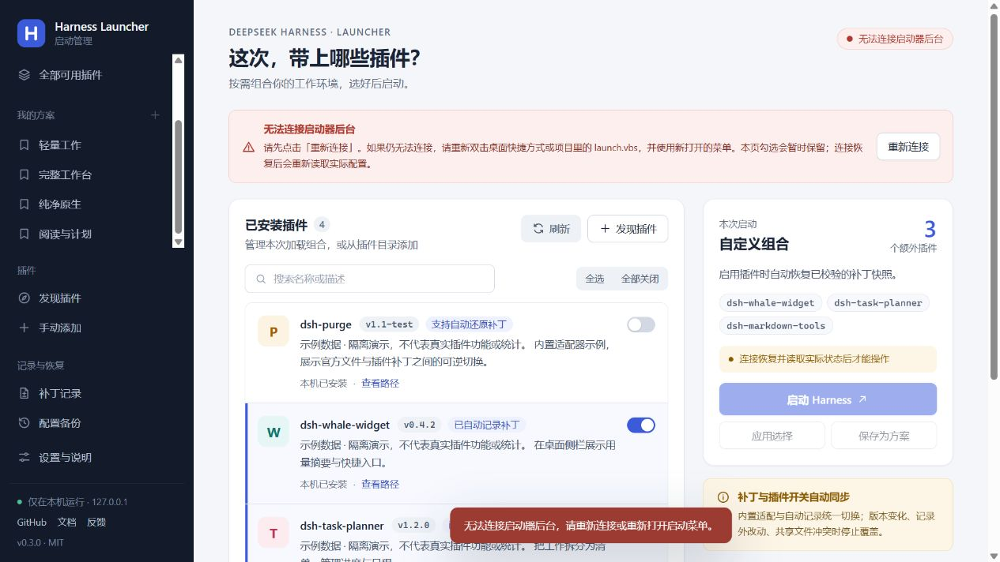

Isolated interaction result: The offline scene displayed a warning and disabled writes. After normal service resumed, automatic polling reconnected while preserving a three-plugin draft. Lost-response write non-replay and expired credentials are covered by frontend automated tests, not individual browser reproductions in this run.

## 24 An 800 px window

Set the viewport to 800 × 900 px, scroll through plugins and inspect the bottom action bar.

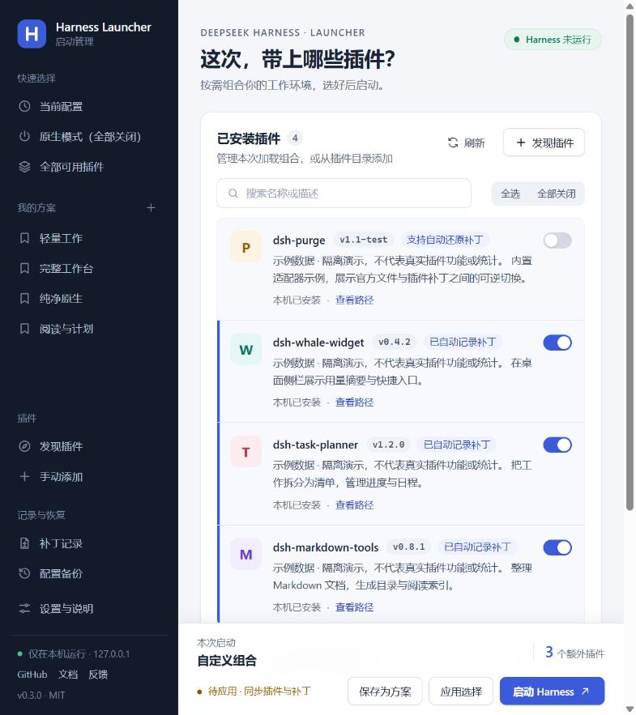

Layout result: DOM `clientWidth` and `scrollWidth` were both 785 px, with no horizontal overflow. All bottom buttons were visible, and scrolling and clicking could reach the list's end. Long scheme names were not tested in this run.

## 25 A 390 px window

Set the viewport to 390 × 844 px and inspect the icon sidebar, warning banner, search, toggles and bottom actions.

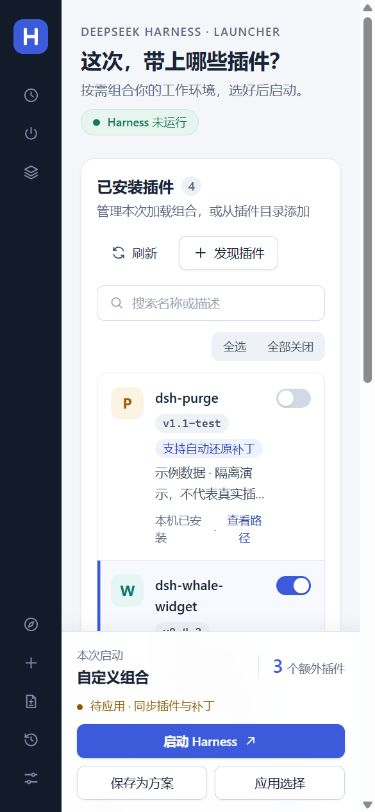

Layout result: DOM `clientWidth` and `scrollWidth` were both 375 px, with no horizontal overflow. All bottom buttons were visible, and scrolling and clicking could reach the list's end. Long scheme names were not tested in this run.

## Appendix: shared interactions and branches

The main images show representative states. This table distinguishes actual interactions, automated tests and usage branches not rerun here.

| Interaction | Verification record |
| --- | --- |
| Scheme overwrite/delete and backup restore, both cancel and confirm | Passed actual isolated interactions |
| Cancelling and confirming service exit | Cancel preserved availability; confirm stopped the isolated demo and disabled writes; the real backend remained running |
| Closing the catalog dialog with Esc | Passed actual isolated interaction |
| Other close buttons, backdrop, keyboard focus, Toast and external links | Usage reference; no individual interaction evidence recorded for every branch |
| Program- and backup-directory opening | Requests responded; system opening was intercepted; profile directory not separately verified |
| Retrying the original page after pagination failure | Covered by frontend automated tests; catalog demonstration used final-page fixtures |
| Empty search, catalog error and retry | Passed actual isolated interactions; retry returned four entries after recovery |
| State-read failure, expired credentials and late-response rejection after stop | Covered by frontend automated tests; not individually browser-reproduced |
| Full state refresh when an online page regains focus | Covered by frontend automated tests; browser run verified draft preservation after disconnection |
| Cancelling an uninstalled, unchanged recording | Usage reference; no browser cancellation-protection demonstration in this run |
| Browser developer log | No error or warn entries in this check |

## Appendix: command-line use and offline migration

The following commands are reference examples. **They do not claim that real-data migration was run again during this verification.** See the [upgrade guide](../README.en.md#upgrading-to-030) and [architecture notes](architecture.md#offline-cutover--离线切换) for migration requirements, archive limits and recovery.

```powershell
# Open the menu; launch.vbs can also use Harness's bundled Python
python launcher.py

# Use a separate launcher store without opening a window
python launcher.py --data D:\demo\launcher-data --no-open

# Offline migration: preview first, apply after review
python migrate.py --data D:\demo\launcher-data
python migrate.py --data D:\demo\launcher-data --apply

# Recover only an interrupted directory cutover
python migrate.py --data D:\demo\launcher-data --recover
```

`DSH_HOME` supplies the Harness data directory; `DSH_EXECUTABLE` supplies its application path. Environment variables provide initial defaults; existing saved settings take precedence. See [command-line options and environment variables](../README.en.md#command-line-options-and-environment-variables) for more options. `--data` selects the launcher's settings, backups and snapshot store, not Harness's data directory.
