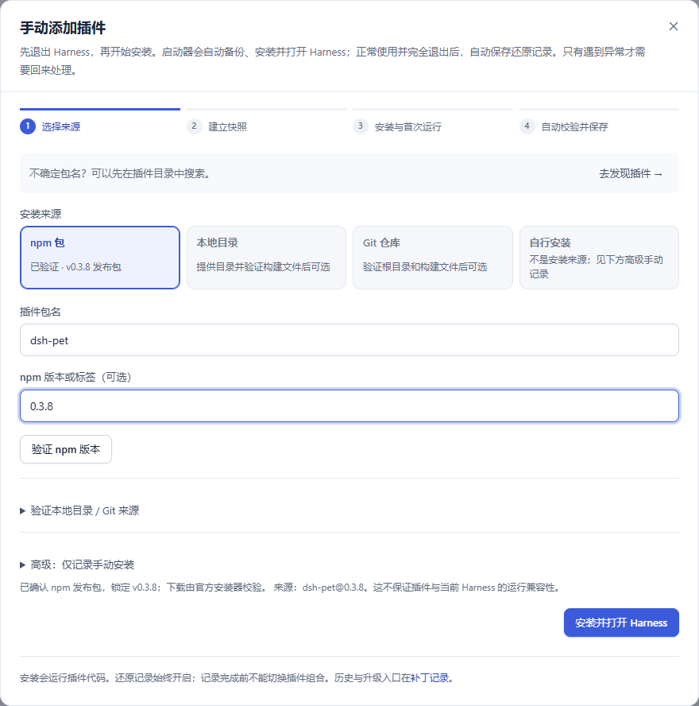
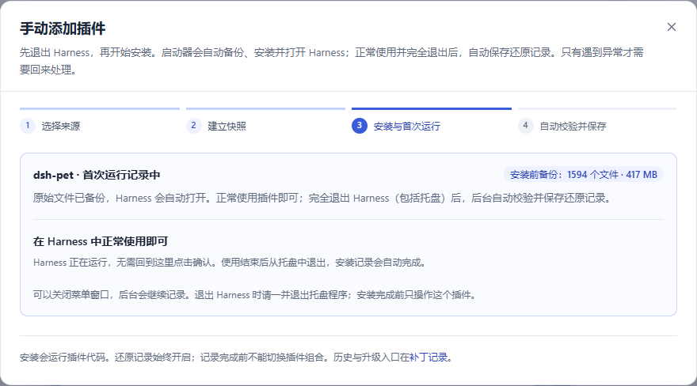
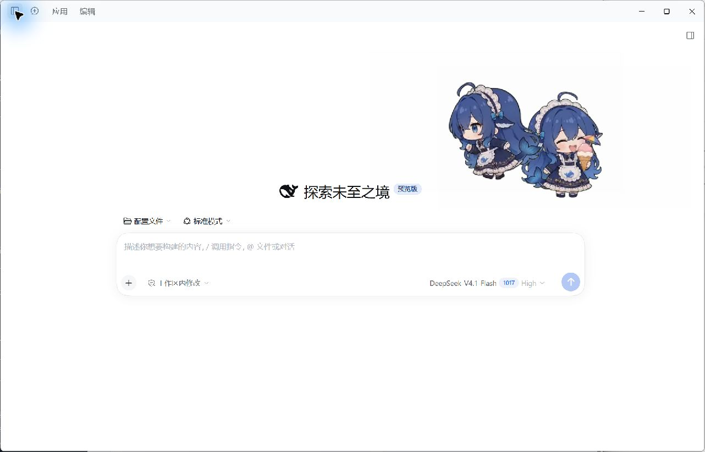
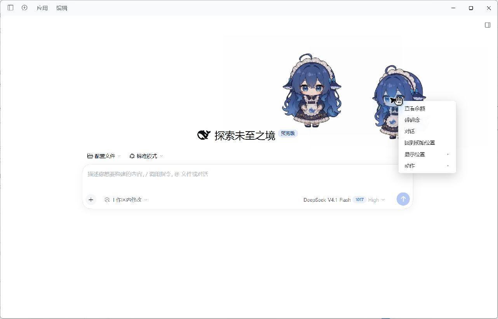
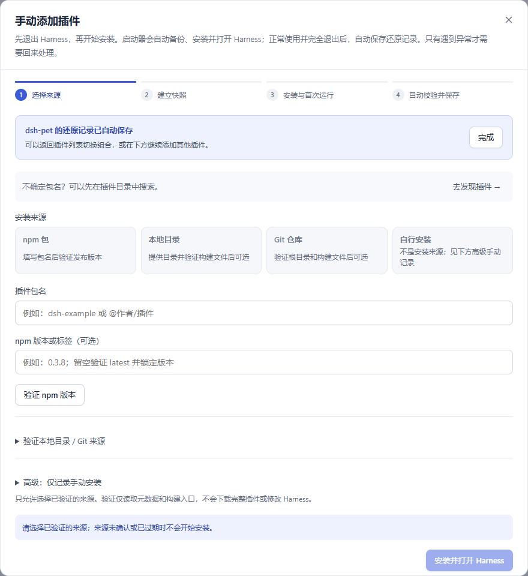
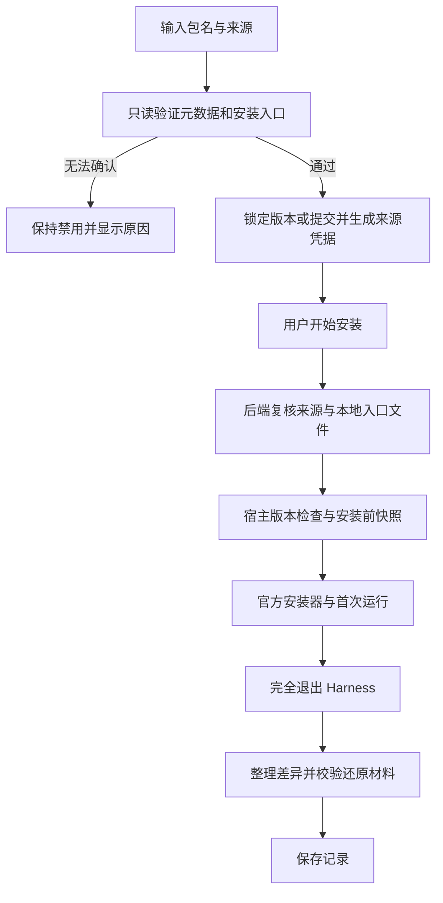

# 安装来源验证

适用版本：Harness Launcher 0.4.4。本文截图来自本机真实启动器页面，测试对象为 dsh-pet 0.3.8；不是模拟安装结果。

## 为什么不能四种来源都直接选

npm 发布包、Git 源码和本地构建目录可能包含不同文件。存在一个仓库链接，并不表示仓库根目录可以直接交给安装器。

| 入口 | 何时可选 | 安装前检查 |
| --- | --- | --- |
| npm 包 | 查到有效的发布版本、插件声明和 SHA-512 完整性信息 | 标签解析成精确版本；由 Harness 官方安装器下载并校验 |
| 本地目录 | 提供绝对路径并通过验证 | 包名、补丁声明、声明的 main/exports 入口存在且在目录内；提交前再次核对这些文件的内容 |
| Git 仓库 | GitHub 根目录包名和声明的安装文件通过验证 | 锁定 40 位提交；缺少构建入口、子目录项目或不完整清单不能直接安装 |
| 高级手动记录 | 用户明确勾选手动记录模式 | 只建立安装前快照并打开 Harness，不代表自动安装来源已验证 |

尚未验证、验证失败和过期的来源不可点击。更改包名、版本或来源立即清除对应验证结果；迟到的网络响应不能启用另一个目标。后端也核对来源凭据，不能通过绕过按钮提交未验证的自动安装。

来源通过后会显示构建授权范围。确认安装会允许当前精确 npm 版本或固定 Git 提交自身的安装脚本；依赖仍遵循官方包管理器策略。本地目录不自动扩大构建权限。授权写在当前 profile，维护恢复点保留原策略，详情见[维护说明](plugin-maintenance.md)。

验证只读取元数据和声明的安装入口，不执行代码、不克隆仓库、不额外下载插件压缩包。远端元数据缓存五分钟；失败时可以重试，旧缓存不能用于过期的安装授权。来源检查不等于运行兼容性、安全审计或完整构建验证。

长时间保存文件时，状态轮询读取已发布的记录器与原子登记文件，避免被全局文件锁阻塞而误显示连接超时。操作按钮会在安装记录完成前保持禁用，实际写操作继续受锁保护。

## dsh-pet 0.3.8

本次使用 [npm 的 0.3.8 发布元数据](https://registry.npmjs.org/dsh-pet/0.3.8)和[作者仓库说明](https://github.com/PC2005-cloud/dsh-pet)。作者仓库中插件位于 `dsh-pet/` 子目录，构建产物需要生成。因此该版本选择 npm 发布包；Git 直接安装保持禁用，本地目录在实际提供并验证构建结果前保持禁用。

1. 在“发现插件”选择目标，或在“手动添加”填写 `dsh-pet`、版本 `0.3.8`。
2. 等待 npm 发布验证；可展开其他来源并查看 Git 验证失败的具体原因。

3. 选择已验证的 npm 来源，点击安装。若刚更新过官方程序，会先校验并接续新版基线，之后建立快照；已有恢复材料保留。

安装来源凭据只在短期内有效；真正开始安装前再次核对目标。官方更新后的基线准备与插件安装共用操作进度。

4. 安装器完成后打开 Harness，进入首次运行记录。

5. 检查宠物显示与菜单响应。下图隐藏了聊天侧栏，未提交模型对话。两只宠物对应插件默认同时开启的 Web 与桌面显示。

本次实测还发现并修复了还原记录的依赖误判：`dsh-client-ui-primitives` 与 `dsh-client-ui-slots` 由官方浏览器前端静态注册，没有独立的 Node 包目录。启动器现在读取官方前端入口的注册表，记录前端文件、归档与 EXE 的内容身份；仅为声明 Web 客户端的插件识别这类 peer，Node 必需依赖缺失和未知构建格式仍会阻止保存。修复后可继续原会话，不必重复下载或安装插件。

6. 从 Harness 的“应用 → 退出”结束首次运行。后台校验完成后，“补丁记录”显示 dsh-pet 0.3.8，插件包与依赖版本材料已保存。

“0 处差异”表示没有修改监控范围内的额外文件，不表示没有安装插件；该插件的包内容、依赖、版本和安装前配置仍被记录。宿主更新后暂停的插件需要重新验证，旧记录不跨版本重放。

## 当前版本实测（2026-10-28）

- 实际卸载并重新安装 npm 精确版本 0.3.8，官方安装器复用 21 个已有依赖包。
- Web 与桌面宠物均显示，Web 右键菜单响应；桌面透明窗口的自动点击未通过工具的目标检查，未记为菜单验收成功。
- 正常退出后完成记录；中途重启可继续同一记录会话，无须重复安装。
- 卸载前后核对 248 项受保护文件和目录，用户内容与外部插件源码保持不变。
- 本地构建目录和 Git 来源的验证规则用隔离测试覆盖，真实固定提交升级另外使用 purge 验收。具体结果、截图、启动计时和测试汇总见[0.4.3 验证记录](validation-0.4.3.md)。
- 包文件数量包含 SDK 与运行依赖，不等于插件实际修改宿主的文件数；未为减少数字删除共享依赖。

## 检查与安装顺序

安装、首次下载和官方更新后的完整基线检查不属于日常启动耗时。dsh-pet 的桌面宠物首次运行可能额外下载 Electron，属于插件自己的运行时准备；Web 显示和桌面显示应分别确认。
