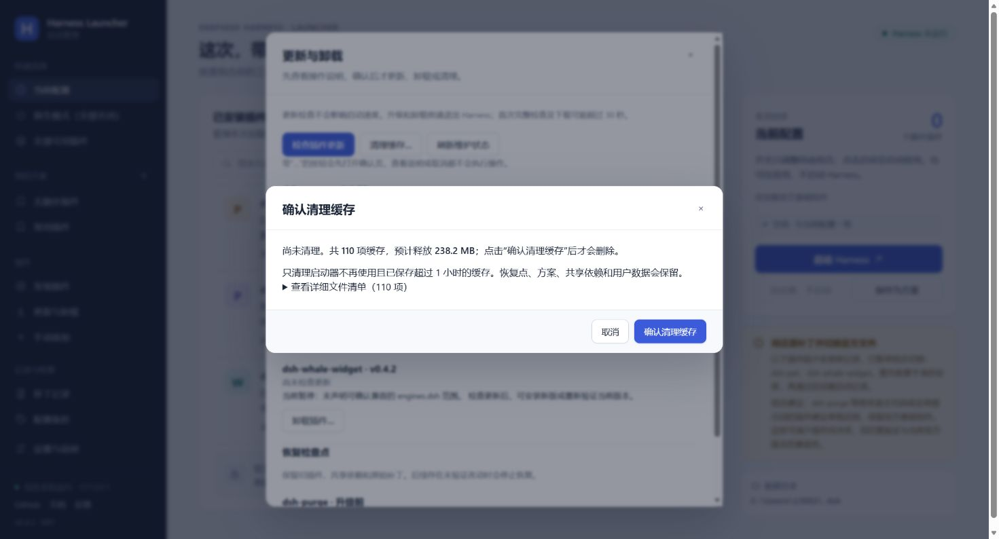
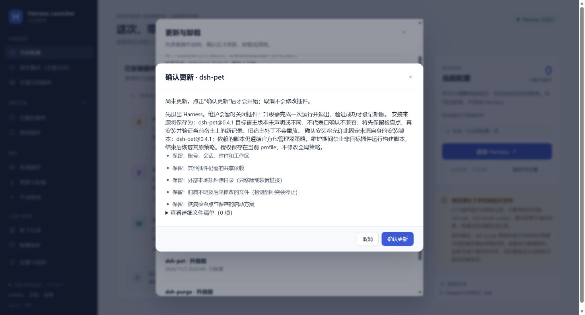
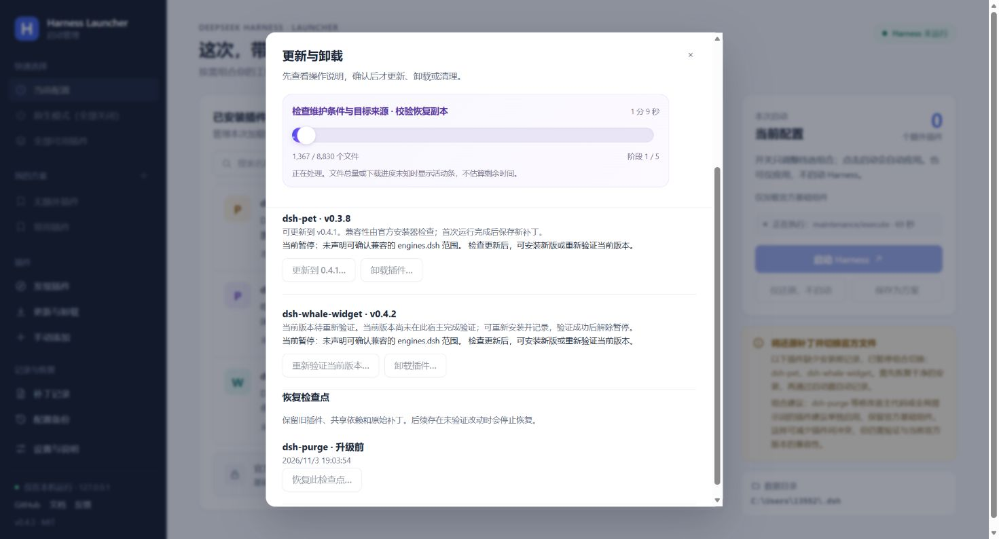
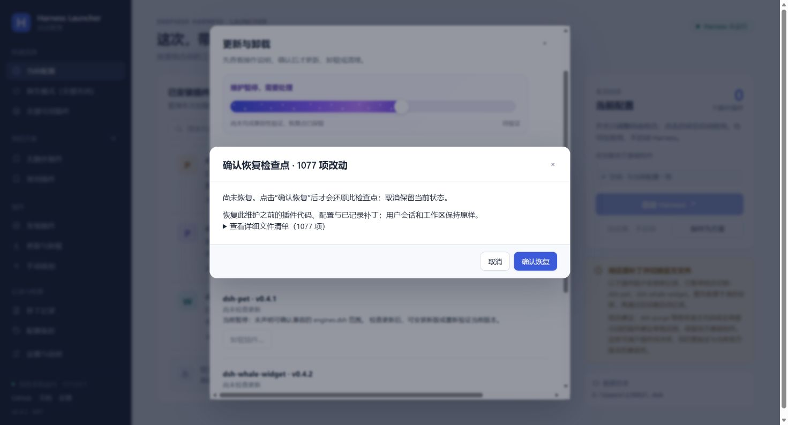
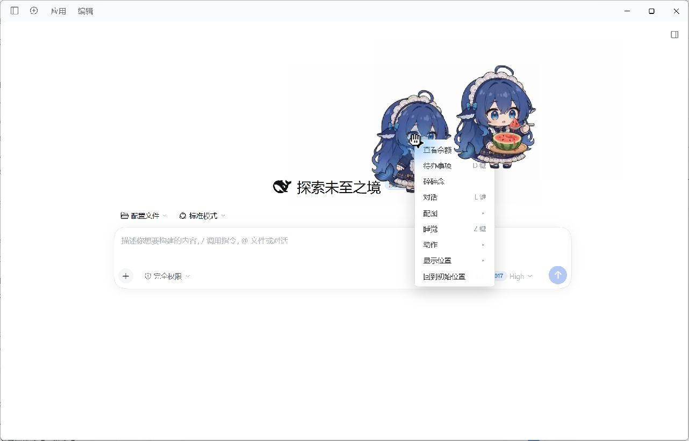
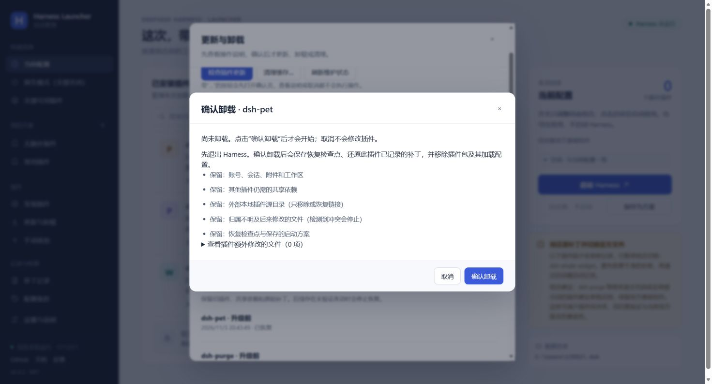
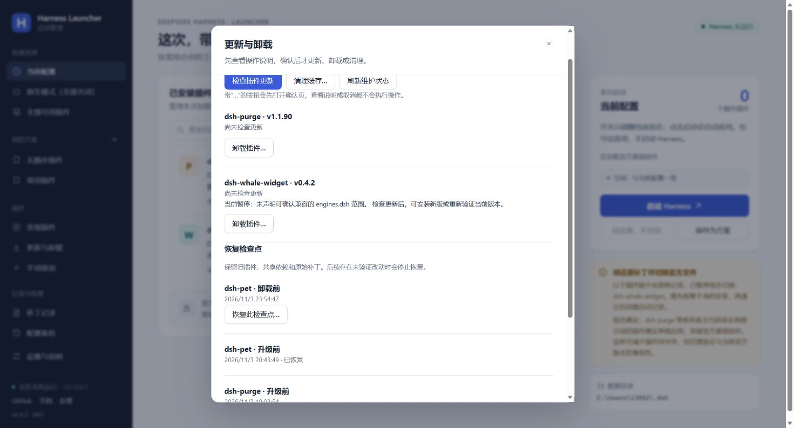
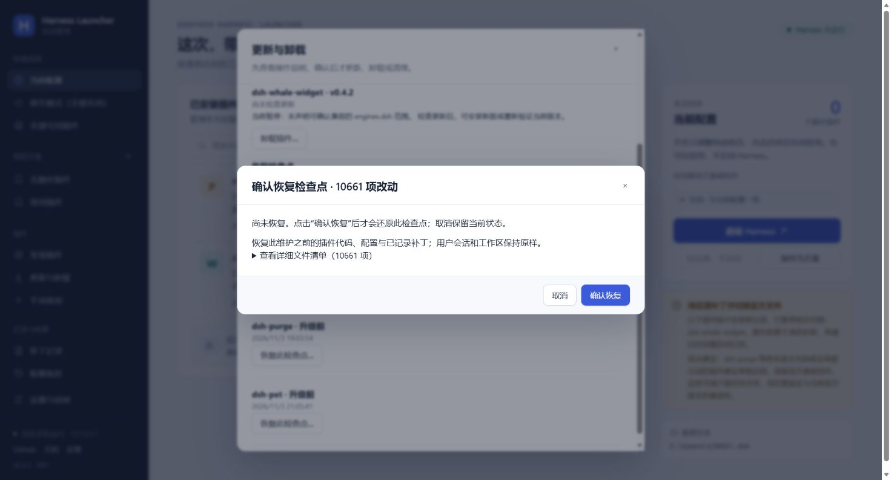
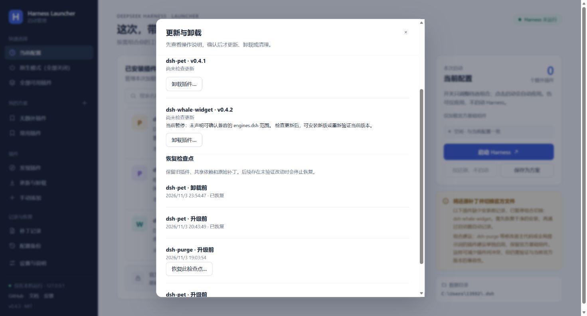

# 维护界面与普通插件实测

启动性能已在 0.4.4 更新，最新三个场景为 23.0–25.7 秒，见[启动速度实测](startup-validation.md)。下文保留维护功能的实际过程及当时计时，便于核对更新、卸载和恢复结果。

[返回首页](../README.md) · [维护操作指南](plugin-maintenance.md)

测试日期：2026-11-03 至 2026-11-04。环境：Windows x64、Harness Launcher 0.4.3、官方 Harness 0.2.1-rc.5。本轮使用 dsh-pet 测试，保留 dsh-purge 的安装、禁用状态和记录。

## 明确区分查看与执行

- “卸载插件…”打开“确认卸载”页，明确提示“尚未卸载”；点击“确认卸载”才执行。
- “清理缓存…”先统计数量和预计释放空间，提示“尚未清理”；点击“确认清理缓存”才删除。
- 查看详情、取消或关闭确认页均不执行操作。文件清单默认折叠，没有可清理缓存时不能确认删除。
- 更新、重新验证和恢复使用各自的确认按钮；安装状态变化后，旧更新提示失效，要求重新检查版本。

本机缓存统计曾运行 242.6 秒仍未完成。修复重复磁盘探测后，同一安装的统计在 8.1 秒完成，列出 110 项、约 238.2 MB。本轮查看后取消，未实际清理任何缓存。统计只枚举一次对象名称；对象读取、删除前路径与内容校验、执行前重新核对引用仍保留。

## dsh-pet 真实更新流程

更新检查发现已安装 0.3.8 可升级至 npm 精确版本 0.4.1；whale 0.4.2 当前无新版，显示单独的同版本重新验证入口。

首次维护会校验插件、共享依赖并保存恢复检查点，耗时不等同于日常启动。修复后的安装阶段耗时 594.5 秒，其中 pnpm 包安装本身为 34.9 秒；首次运行结束后的记录验证为 665.0 秒。等待用户使用和暂停测试的时间没有计入这两个后台操作耗时。

首次实测发现：官方 pnpm 完成 pet 包替换后，因非目标 Git 插件的未获许可构建脚本返回 `ERR_PNPM_IGNORED_BUILDS`；该脚本未执行。启动器保留失败检查点，没有把此次更新标记为成功。随后通过确认页恢复 1,077 项改动，pet 恢复为 0.3.8；248 项受保护内容、purge 版本、依赖引用和补丁记录均保持一致。

通用修复在维护期间临时禁止非目标插件构建，操作后恢复原策略。使用本机 pnpm 11.28.5 和两个本地测试包验证：目标脚本执行，非目标脚本不执行，原策略恢复。真实 pet 更新也已通过，安装为 0.4.1；Web 宠物和独立桌面宠物正常显示，Web 右键菜单可打开。正常退出后完成验证，解除 pet 的暂停状态，恢复更新前的原生组合。

## 卸载确认

实测先打开 pet 卸载确认页，再取消：插件仍为 0.4.1，没有执行卸载。随后重新打开确认页，点击“确认卸载”进入实际维护流程。

文件清单现在标注“插件额外修改的文件”。pet 的额外差异为 0，不代表插件包大小为 0；卸载仍移除包及加载配置。

卸载完成，后台总耗时 374.7 秒；其中官方 pnpm 移除包为 15.6 秒。文件系统中已没有 pet 的包入口，加载配置和顶层依赖中均没有 pet，另外两个插件保留。卸载后的 248 项受保护内容全部一致，purge 的核心状态、补丁记录、依赖引用和版本与测试前相同。

## 从卸载检查点恢复

选择 pet 的“卸载前”检查点，确认页列出 10,661 项变化。这个数量包含包目录、文件和依赖，并非 pet 修改了这么多官方程序文件。

点击确认后恢复成功，pet 0.4.1 重新出现在列表中，检查点标为“已恢复”。完整恢复耗时 1,142.0 秒，约 19 分钟。这是本轮发现的维护性能短板，日常启动计时单独记录。恢复过程中核对文件、还原依赖和配置，并保留后续冲突检查。

这次运行也暴露出逐文件恢复期间只有阶段文字的问题。新版补充了“校验待恢复内容”“移除已记录的替换条目”“写回检查点文件”三段计数；恢复冲突和中断续做测试通过。

恢复后的首次启用还发现一处组合切换误报：待重新验证的 whale 没有启用，但最后复核把它当成未记录插件，阻止了 pet 启用。已让提交阶段沿用准备阶段的可用插件集合；待验证插件仍不能被选中。隔离用例复现了同样错误，并覆盖修复后的启停、内容变化拒绝和启动失败回滚。

修复后启用 pet 成功，后台操作耗时 101.6 秒；窗口随后可用，Web 和桌面宠物均显示。正常退出后用同一组合再启动，后台操作为 80.5 秒，窗口和 pet 均恢复。这两项均超过约 30 秒目标，不计为速度验收通过。上述后台时间截至发出启动请求，窗口可用还包含应用加载和窗口观察时间。

## 停用后回到官方原版

正常退出 Harness，选择“原生模式（全部关闭）”再启动。pet 消失，官方输入界面正常打开，后台流程耗时 110.6 秒。这项也未达到约 30 秒目标；本版的功能验证与速度目标分开记录。

文件比对结果：EXE、ASAR 和 3 个官方 CLI 文件与同版本、已验证签名的官方安装包一致；加载项只剩两个官方组件，活动解包目录不存在，受管理文件均为原生内容。248 项受保护内容全部一致，purge 的版本、依赖、核心状态和补丁记录与测试前一致。

## 定向回归

10 项维护与暂停状态界面测试、9 项普通插件与缓存后端测试、10 项安装构建策略测试、1 项安装参数边界测试、8 项文件检查点测试及 1 项中断恢复测试通过，加上组合切换误报修复的 4 项回归，共 43 项不同用例。覆盖只读查看、取消、精确确认令牌、冲突时禁止执行、空清理列表、切换确认操作、更新状态失效、普通插件卸载恢复、过期确认阻断，以及缓存引用与并发新增对象的保护。构建隔离另外覆盖失败恢复、未知策略阻断、策略冲突保留和子进程未退出时保留禁止状态。本轮没有运行 dsh-purge 的真实启停或升级测试。
