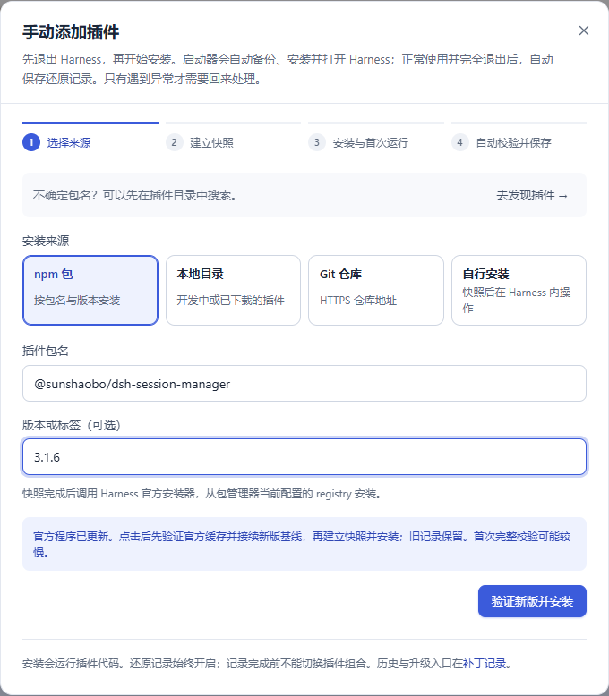
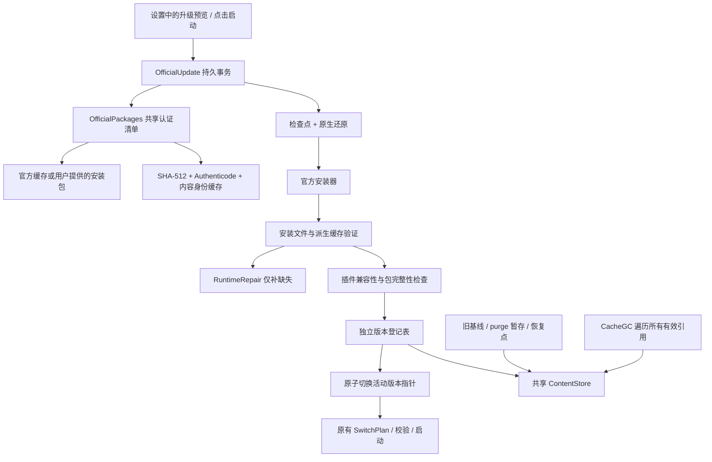
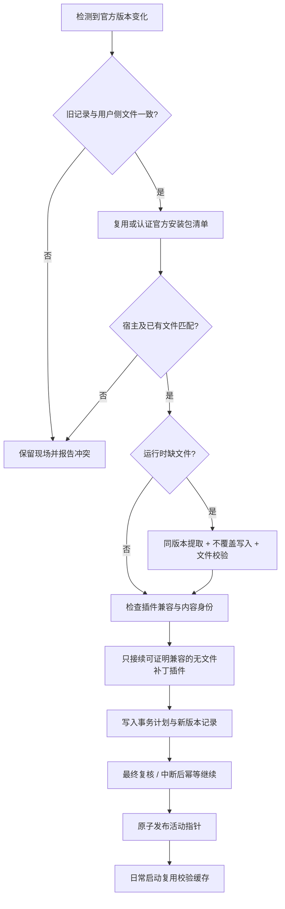

# 官方更新接续与共享校验缓存

这是 **0.4.4 社区预览版**的使用说明。已完成模拟升级与故障注入测试；没有新的官方版本可用于本机真实升级验收。本页截图使用隔离示例数据，不能作为真实安装成功的证据。

## 使用方式

完全退出 Harness，在“设置与说明 → 官方版本更新”操作。默认复用官方更新器已经下载的安装包；也可在下方填写官方安装包路径及其 SHA-512。启动器没有另设下载器，不会重复请求同一安装包。

| 场景 | 行为 |
| --- | --- |
| 从启动器更新 | 检查并预览缓存包 → 保存恢复检查点 → 还原受管理补丁 → 调用官方安装器 → 验证已安装文件 → 建立新基线 → 恢复可确认兼容的插件 |
| 在 Harness 内更新 | 下一次点击启动时检查官方缓存。官方文件匹配且用户侧证据完整时自动接续；状态轮询不会触发校验、下载或安装 |
| 新版缺少运行时 | 先排除宿主与已有文件冲突，再从同版本已认证安装包补齐缺失文件；每个补齐文件做 SHA-256 验证 |
| 未知修改或补丁冲突 | 保留文件和旧记录，显示冲突路径或暂停原因；不通过改哈希、删记录、覆盖旧快照来放行 |

“检查并接续已安装版本”用于显式重试或继续中断的接续。“宿主未变时恢复原组合”只适用于官方安装未成功改变宿主的情况：复核旧宿主后恢复旧插件组合，不降级官方程序或用户数据库。

官方更新后直接安装新插件也会先接续基线。有官方缓存时，安装按钮显示“验证新版并安装”，表单显示检查进度；通过后才为新插件建立快照。没有缓存或存在冲突时，会显示原因及设置入口。旧插件的完成提示不会带到另一插件的表单里，灰色步骤表示尚未开始。

## 插件兼容边界

自动接续普通插件必须同时满足：有完整旧记录；文件差异为空；包及依赖文件未变化；`engines.dsh` 明确覆盖新版本；宿主提供的依赖名称、版本和清单内容未变化；不含需要重新适配 Electron 的 `.node` 原生扩展。当前只接受可严格判断的精确版本、比较范围、`^` 和 `~`；未知语法以及未明确覆盖的预发布版本会暂停，不猜测兼容。

purge、其他有文件补丁的插件及未记录插件保留安装文件、配置和旧版本回滚材料，但暂停跨版本加载。在“更新与卸载”安装新版或重新验证当前版本，可建立针对当前宿主的新记录；校验成功后解除暂停。purge 的新补丁必须与当前官方归档匹配，不能把旧程序目录覆盖到新版。启用 purge 时直接通过官方按钮更新，可能留下混合安装；这种现场会停止自动接续。

暂停插件若能完整记录其包与依赖，可在“更新与卸载”中继续预览升级或卸载；文件不可读或后续发生未知改动时会停止。校验和创建新基线之间再次复核用户文件及插件包，避免把并发修改纳入官方基线。

这里判断的是继续加载的已知条件，无法保证第三方插件未来所有运行行为都兼容。官方更新器自行触发的立即重启不经过启动器，仍无法提前拦截；启动器负责下一次经过它的检查与恢复。

## 如何减少时间和空间成本

- **一个安装包，一份内容清单。** SHA-512、发布者签名及包内文件哈希的结果由升级、原生验证和运行时修复共享。正常接续后不再解包；再次检查同一版本不会创建另一代基线。
- **缓存以内容身份为依据。** 每次使用仍确认安装包的真实 SHA-256；NTFS 上沿用文件身份、USN、ChangeTime 与排他读取校验缓存。改变内容、替换文件、日志证据失效或不支持的平台会重新读取，不能只比较大小和时间。
- **签名信任有期限。** 最长复用 24 小时的 Authenticode 结果，过期重新验证签名；复验不重复生成整份文件清单。时钟倒退也不会延长信任。
- **按需解出缺失文件。** 本次已有解压结果直接复用；仅有持久清单时才提取缺失成员。健康运行时不再为修复准备整份文件副本。
- **区分程序内容与可再生缓存。** Python 字节码的时间戳和编译路径会随运行改变；源码和解释器先匹配官方清单，再比较缓存代码是否对应原源码。比较结果按内容哈希共享；缓存变化才重新比较，源码与 DLL 改动仍拦截。原理参见 [Python PEP 552](https://peps.python.org/pep-0552/)；验证子进程使用[隔离模式和独立缓存路径](https://docs.python.org/3/using/cmdline.html)。
- **不复制整套历史。** 不同官方版本各自保存活动登记表与补丁暂存目录，共享按内容寻址的不可变文件、包和版本对象。缓存回收把所有仍保留的版本、检查点和官方包清单作为引用根。
- **更新不占用每日启动路径。** 未变化的日常启动不访问网络、不解包、不执行清理。第一次遇到新版本需要一次完整认证，这部分可能超过 30 秒。

## 架构图

## 校验与接续原理图

## 验证范围

自动测试使用真实文件系统、记录、事务和 HTTP/UI 边界，但替换签名验证、解包与安装器执行，覆盖正常接续、同版本拒绝重装、包变动、签名过期、缓存损坏、缺失修复、未知改动、兼容与不兼容插件、purge 混合安装、安装失败、指针提交中断、进程重开和缓存回收引用。另使用本机已有官方包只读检查真实签名与解包缓存，结果记录在本次开发验证中。

本轮全量回归运行 429 项（427 项通过，2 项受 Windows 符号链接权限限制跳过），随后针对更新、维护、修复和并发边界补跑回归。Python 派生缓存还覆盖了真实解释器比较、恶意缓存不执行、源码或解释器改动拦截、陌生加载配置拦截以及缓存结果失效。

更新与修复专项回归 51 项通过，派生缓存独立检查 8 项通过。最新安装入口与记录流程回归 50 项通过，前端 49 项通过；覆盖原生基线接续后安装、冲突时阻止安装、历史完成提示、进度展示和错误保留。功能截图与示意图已渲染检查，界面覆盖 1440 / 1080 / 390 宽度，无脚本异常。开发版启动器已重启，真实本机界面确认安装按钮可用，前端资源与工作区一致，插件选择及 profile 清单保持原样；没有为验证执行官方安装器或新插件安装。

本机已有官方 `0.2.1-rc.3` 安装包共 7,811 个文件：首次认证及建清单耗时 349.817 秒，再次复用同一清单 0.607 秒。首次测量与全量测试并行，不能作为一般性能承诺。这两项测量都没有执行安装器，也不是启动到窗口可用耗时。

真实安装目录还暴露了正常重建的 Python 字节码与安装包不同的问题，已加入上述源码派生验证。最终只读检查没有发现缺失或代码冲突；已建立缓存后，连续复核为 5.246 秒，重新打开缓存后为 6.620 秒。首次验证新出现的派生缓存曾耗时 64.639 秒；首次或文件变化后的完整检查仍可能超过 30 秒。没有为此改写实际安装目录。

仍待新官方版本发布后验证：真实 NSIS 安装与退出行为、安装后的实际启动到窗口可用时间、真实普通插件与 purge 的新版适配。模拟测试不能代替这些验收。
