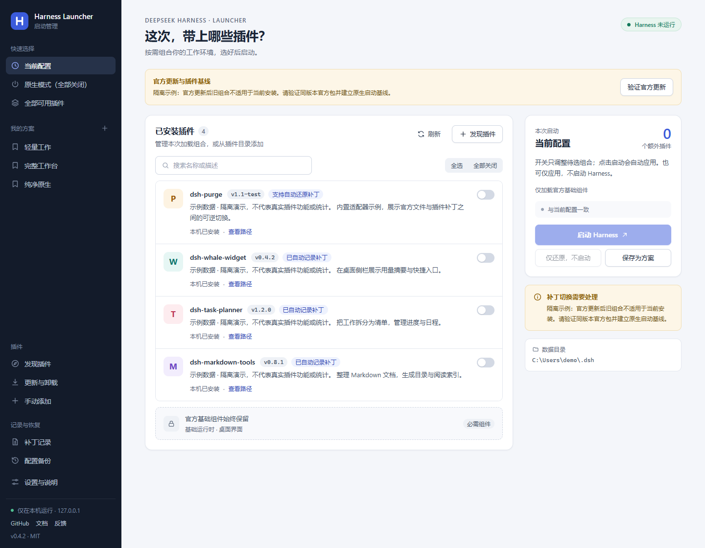

# 官方更新后恢复原生启动

[使用指南](../README.md) · [运行时修复](runtime-repair.md) · [架构与原理](architecture.md)

0.4.2 修复了一个流程缺口：官方更新改变 EXE / ASAR 后，旧“当前组合”仍绑定更新前的哈希，导致所有插件关闭也无法从启动器启动。首页现在提前显示宿主变化，不再把旧原生记录显示为当前宿主已通过校验。

## 操作

1. 完全退出 Harness。更新前应已经还原为原生组合；如果仍有活动补丁、`resources/app` 或未完成安装记录，工具会停止并保留现场。
2. 若运行时缺失，先完成“官方运行时修复”。
3. 打开“设置与说明 → 官方更新后原生启动”，点击“验证新版并预览基线”。默认使用官方更新缓存；手动选择包时填写官方 SHA-512。需要安装 7-Zip。
4. 验证成功后点击“保存原生启动基线”，返回首页选择当前无插件配置或“原生模式”，再点击启动。

首次验证会解包并扫描，可能超过 30 秒。日常不会重复解包，会用既有 NTFS 身份缓存复核内容；文件变化或缓存失效时重新计算哈希。

## 校验与保留范围

- 官方包 SHA-512、Windows Authenticode 有效状态及 DeepSeek 发布者必须通过。
- 比对包内所有非 runtime 的桌面文件、完整 CLI 和六个必需运行时文件。EXE、ASAR、依赖文件不匹配或缺失就停止。该步骤不是完整 Python 库或全部 runtime 文件扫描，完整运行时检查仍在修复入口。
- CLI / ASAR 解包模块目录含未知额外文件或链接时停止，不删除这些内容。
- 用户侧受管路径必须与旧的已验证原生组合一致。自动生成的 `cordis.yml` 使用既有原生配置检查；用户补丁配置仍需内容一致。账号、会话与工作区不纳入采集。
- 保存的是独立的内容寻址基线与一个原子引用文件。原组合、purge 记录、安装文件、插件包和配置都保持原样；缓存清理保留新基线及旧恢复对象。
- 预览令牌有效期 30 分钟。提交前和每次启动都复核宿主、配置、旧记录及文件；主程序和 ASAR 在最终验证与启动期间持有禁止写入/删除的读句柄。
- 中断前未提交引用时不放行启动；引用已提交时重新读取状态即可。不存在把旧哈希直接改成新哈希的步骤。

## 插件边界

此入口只恢复已验证的新版**原生启动**。它不证明旧插件兼容新版，也不自动迁移、重新记录或跨版本还原普通插件和 purge。旧插件的启用、组合切换、安装记录和恢复仍受原有宿主边界限制；带插件更新形成的混合环境不会被自动接纳。

## 本机验证

使用真实官方 0.2.1-rc.3 更新缓存验证 1,669 个启动相关文件，建立基线耗时 184.395 秒；旧配置、插件索引和 purge 记录的内容哈希保持不变，暂存内容清理成功。这是一次性验证耗时，不是日常启动耗时。

新增 16 项回归覆盖签名/校验失败、原生更新后的启动、旧插件仍被阻止、文件替换、用户改动、预览过期、损坏记录、请求认证与锁释放、写入失败和垃圾回收引用。宿主更新与维护相关 67 项回归通过，前端 41 项通过。截图使用隔离示例，浏览器检查覆盖 1440 / 1080 / 390 宽度；最终发布以对应提交的完整 Windows CI 为准。

