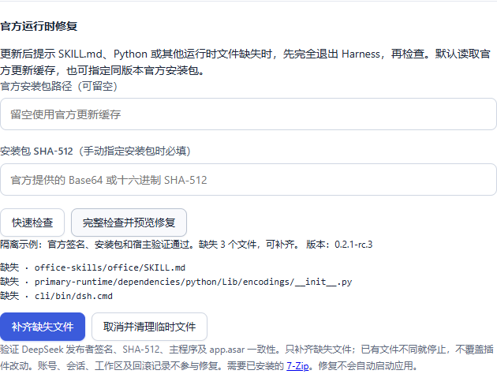
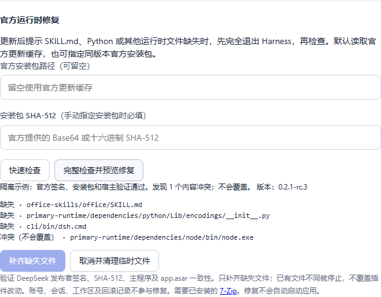

# 官方运行时检查与修复

[使用指南](../README.md) · [官方更新边界](host-updates.md) · [架构与原理](architecture.md)

0.4.1 为 Windows x64 增加同版本官方运行时恢复。适用于官方更新后 `resources/runtime` 为空或部分文件缺失，例如 `ENOENT ... office-skills/office/SKILL.md`。此功能修复安装文件缺失，不解决跨版本插件兼容性，也不能拦截官方更新器自行重启。

当前 0.4.2 中，补齐运行时后若仍提示“宿主文件已变化”，请使用同一设置页的[官方更新后原生启动](official-update-native.md)。运行时完整与旧补丁基线适用性是两项不同检查。

## 操作

1. 完全退出 Harness，包括崩溃对话框与托盘进程；无需退出启动器。
2. 打开“设置与说明 → 官方运行时修复”。程序路径以已保存的设置为准。
3. 点击“完整检查并预览修复”。默认使用本机官方更新缓存中的安装包及 `update-info.json` 校验和。缓存缺失时，填写同版本官方 Windows x64 安装包路径及官方 SHA-512（Base64 或十六进制）。修复不会执行安装程序。
4. 查看缺失文件和内容冲突。仅无冲突且确有缺失时，才可点击“补齐缺失文件”。已有文件不同或为空时停止，避免覆盖插件修改或未知内容。
5. 完整验证成功后回到主界面启动。原来的插件宿主检查继续生效；修复不会修改基线或将旧补丁认证为兼容新版。

需安装 [7-Zip](https://www.7-zip.org/)，工具从 Program Files 中查找。签名验证使用 Windows 自带 PowerShell 的 Authenticode 功能，发布者必须为 DeepSeek 对应公司，状态必须有效；无法完成验证时停止，不降级为跳过校验。

## 范围与中断

- 日常启动仅探测六个必需文件是否存在且非空，不下载、不解压、不扫描全目录。快速检查通过不等于每一个运行时文件都完整，仍可按需发起完整检查。
- 完整检查复制官方安装包到专用暂存目录，校验 SHA-512 和签名，验证解包路径，提取运行时和宿主身份文件；包内 EXE 与 `app.asar` 必须和当前安装完全一致。缺少活动 ASAR、插件更改归档、版本混装或链接路径都会停止。
- 预览显示缺失与冲突，令牌保留 30 分钟。执行前再次核对宿主与运行时；预览后任何相关变化要求重新检查。程序重启后需重新预览。
- 只写 `resources/runtime` 内官方清单里缺失的文件。采用同卷临时文件、SHA-256 校验和不覆盖现有目标的原子发布；最后重新核验全部官方清单。额外文件保留。
- 账号、凭据、会话、工作区、插件及其共享依赖目录、补丁记录和回滚数据均不参与修复。官方运行时自身的依赖属于补齐范围，已有文件一律不覆盖；损坏内容和插件改动需要另行处理。运行时缺失时仍可使用经过原有校验的“仅应用，不启动”恢复原生组合；宿主版本不匹配则继续停止。
- 失败或断电时保留已验证写入的文件，重新完整检查可继续补齐；不递归删除已写入文件。凭据目录从来不是恢复源或目标。此功能不把“删除新增文件”当成自动回滚。
- 成功或取消当前预览时清理本次暂存内容。异常退出可能留下 `.harness-launcher/runtime-repair/staging` 下的临时副本，暂不自动删除；小型修复凭据保存在 `runtime-repair/receipts`。插件的内容缓存与回滚资料不受影响。

完整恢复包含解压和全部文件校验，可能需要数分钟，不计入日常启动约 30 秒的目标。签名检查可能访问 Windows 的证书验证服务；启动器不上传用户文件。

## 界面演示

以下为隔离示例，说明缺失、预览及冲突状态，不包含用户会话；真实官方包恢复验证结果另行记录。

## 0.4.1 验证记录

- 修复、宿主更新相关的本机定向回归 53 项通过；另对启动阻止、仅应用恢复、认证 API 与请求锁释放执行 3 项检查，均通过。最终修复模块含 23 项用例；发布以对应提交的 Windows Python 3.12 / 3.13 完整 CI 成功为门禁。
- 前端 38 项通过；真实前端隔离浏览器检查覆盖预览不写入、有冲突禁用执行、1440 / 1080 / 390 宽度，无脚本异常或横向溢出。
- 使用本机缓存的真实官方 0.2.1-rc.3 安装包，在隔离安装副本中从空运行时补齐 6,150 个文件；签名、SHA-512、宿主一致性和逐文件 SHA-256 均通过，额外用户文件、profile 配置保持不变，临时目录清理完成。
- 上述完整恢复耗时 884.312 秒，当时与全量回归并发运行；这是一次性解压、写入和完整校验，不是日常启动耗时。没有为加速而关闭校验或覆盖已有文件。
- 对实际安装做 20 次快速必需文件检查，中位 14.20 毫秒，最大 18.33 毫秒。仅说明新增检查的本机成本，不代替 Harness 窗口启动或插件兼容性验收。
