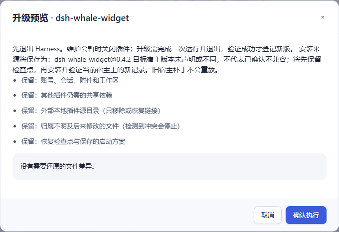
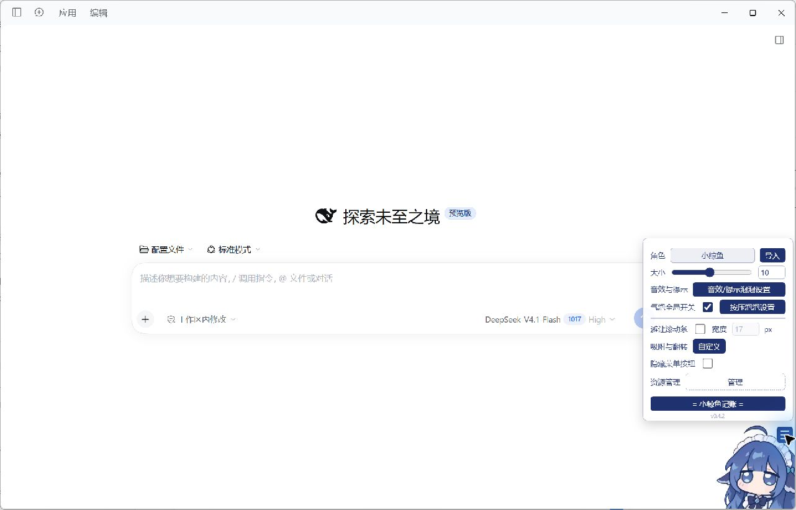
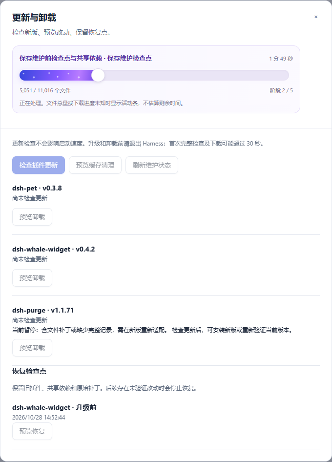
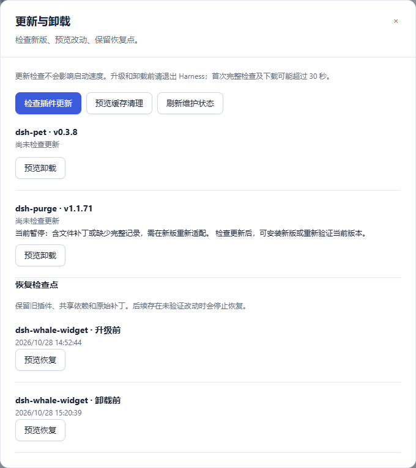
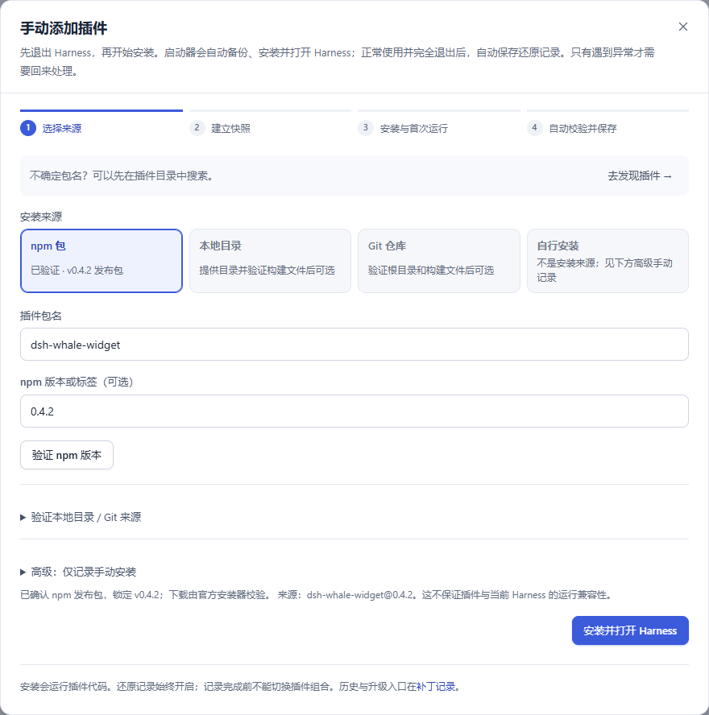
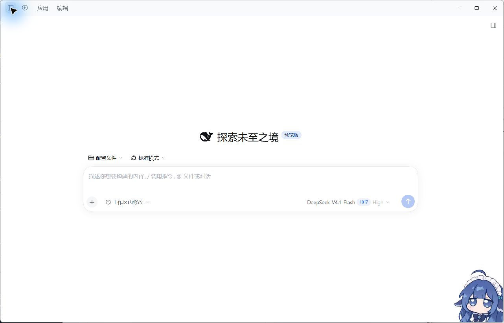
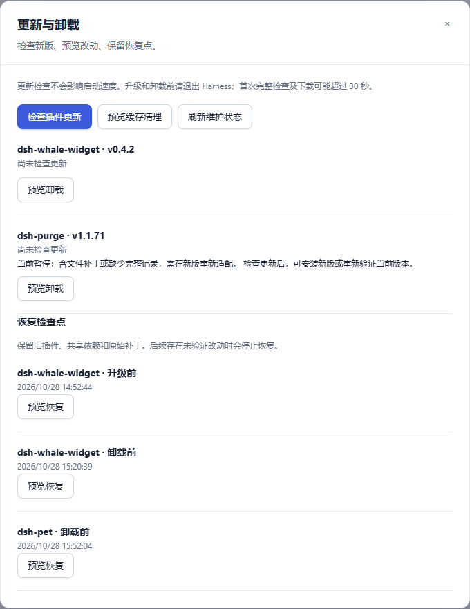
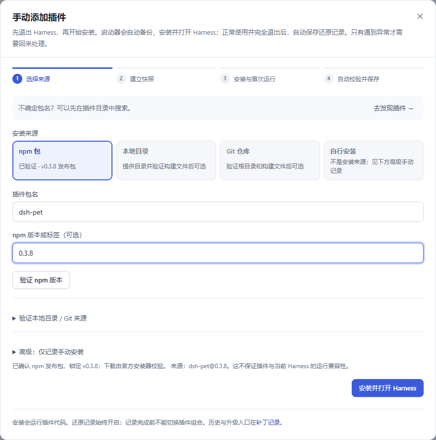
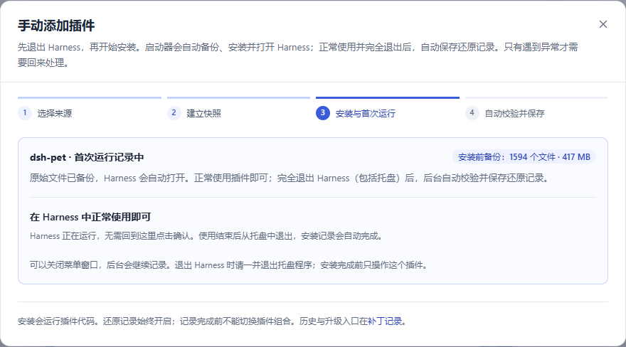
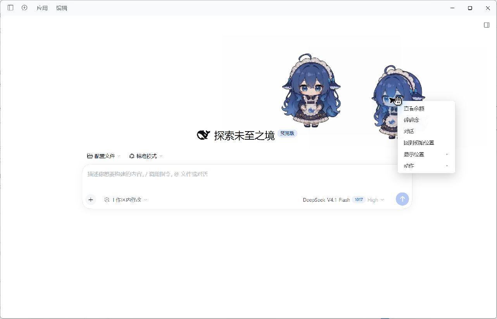

# 0.4.3 真实插件验收

[返回首页](../README.md) · [安装来源](install-sources.md) · [维护指南](plugin-maintenance.md) · [架构与校验原理](architecture.md)

这份记录始于 2026-10-28，按实际安装环境记录本版的验证结果。当前官方 Harness 0.2.1-rc.5 上的 pet 更新与维护界面测试见[维护界面与普通插件实测](maintenance-ui-validation.md)；下文保留本版早期在 rc.3 上完成的 whale 和 pet 安装、卸载记录。

2026-11-03 补充：本机已切换到官方 Harness 0.2.1-rc.5，完成 purge 1.1.90 的真实补丁应用及两轮启用/关闭回退，最终保持官方原生窗口。官方 EXE、归档和 CLI 摘要一致，248 项受保护内容无变化。此轮按要求只做针对性回归；窗口可用的 30 秒目标及完整卸载验收未据此宣称通过，见 [当前启停与回退记录](purge-source-audit.md#当前安装的-rc5-启停与原生回退验收2026-11-03)。

环境为 Windows x64、已有官方 Harness 0.2.1-rc.3 安装。使用真实启动器服务、官方包管理器和原生 Harness 窗口，没有用模拟插件替代下列测试。公开窗口截图隐藏会话列表，没有提交模型对话或公开账户余额。

## whale：重新验证、卸载与重新安装

测试版本为 `dsh-whale-widget@0.4.2`。先为官方更新后暂停的安装建立新记录，再执行真实卸载，最后从已验证的 npm 精确版本重新安装。

安装后确认挂件显示、点击响应与设置菜单。正常退出 Harness，重启启动器后继续原维护事务，配置、选择和维护日志保持不变。最终验证解除暂停，并保留升级前恢复点。

随后在维护页预览并卸载。目标包及加载项消失，另外两个插件仍存在。卸载前后对账号标识、凭据、会话、附件、存储、自定义 whale 资源与外部 purge 源目录共 248 项文件和目录进行内容摘要比对，结果无变化。摘要只保存在本机诊断目录，不上传用户内容。

重新添加时仅已验证的 npm 来源可选。官方安装器实际加入 `dsh-whale-widget 0.4.2`，窗口再次正常显示；退出后自动记录完成，文件差异为 0，包与版本恢复材料已保存。最后恢复原生选择。

## pet：卸载与重新安装

`dsh-pet 0.3.8` 经预览后实际卸载。whale 与 purge 仍在，维护恢复点保留；同样的 248 项受保护内容无变化。

重新验证 npm 精确版本并安装，官方安装器复用 21 个已有包，未为演示清空下载缓存。Web 宠物与独立 Electron 桌面宠物均实际显示，Web 右键菜单可交互。没有提交模型对话或打开余额信息。

桌面透明窗口的自动点击两次被控制工具的目标窗口检查拒绝，因此本轮未将桌面右键操作记为通过；Web 菜单测试通过。正常退出 Harness 后，桌面宠物也退出。

首次保存遇到硬链接的并发日志冲突。修复后重启启动器，继续同一安装会话，未重新下载、安装或重放首次运行；记录成功保存，额外文件差异为 0。

## purge：当前版本启停与原生回退通过

当前测试组合为官方 Harness **0.2.1-rc.5** 与固定 Git 提交的 **dsh-purge 1.1.90**。补丁启用后的实际面板正常显示，正常退出后关闭插件，官方原生窗口可打开；第二轮重复启停未出现新的记录冲突。最终独立校验原生组合、官方程序、归档、CLI 与受管注入文件，保留可重新启用的补丁和回滚记录。

本轮修复共享恢复内容在新代际的查找、普通配置差异记录和运行时链接检查点；首次补丁运行的预设初始化经源码精确复现后封存。248 项受保护内容无变化。详细步骤、上游自带重启失败的边界、针对性测试和耗时见 [purge 验收记录](purge-source-audit.md)。新版完整卸载和全部插件功能仍未因此算作通过。

## 自动化回归

2026-10-28，本机全量回归运行 489 项测试，结果为 `OK (skipped=2)`，耗时 1941.078 秒；另有 59 项前端测试通过。自动化回归不替代尚未完成的 purge 实际功能、重启、切换组合和发布包验证。

## 本轮发现并修复的问题

- 更新检查和执行使用不同的元数据缓存，临时网络失败被误报为目标版本变化。现在共享短期查询结果，并在执行前复核精确目标，保留真实网络错误。
- 包和恢复副本串行处理，依赖校验期间没有文件计数。改为最多 8 路独立校验，显示子步骤和实际数量；完整检查、共享依赖和回滚验证继续保留。
- 已存在的内容副本仍反复创建临时文件并落盘。现在先验证源和已有副本，相同内容直接复用。
- 并发保存同一内容时可能竞争替换 Windows 文件。固定数量的内容写入锁避免重复发布，不按插件设置例外。
- 状态轮询的短暂读句柄可能使记录文件原子替换失败。保留同一份已落盘临时文件，进行有上限的短暂重试；持续拒绝访问仍报错并保留原文件。
- 重启后内存计数归零，界面误显示“安装前备份 0 个文件”。现在明确显示快照已保存，继续时重新校验。
- 嵌套包校验可能把启动进度从最后阶段退回包阶段。子步骤现在沿用所属操作阶段。
- 本地目录链接升级为下载包时，Windows 包管理器报 `EPERM`，且清理到了外部源码的部分 Git 元数据。此次已从安装前内容快照补齐 30 个缺失条目，未覆盖现有文件，事前 248 项保护清单重新全部一致。产品修复为先验证并移除检查点内的链接本身，再调用官方安装器，恢复时仍核验外部源码；新增成功、失败和中断重放测试。
- 恢复过程逐条重新创建安装路径上下文，造成无效重复读取。现在一次恢复复用路径解析对象，每次文件写入仍保留路径和宿主检查。
- pet 依赖中不同路径共享硬链接；并行校验会互相改变 NTFS CLOSE 标记，产生文件变化误报。现在按物理文件身份串行处理同一文件，其他文件仍并行；快照和真正的文件变化检查继续保留。
- 固定 Git 提交已下载，但官方 pnpm 因安装脚本未授权返回失败。安装来源和升级预览披露授权范围：Git 来源和构建授权均固定提交，npm 来源使用精确版本；其他依赖继续使用原策略，不允许全部构建。2026-11-03 实测确认本机 pnpm 11.28.5 的 Git 构建不能仅凭包名授权，保留精确来源授权。维护检查点包含当前 profile 的构建策略。

## 时间与范围

首次安装、下载、维护和完整基线检查不属于日常启动的约 30 秒目标。此轮真实 npm 安装曾因网络 `ECONNRESET` 等待重试；官方安装器保留供应链检查，未为缩短时间关闭 TLS 或文件校验。已有包管理器缓存可复用，不为制造下载演示而清空缓存。

真实下一版本官方升级仍需要相应发布包才能验收；模拟故障测试不能代替该项。回滚范围限于文档列出的受管理文件，任意第三方脚本对系统服务、注册表及工作区的写入不属于完整系统回滚保证。
